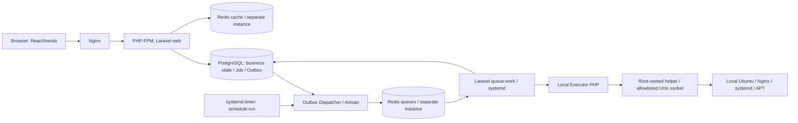

# معماری نسخه اول — راه‌انداز

> سند مکمل `PROJECT_SPEC.md` نسخه 2.0، تاریخ 2026-10-12. **این سند مشخصات مطلوب است، نه ادعای پیاده‌سازی موجود.**

راه‌انداز یک **Laravel modular monolith** با frontend **Inertia.js 3 + React 19 + TypeScript strict + Tailwind CSS 4** است. برنامه برای اجرا روی همان Ubuntu Server 22.04/24.04/26.04 طراحی می‌شود. به‌جای کنترل سرور مقصد با SSH، وضعیت همان سرور محلی را می‌خواند و mutation را فقط از helper بسیار محدود عبور می‌دهد.

## مرزبندی مؤلفه‌ها

| مؤلفه | قرارداد |
| --- | --- |
| `app/Domain/` | accounts, onboarding, servers, mirrors, Git, projects, deployments, databases, backups, monitoring, audit, notifications؛ Eloquent و use caseهای business |
| `app/Http/` | FormRequest، Policy، controller و Inertia props محدود یا endpoint JSON؛ HTTP به‌هیچ‌وجه package/deploy اجرا نمی‌کند |
| `app/Jobs/`, `app/Application/` | Job/Step/Outbox PostgreSQL، enqueue پس از commit، claim، lease/fencing، idempotency و rollback/reconcile |
| `app/Infrastructure/Executor/` | adapterهای PHP برای probe و operationهای versioned؛ هیچ command متکی به string interpolation ناامن نیست |
| `infrastructure/privilege_helper/` | binary/daemon root-owned با request schema ثابت، peer credentials، allowlist operation و audit، immutable برای accountهای پنل |
| `resources/js/` | صفحات TSX، layout RTL، type-safe props، theme، Sonner Toast و UI shadcn/Radix گزینشی، Lucide و assets محلی |
| `public/build/` | assetهای Vite آماده؛ Node runtime برای سرویس production پنل لازم نیست |

## هویت‌ها و مجوزها

- حساب سیستم `rahandaz` ثابت، بدون sudo/docker، با shell non-login و password locked است؛ هماهنگ‌کننده resourceهای محدود به نصب راه‌انداز، **نه root**. installer در اولین نصب برای packageها به root نیاز دارد؛ عملیات privileged بعدی فقط helper allowlisted.
- PHP-FPM و workerها با هویت‌های service محدود `rahandaz-web` و `rahandaz-worker` اجرا می‌شوند. UIDهای جدا برای هر environment کاربر (`rhproj_<shortid>`) تعریف می‌شوند؛ کد Git repo هرگز با هویت web/worker یا secret control plane اجرا نشود.
- ایزولاسیون Unix user + filesystem ACL + systemd cgroup بدون Docker است؛ جایگزین security isolation یک VM در برابر tenant خصمانه نیست. پروژه‌ها متعلق به مالک/تیم مورد اعتماد فرض می‌شوند.
- `APP_KEY` Laravel و `RAHANDAZ_MASTER_KEY` دو secret مستقل با backup/rotation مشخص‌اند؛ PostgreSQL محل ciphertext و state است، نه جای امن کلید اصلی. همه requestهای عملیاتی resource scope/Policy دارند.

## Queue/Database

PostgreSQL منبع نهایی وضعیت است. dispatcher ردیف‌های Outbox را در transaction کوتاه claim و روی Redis queue منتشر می‌کند. Laravel worker فقط ID job را دریافت و state/lease را از PostgreSQL کنترل می‌کند. semantics at-least-once است؛ duplicate dispatch/timeout/worker loss نیاز به reconciliation با وضعیت systemd/OS دارند. Redis queue با noeviction و persistence آزموده جدا از Redis cache با eviction و quota است. `retry_after > worker timeout` و deadline هر operation ضروری است.

در پروفایل `lite` یک worker کوتاه `control` و یک worker اجرایی `provision,deploy,backup` با concurrency=1 کافی است؛ `monitor` با scheduler کوتاه انجام می‌شود. Laravel Horizon اختیاری است و نباید هم‌زمان با worker معمولی همان صف را مصرف کند. Scheduler با `php artisan schedule:run` و systemd timer هر دقیقه اجرا می‌شود.

## مرز شناسه

داخل PostgreSQL رابطه با `id` از نوع BIGINT است. مرز HTTP و Inertia شناسه `uuid` از نوع UUIDv7 را می‌بیند. این دو به‌جای هم در کد داخلی عوض نمی‌شوند.

سه مفهوم جدا هستند: `id` داخلی، `uuid` عمومی، و شناسه provider مانند شناسه مخزن GitHub یا GitLab. مورد سوم نوع خودش را دارد و الزاماً UUID نیست.

`uuid` ترتیب ردیف را در URL پنهان می‌کند و مجوز دسترسی نیست. Policy و عضویت workspace بعد از resolve شدن منبع جدا بررسی می‌شوند. جدول‌های فریم‌ورک و pivot بدون هویت مستقل این جفت شناسه را ندارند؛ استثنا باید در ADR 0004 ثبت شود.

## Deployment بدون Docker

هر Project چند Environment مستقل دارد. برای هر Environment: UID، path release/shared، port یا FPM pool، secret، database role، domain و Nginx site مستقل ذخیره می‌شود. repo GitHub/GitLab و branch/tag انتخابی به commit SHA ثابت resolve می‌شود؛ webhook فقط branch مطلوب و delivery id امضاشده را می‌پذیرد. static release از symlink، Laravel از release + PHP-FPM/OPcache policy، Next/Nuxt از blue-green روی portهای مستقل استفاده می‌کنند. healthcheck از route واقعی، release marker و rollout/rollback برای هر deployment ثبت می‌شوند. zero downtime **مشروط** به capacity، migration سازگار و drain است و تضمین مطلق نیست.

## نصب، سلامت و مصرف

GitHub README یک دستور واحد برای دانلود **release امضاشده و verified** دارد؛ تا انتشار واقعی repo/key نباید دستور اجرایی جعلی نشان داد. installer با دسترسی موقت root برنامه PHP-FPM، Nginx، PostgreSQL، دو Redis، user/service و helper را آماده می‌کند؛ پس از bootstrap همه فعالیت‌های عادی غیر-root هستند. Wizard انتخاب software، mirror، Git و دیتابیس را به Job مرحله‌ای منتقل می‌کند. پس از موفقیت، welcome static site نیم‌صفحه‌ای حذف‌پذیر روی domain/IP بدون overwrite site موجود نمایش داده می‌شود؛ کنترل‌پنل در `/rahandaz/` باقی می‌ماند.

بودجه عملکرد `lite`: هدف idle افزوده **≤512MiB RAM و متوسط ≤0.5 vCPU** پس از benchmark با پروفایل 1 vCPU/2GB. این عدد peak build/backup را تضمین نمی‌کند؛ workloadهای سنگین با preflight/resource cgroup محدود یا blocked می‌شوند. کنترل‌پلین نباید بعد از خرابی خود سرویسینگ پروژه‌ها را متوقف کند.

**منبع حقیقت درباره ماژول‌ها، گردش نصب، مجوزها، API و قیدهای آزمون:** `PROJECT_SPEC.md`. هر تغییر مهم مرز trust/queue/runtime باید ADR داشته باشد.
