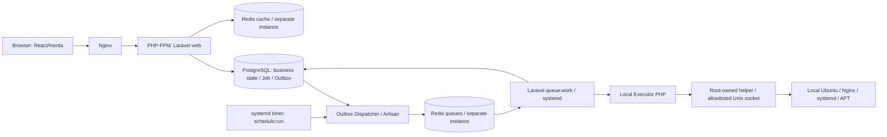

# معماری نسخه اول — راه‌انداز

> سند مکمل `PROJECT_SPEC.md` نسخه 2.0، تاریخ 2026-10-12. **این سند مشخصات مطلوب است، نه ادعای پیاده‌سازی موجود.**

راه‌انداز یک **Laravel modular monolith** با frontend **Inertia.js 3 + React 19 + TypeScript strict + Tailwind CSS 4** است. برنامه برای اجرا روی همان Ubuntu Server 22.04/24.04/26.04 طراحی می‌شود. به‌جای کنترل سرور مقصد با SSH، وضعیت همان سرور محلی را می‌خواند و mutation را فقط از helper بسیار محدود عبور می‌دهد.

## مرزبندی مؤلفه‌ها

| مؤلفه | قرارداد |
| --- | --- |
| `app/Domain/` | accounts, onboarding, servers, mirrors, Git, projects, deployments, databases, backups, monitoring, audit, notifications؛ Eloquent و use caseهای business |
| `app/Http/` | FormRequest، Policy، controller و Inertia props محدود یا endpoint JSON؛ HTTP به‌هیچ‌وجه package/deploy اجرا نمی‌کند |
| `app/Jobs/`, `app/Application/` | Job/Step/Outbox PostgreSQL، enqueue پس از commit، claim، lease/fencing، idempotency و rollback/reconcile |
| `app/Infrastructure/Executor/` | دروازه اجرا. `allowsHostMutation()` هنوز `false` است و runner را موفق نمی‌کند |
| `app/Infrastructure/Operations/` | کاتالوگ، اعتبارسنجی ورودی، تجزیه JSON و Process با argv. dispatcher تا باز شدن دروازه فرآیندی نمی‌سازد |
| `infrastructure/operations/` | موتور Bash نسخه‌دار. apply زنده روی میزبان توسعه `LIVE_MUTATION_BLOCKED` است |
| `infrastructure/privilege_helper/` | قرارداد CLI محدود. سوکت root و نصب daemon هنوز وجود ندارد |
| `tests/infrastructure/ubuntu-lab/` | آزمایشگاه Docker برای Ubuntu 22.04/24.04/26.04. production این مسیر را اجرا نمی‌کند و نتیجه‌اش `supported` نیست |
| `resources/js/` | صفحات TSX، layout RTL، type-safe props، theme، React-Toastify و UI shadcn/Radix گزینشی، Lucide و assets محلی |
| `public/build/` | assetهای Vite آماده؛ Node runtime برای سرویس production پنل لازم نیست |

## هویت‌ها و مجوزها

- حساب مدیر `rahandaz` با SSH مبتنی بر کلید و sudo رمزدار از حساب سرویس `rahandaz-svc` locked/nologin و بدون sudo/docker جدا است. installer در اولین نصب برای packageها به root نیاز دارد؛ عملیات privileged بعدی فقط helper allowlisted.
- PHP-FPM و workerها با هویت‌های service محدود `rahandaz-web` و `rahandaz-worker` اجرا می‌شوند. UIDهای جدا برای هر environment کاربر (`rhproj_<shortid>`) تعریف می‌شوند؛ کد Git repo هرگز با هویت web/worker یا secret control plane اجرا نشود.
- ایزولاسیون Unix user + filesystem ACL + systemd cgroup بدون Docker است؛ جایگزین security isolation یک VM در برابر tenant خصمانه نیست. پروژه‌ها متعلق به مالک/تیم مورد اعتماد فرض می‌شوند.
- `APP_KEY` Laravel و `RAHANDAZ_MASTER_KEY` دو secret مستقل با backup/rotation مشخص‌اند؛ PostgreSQL محل ciphertext و state است، نه جای امن کلید اصلی. همه requestهای عملیاتی resource scope/Policy دارند.

## Queue/Database

PostgreSQL منبع نهایی وضعیت است. dispatcher ردیف‌های Outbox را در transaction کوتاه claim و روی Redis queue منتشر می‌کند. Laravel worker فقط ID job را دریافت و state/lease را از PostgreSQL کنترل می‌کند. semantics at-least-once است؛ duplicate dispatch/timeout/worker loss نیاز به reconciliation با وضعیت systemd/OS دارند. Redis queue با noeviction و persistence آزموده جدا از Redis cache با eviction و quota است. `retry_after > worker timeout` و deadline هر operation ضروری است.

در پروفایل `lite` یک worker کوتاه `control` و یک worker اجرایی `provision,deploy,backup` با concurrency=1 کافی است؛ `monitor` با scheduler کوتاه انجام می‌شود. Laravel Horizon اختیاری است و نباید هم‌زمان با worker معمولی همان صف را مصرف کند. Scheduler با `php artisan schedule:run` و systemd timer هر دقیقه اجرا می‌شود.

## مرز شناسه

داخل PostgreSQL رابطه با `id` از نوع BIGINT است. مرز HTTP و Inertia شناسه `uuid` از نوع UUIDv7 را می‌بیند. این دو به‌جای هم در کد داخلی عوض نمی‌شوند.

سه مفهوم جدا هستند: `id` داخلی، `uuid` عمومی، و شناسه provider مانند شناسه مخزن GitHub یا GitLab. مورد سوم نوع خودش را دارد و الزاماً UUID نیست.

`uuid` ترتیب ردیف را در URL پنهان می‌کند و مجوز دسترسی نیست. Policy و عضویت workspace بعد از resolve شدن منبع جدا بررسی می‌شوند. جدول‌های فریم‌ورک و pivot بدون هویت مستقل این جفت شناسه را ندارند؛ استثنا باید در ADR 0004 ثبت شود.

## Frontend

صفحات Inertia در `resources/js/pages` هستند و هر صفحه یک chunk جدا می‌گیرد. Layout مهمان و پنل جداست. `AppLayout` عنوان/شرح مشترک، سایدبار desktop، Sheet تبلت/موبایل مبتنی بر Radix، منوی حساب، Modal تأیید خروج، skip link و اعلان را فراهم می‌کند؛ `AuthLayout` ورود و تغییر گذرواژه را بدون افشای اطلاعات میزبان پوشش می‌دهد. هویت بصری از assetهای ثابت `public/branding` و کامپوننت‌های `AppLogo`/`AppLogoSymbol` می‌آید؛ favicon و Open Graph بدون runtime جاوااسکریپت از `public/` سرو می‌شوند. navigation خطای Inertia صفحه React دارد، اما درخواست مستقیم ۴۰۳/۴۰۴/۴۱۹/۵۰۰/۵۰۳ با Blade و CSS عمومی مستقل از bundle پاسخ می‌گیرد تا خرابی JavaScript متن خطا را پنهان نکند. داده از controller با allowlist می‌آید و `id` عددی در props عمومی نیست. فرم‌های ساده ورود و گذرواژه از `useForm` خود Inertia استفاده می‌کنند. Toast پیام‌های flash، خطای فرم و شکست درخواست رابط را از مسیر مشترک `notify` نشان می‌دهد و موفقیت نصب را از روی کلیک اعلام نمی‌کند. نمودار و تقویم انتخابی تا وقتی داده یا فرم واقعی نباشد بارگذاری نمی‌شوند. جزئیات در `docs/UI_GUIDELINES.md` و `docs/BRAND_GUIDELINES.md`.

## Deployment بدون Docker

هر Project چند Environment مستقل دارد. برای هر Environment: UID، path release/shared، port یا FPM pool، secret، database role، domain و Nginx site مستقل ذخیره می‌شود. منبع deployment یا Git است که branch/tag آن به commit SHA ثابت resolve می‌شود، یا ZIP خصوصی immutable که SHA-256 آن هویت artifact است. upload ZIP فقط inspect/store/job را در HTTP انجام می‌دهد و extraction/build به worker محدود می‌ماند. webhook فقط branch مطلوب و delivery id امضاشده را می‌پذیرد. static release از symlink، Laravel از release + PHP-FPM/OPcache policy، Next/Nuxt از blue-green روی portهای مستقل استفاده می‌کنند. healthcheck از route واقعی، release marker و rollout/rollback برای هر deployment ثبت می‌شوند. zero downtime **مشروط** به capacity، migration سازگار و drain است و تضمین مطلق نیست. جزئیات ZIP در `docs/PROJECT_ARCHIVE_UPLOADS.md` است.

## نصب، سلامت و مصرف

GitHub README یک دستور واحد برای دانلود **release امضاشده و verified** دارد؛ تا انتشار واقعی repo/key نباید دستور اجرایی جعلی نشان داد. installer با دسترسی موقت root برنامه PHP-FPM، Nginx، PostgreSQL، دو Redis، user/service و helper را آماده می‌کند؛ پس از bootstrap همه فعالیت‌های عادی غیر-root هستند. Wizard انتخاب software، mirror، Git و دیتابیس را به Job مرحله‌ای منتقل می‌کند. پس از موفقیت، welcome static site نیم‌صفحه‌ای حذف‌پذیر روی domain/IP بدون overwrite site موجود نمایش داده می‌شود؛ پنل مدیریت در `/rahandaz/` باقی می‌ماند.

بودجه عملکرد `lite`: هدف idle افزوده **≤512MiB RAM و متوسط ≤0.5 vCPU** پس از benchmark با پروفایل 1 vCPU/2GB. این عدد peak build/backup را تضمین نمی‌کند؛ workloadهای سنگین با preflight/resource cgroup محدود یا blocked می‌شوند. راه‌انداز نباید بعد از خرابی خود، سرویس پروژه‌های کاربر را متوقف کند.

به‌روزرسانی خود راه‌انداز از CLI `installer/bin/rahandaz` و کتابخانه `installer/lib/update.sh` می‌گذرد و به Laravel نسخه‌ای که در حال جایگزینی است وابسته نیست. پنل فقط وضعیت backend را نشان می‌دهد و فرمان root اجرا نمی‌کند. جزئیات در `docs/SELF_UPDATE.md` است.

**منبع حقیقت درباره ماژول‌ها، گردش نصب، مجوزها، API و قیدهای آزمون:** `PROJECT_SPEC.md`. هر تغییر مهم مرز trust/queue/runtime باید ADR داشته باشد.

## وضعیت برش ۲۰۲۶-۱۰-۱۴

صفحات deployment/domain/database/backup/monitoring اکنون request/DB/Job/Audit واقعی دارند، نه host executor. شکست Job به deployment و restore مرتبط منتقل می‌شود و notification/audit واقعی یکتا ثبت می‌شود. نمودار/collector و نتیجه host ساخته نشده‌اند. آموزش‌ها Markdown نسخه‌دار و bookmark PG با pivot فاقد شناسه عمومی مستقل‌اند؛ ADR 0004 و `docs/TUTORIALS_ARCHITECTURE.md` قرارداد را ثبت کرده‌اند. retained metrics روزانه با batch محدود پاک می‌شوند. ResourceGrant جامع و مرز helper/socket همچنان blockerند. `docs/V1_RELEASE_READINESS.md` وضعیت اجرای واقعی را از معماری هدف جدا می‌کند.

سیاست SSH در [SSH_ACCESS_POLICY.md](../docs/SSH_ACCESS_POLICY.md) تکمیل شده است: رمز Ubuntu برای sudo است؛ ورود SSH هدف فقط با کلید عمومی ثبت‌شده از پنل است. مسیر کامل ثبت/اعمال کلید و اثبات اتصال هنوز تکمیل نشده و دسترسی bootstrap تا تأیید recovery و اتصال دوم حفظ می‌شود؛ نصب امن از نظر SSH هنوز تأیید نشده است.
