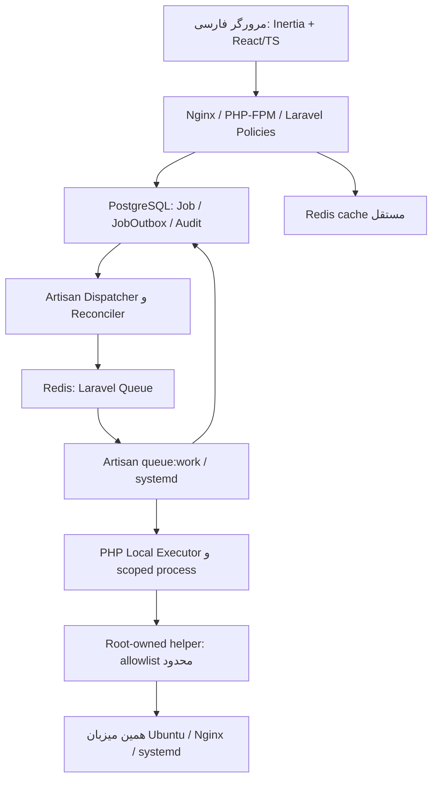
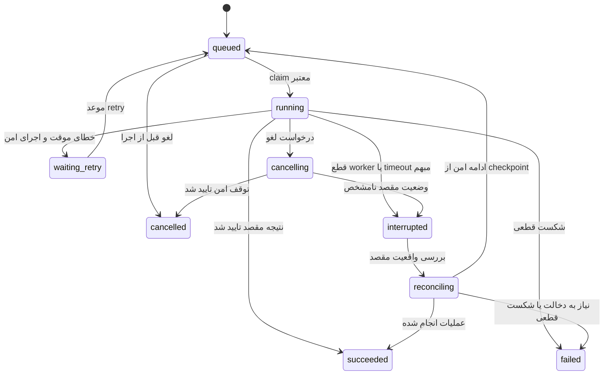

# راه‌انداز | Rahandaz — مشخصات جامع محصول و پیاده‌سازی

> مرجع اجرایی برای Agentهای برنامه‌نویسی مانند Codex، Grok و سایر توسعه‌دهندگان.
> این سند مشخصات هدف است؛ وجود یک قابلیت در آن به معنی پیاده‌سازی فعلی آن نیست.

| ویژگی                    | مقدار                                                        |
| ------------------------ | ------------------------------------------------------------ |
| نام فارسی                | راه‌انداز                                                    |
| نام انگلیسی / شناسه فنی  | Rahandaz / `rahandaz`                                        |
| محل سند                  | `docs/PROJECT_SPEC.md`                                       |
| نسخه سند                 | 2.0                                                          |
| تاریخ                    | 2026-10-12                                                   |
| نوع محصول                | پنل فارسی خودمیزبان برای مدیریت سرور، سرویس و استقرار پروژه  |
| معماری                   | Laravel modular monolith + Laravel Queue + local executor   |
| سیستم‌عامل مرجع نسخه اول | Ubuntu Server 22.04، 24.04 و 26.04 با systemd                |
| زبان و جهت پیش‌فرض       | فارسی، `fa-IR`، راست‌به‌چپ                                   |
| رابط                     | Inertia.js + React + TypeScript + Tailwind CSS + Vite       |
| زیرساخت                  | PostgreSQL، Redis، systemd، Nginx                            |

## 1. دستور اصلی به Agent

تو مسئول ساخت یک محصول واقعی، قابل نصب، قابل نگهداری و دارای رابط حرفه‌ای هستی. این پروژه صرفاً داشبورد نمایشی، مجموعه‌ای از shell commandها یا بازطراحی یک پنل آماده نیست.

1. قبل از تغییر، این سند، `AGENTS.md` موجود، فایل‌های وابستگی و کد مرتبط را بخوان. اگر مخزن قبلاً وجود دارد، ابتدا واقعیت آن را بررسی کن؛ کد موجود را کورکورانه جایگزین نکن.
2. stack قطعی این بازنگری Laravel + Inertia.js + React/TypeScript است. تغییر اساسی بعدی در stack یا مرز اعتماد نیازمند ADR است؛ این مهاجرت معماری به درخواست مالک انجام شده و نیازی به اجازه مجدد ندارد.
3. کار را در برش‌های عمودی قابل استفاده پیش ببر: مدل، مجوز، service، task، رابط، آزمون و مستندات همان قابلیت.
4. هر مرحله باید روی محیط توسعه و آزمایش تعریف‌شده قابل اجرا باشد. دکمه بدون backend، داده ساختگی در production و نتیجه موفقیت بدون اجرای واقعی ممنوع است.
5. عملیات خارجی را در درخواست HTTP اجرا نکن. درخواست فقط validation، authorization و ثبت job انجام می‌دهد.
6. امنیت سمت سرور الزامی است؛ مخفی کردن دکمه جای authorization را نمی‌گیرد.
7. همه عملیات دارای اثر جانبی باید timeout، audit، مدیریت تکرار، قفل مناسب و مسیر شکست مشخص داشته باشند.
8. از نوشتن migration مخرب، پاک کردن داده، reboot یا آزمایش روی سرور واقعی بدون مجوز صریح خودداری کن. VM آزمایشگاهی مجزا برای تست زیرساخت بساز.
9. پس از هر مرحله، تغییرات، روش اجرا، آزمون‌های اجراشده و محدودیت‌های واقعی را گزارش کن. ادعای انجام آزمون اجرا‌نشده ممنوع است.
10. نام و برند پروژه راه‌انداز است؛ هیچ ادعای بررسی نام تجاری، آزاد بودن دامنه یا مشابهت کامل با محصولی خارجی نکن. محصول مستقل است.

## 2. مسئله، مخاطب و نتیجه مورد انتظار

راه‌انداز در نسخه اول به توسعه‌دهنده یا مدیر **همان سروری که پنل روی آن نصب است** کمک می‌کند بدون اجرای مکرر دستورات دستی، وضعیت میزبان را ببیند، نرم‌افزار نصب و به‌روزرسانی کند، سرویس‌ها را مدیریت کند، پروژه مستقر کند، لاگ ببیند، پشتیبان بگیرد و در شکست به نسخه سالم برگردد.

دامنه قطعی نسخه اول تک‌سرور است: کنترل‌پنل، worker و پروژه‌های کاربر روی یک میزبان قرار دارند. هیچ سرور مقصد، inventory، کلید SSH مدیریتی، agent راه دور یا اتصال چندسروری در نسخه اول وجود ندارد. کنترل‌پنل در production مستقیماً با PHP-FPM، Nginx، systemd و Laravel Queue روی Ubuntu نصب می‌شود و اجرای پنل، worker یا scheduler داخل Docker در نسخه اول پشتیبانی نمی‌شود. محیط توسعه نیز برای خود برنامه PHP/Artisan/Vite را روی میزبان اجرا می‌کند؛ PostgreSQL و دو Redis توسعه را می‌توان مستقیم یا با Compose مخصوص dependencyها اجرا کرد. Docker برای استقرار پروژه‌ها در نسخه اول استفاده نمی‌شود؛ نصب اختیاری آن برای کاربری خارج از deployment پنل فقط با catalog امن ممکن است.

نسخه اول یک نصب متعلق به یک مالک یا تیم مورد اعتماد، همراه کاربران و نقش‌های متعدد است. مدل Workspace از ابتدا وجود دارد، ولی هر Workspace در این نسخه همان میزبان محلی حفاظت‌شده را می‌بیند. SaaS چندمستاجری عمومی و اجرای کد مشتری ناشناس پشتیبانی نمی‌شود.

اهداف:

- نصب ساده و تکرارپذیر، نه نصب پنهان و غیرقابل کنترل.
- نصب production مستقیم و بدون Docker همراه PostgreSQL و دو instance/role مجزای Redis برای queue و cache؛ Docker وابستگی پنل یا روش استقرار پروژه در نسخه اول نیست؛ نصب اختیاری موتور به‌عنوان package مستقل امکان‌پذیر است.
- کارکرد سبک روی پروفایل حداقلی 1 vCPU / 2GB RAM و اشغال کنترل‌شده دیسک، همراه degradation صادقانه برای buildهای سنگین.
- رابط فارسی با قابلیت‌های روشن، فرم‌های قابل فهم و نمایش شفاف نتیجه عملیات.
- شناسایی امن و فقط‌خواندنی سیستم‌عامل، CPU، RAM، disk، packageها، portها، systemd unitها و قفل package manager روی میزبان محلی.
- نصب و پیکربندی نسخه‌های پشتیبانی‌شده Nginx، PHP، Node.js، Python برای پروژه‌های کاربر، PostgreSQL، MySQL، MariaDB، MongoDB و Redis؛ نصب Docker به‌عنوان نرم‌افزار اختیاری (نه محیط استقرار) فقط با helper امن و catalog آزموده قابل ارائه است.
- مدیریت به‌روزرسانی‌های امنیتی و patchها با preview، پنجره نگهداری و تفکیک update عادی از major upgrade.
- استقرار قابل اعتماد با کمترین اختلال ممکن، بررسی سلامت و rollback مشخص.
- حفظ دسترسی به پنل و SSH موجود هنگام تغییر Nginx، سرویس‌ها یا packageهای همان سرور.
- کارکرد رابط بدون وابستگی به CDN یا اینترنت خارجی برای فونت، CSS و JavaScript.
- انتشار عمومی و متن‌باز نسخه اول در GitHub، همراه release قابل راستی‌آزمایی و نصب تک‌دستوری روی Ubuntuهای هدف.

### 2.1 مرز نسخه‌ها

این بخش بر هر اشاره قدیمی‌تر یا عمومی‌تر در ادامه سند اولویت دارد:

| نسخه | دامنه |
| --- | --- |
| نسخه ۱ | فقط میزبان محلی؛ مدیریت نرم‌افزار، سرویس، پروژه، deploy، domain/TLS، database، backup، monitoring و update همان میزبان |
| نسخه ۲ | مدیریت چند سرور مورد اعتماد، اتصال SSH، inventory، credential مقصد و اجرای دسته‌ای؛ انتخاب Ansible در ADR مستقل ارزیابی می‌شود |
| نسخه ۳ | worker/agent توزیع‌شده، API اتوماسیون، providerهای cloud و قابلیت‌های مقیاس بزرگ پس از تثبیت امنیت و telemetry |

### 2.2 خارج از دامنه نسخه اول

- Kubernetes، ساخت cloud provider، billing، email hosting و کنترل‌پنل عمومی هاست اشتراکی.
- ترمینال آزاد root، اجرای shell دلخواه از مرورگر و playbook دلخواه آپلودشده توسط کاربر. کنسول نسخه ۱ فقط فهرست ثابت بررسی‌های فقط‌خواندنی است و فرمان دلخواه، نصب یا تغییر فایل را اجرا نمی‌کند.
- پشتیبانی تضمینی از همه توزیع‌ها و همه نسخه‌های نرم‌افزار.
- هر نوع مدیریت سرور دیگر با SSH، Ansible، agent یا API ابری.
- تغییرات شبکه/firewall/SSH بدون پیش‌بینی recovery.
- تضمین اجرای هم‌زمان تعداد نامحدود پروژه یا build سنگین Nuxt/Next روی سرور 2GB؛ ظرفیت هر workload باید پیش از اجرا سنجیده شود.
- ارتقای خودکار major دیتابیس یا تبدیل خودکار MySQL به MariaDB.
- تضمین مطلق zero downtime برای migration ناسازگار، restart سیستم یا ماشین کم‌حافظه.

### 2.3 بودجه منابع و اصل کم‌مصرف بودن

پروفایل آزمون حداقلی رسمی نسخه اول: **1 vCPU، 2GB RAM**، Ubuntu Server و فضای آزاد موردنیاز بسته؛ این حد به معنی ظرفیت تضمینی build چند Next/Nuxt یا چند دیتابیس سنگین نیست. راه‌انداز باید در کنار workloadهای واقعی کم‌مصرف بماند و preflight پیش از عملیات سنگین RAM آزاد، load، swap، disk و ریسک OOM را بسنجد.

- **هدف طراحی (نه ادعای تضمین‌شده):** footprint افزوده کنترل‌پلین در حالت idle و پس از warm-up، شامل PHP-FPM راه‌انداز، workerهای ضروری، PostgreSQL/Redis اختصاصی و Nginx سهم‌پذیر، ترجیحاً **حداکثر 512MiB RAM** و متوسط مصرف CPU در وضعیت عادی **حداکثر 0.5 vCPU** روی بازه اندازه‌گیری‌شده. benchmark باید PSS/RSS و سهم سرویس‌های مشترک را تفکیک کند؛ جمع ساده RSS processهای اشتراکی موجب دوباره‌شماری است. هر محدودیت بالاتر فقط با اندازه‌گیری و ثبت در `docs/PERFORMANCE.md` پذیرفته می‌شود.
- **قید صداقت:** در لحظه نصب APT، Composer/npm build، migration، backup، restore یا راه‌اندازی چند runtime، مصرف CPU/RAM می‌تواند از هدف idle بیشتر باشد. «حداکثر 0.5 در تمام لحظات» بدون محدودکردن شدید سرعت یا خطر OOM قابل تضمین نیست؛ peak، p95، idle و مصرف پروژه‌های کاربر جدا گزارش می‌شوند. روی resource budget ناکافی عملیات سنگین به‌جای آسیب‌زدن به پروژه فعال block/queue می‌شود.
- پروفایل `lite` پیش‌فرض یک worker کوتاه `control` و یک worker اجرایی با concurrency=1 دارد؛ تعداد PHP-FPM childها محدود است. Redis cache سقف `maxmemory` و eviction اختصاصی دارد؛ Redis queue با `noeviction` و persistence آزموده پیکربندی می‌شود. dashboard Horizon به‌عنوان ابزار تشخیصی اختیاری در پروفایل بزرگ‌تر است، نه process اجباری در lite.
- Laravel scheduler از systemd timer دوره‌ای و `php artisan schedule:run` استفاده می‌کند؛ برای نسخه تک‌سرور daemon دائمی scheduler اجباری نیست. Dispatch و reconciler به‌صورت کوتاه و قابل recovery اجرا می‌شوند.
- هر build/process پروژه با UID مستقل و `systemd` scope/cgroup دارای `MemoryMax`، `CPUQuota`، `TasksMax`، `IOWeight` و timeout است؛ capهای مصرف پروژه جدا از cap پنل هستند. تنها یک build سنگین در پروفایل حداقلی مجاز است؛ پنل و سایت فعال باید اولویت حفظ سرویس داشته باشند.
- در صفحات قابل مشاهده polling تطبیقی و در tab پنهان backoff فعال است. PostgreSQL برای business state و durable job، Redis برای cache/queue/lock کوتاه‌عمر؛ metricها batch/retention و صفحه‌ها pagination/cursor دارند. WebSocket server و Node SSR daemon در MVP اجرا نمی‌شوند، مگر بعد از benchmark/ADR.
- ساخت swap بزرگ بدون preview و تایید Owner ممنوع است. footprint دیسک متعلق به کنترل‌پلین پس از نصب تمیز هدفاً زیر 2GB و همراه log/cache/releaseهای نگهداری‌شده هدفاً زیر 5GB است؛ artifact/DB/backup پروژه‌ها جدا محاسبه شوند.
- معیار پذیرش: ۳۰ دقیقه idle، ۱۵ دقیقه polling، یک deploy سبک، یک شکست worker و آزمایش بازگشت؛ مصرف CPU، RAM PSS/RSS، p95 درخواست، disk و موفقیت پروژه فعال ثبت شود. ادعای دستیابی به سقف قبل از VM benchmark ممنوع است.

### 2.4 انتشار عمومی و متن‌باز

نسخه اول پس از تکمیل به‌صورت public و open-source در GitHub منتشر می‌شود. پیش از انتشار باید مجوز OSI-approved با تصمیم صریح مالک انتخاب و در `LICENSE` ثبت شود؛ تا پیش از آن نباید نوع مجوز حدس زده شود.

- repository فاقد secret، credential، داده شخصی، artifact حجیم و config محیط واقعی باشد.
- هر release دارای tag امضاشده یا provenance قابل بررسی، checksum مستقل، changelog، compatibility matrix و artifact آماده نصب باشد.
- CI عمومی lint، test، migration check، asset build، dependency audit و integration matrix Ubuntu 22.04/24.04/26.04 را اجرا کند.
- مسیر نصب اصلی یک فرمان مستند مانند دانلود installer نسخه‌دار و اجرای آن با checksum/signature verification است؛ الگوی ناامن `curl ... | sudo bash` بدون نمایش و verify محتوا مسیر پیشنهادی نیست.
- issue template امنیتی، `SECURITY.md`، سیاست نسخه‌های پشتیبانی‌شده، release notes و راهنمای contribution پیش از public شدن کامل شوند.

## 3. تصمیم‌های معماری قطعی

| بخش | تصمیم | دلیل / قید |
| --- | --- | --- |
| Backend | **Laravel 13.x**، نسخه patch امن و سازگار pin‌شده | modular monolith، Eloquent، Policy، FormRequest، Artisan و migration |
| PHP پنل | PHP 8.3+ مطابق ماتریس رسمی Laravel 13 و اکستنشن‌های آزموده؛ **ترجیح PHP 8.4/8.5 پس از CI** | نسخه PHP پنل مستقل از PHP پروژه‌ها و CLI default سیستم؛ از مسیر `/usr/bin/php` متغیر استفاده نشود |
| Frontend | **Inertia.js 3 + React 19 + TypeScript strict + Vite** | routing از Laravel؛ React pages؛ API صرفاً برای عملیات/stream لازم |
| CSS/UI | Tailwind CSS 4 + tokenهای CSS + shadcn/ui به صورت selective + Radix primitives + Lucide React | نسخه دقیق dependencyها lock، bundle self-hosted، اجتناب از import سنگین |
| فرم و اعلان | Inertia `useForm` یا فرم typed، Zod برای UX اختیاری؛ Sonner برای Toast | validation اصلی FormRequest/Policy سمت Laravel؛ toast از state واقعی Job |
| پایگاه داده | PostgreSQL با connection و role اختصاصی پنل | source of truth برای User، Job، Outbox، audit، configuration و metadata |
| صف | Laravel Queue با driver Redis و `ShouldQueue`؛ `queue:work` زیر systemd | concurrency کم، retry/backoff، worker restart، idempotency؛ Horizon فقط optional |
| Cache/lock | Redis مجزا از queue، ترجیحاً instance/service و ACL مستقل | cache eviction نباید job را حذف کند؛ PostgreSQL lease/fencing برای mutation |
| زمان‌بندی | Laravel Scheduler (`schedule:run`) با `systemd timer` و guard یکتا | بدون Laravel Scheduler یا daemon اضافی |
| اجرای زیرساخت | Local executor با service/adapterهای PHP و helper کوچک root-owned | اجرای پروژه بدون Docker، بدون shell آزاد و بدون root در web/worker |
| وب | Nginx + PHP-FPM اختصاصی پنل، FastCGI و OPcache | کم‌مصرف، بدون PHP-FPM/ASGI/Node SSR runtime |
| process | systemd برای FPM pool، workerها، timer و سرویس پروژه | مالکیت و resource isolation روشن |
| فونت/زمان | Vazirmatn محلی، locale `fa-IR`، UTC در DB و جلالی در frontend | عدم وابستگی به CDN |
| شناسه‌ها | `id` از نوع BIGINT کلید اصلی داخلی؛ `uuid` از نوع native UUIDv7 شناسه عمومی | کلید خارجی داخلی BIGINT است. API و URL فقط `uuid` می‌بینند. UUID مجوز نیست |

**تایید نسخه‌ها:** نسخه‌های major بالا مبنای طراحی این سندند، نه مجوز نصب `latest`. Agent پیش از bootstrap باید نسخه‌های patch، Laravel/React/Inertia/Tailwind و PHP/extensionها را از منابع رسمی/CI بررسی و در `composer.lock`، `package-lock.json` و `docs/DEPENDENCIES.md` قفل کند. در صورت عدم پشتیبانی یک ترکیب روی Ubuntu 22.04/24.04/26.04، آن ترکیب باید `untested` یا `unsupported` باشد؛ با جایگزین‌کردن خاموش runtime یا package نباید موفقیت جعل شود. Node.js فقط برای build دارایی‌های frontend پنل در development/CI است و برای اجرای production پنل نیاز نیست؛ Node پروژه‌های کاربر مستقل است.

### 3.1 جریان کنترل



request وب صرفاً validation، Policy، برنامه عملیات و Job/Outbox را در transaction ثبت می‌کند و پاسخ `202` برمی‌گرداند؛ نصب APT یا deploy مستقیم در HTTP انجام نمی‌شود. Redis واسطه اجراست و source of truth نیست. worker نیز root نیست و helper تنها verbهای نسخه‌دار، schemaدار و resource-bound را می‌پذیرد. compromise پنل روی میزبان خودمیزبان ریسک بالایی دارد؛ sandbox یک جایگزین مرز privilege واقعی نیست.

## 4. ساختار مخزن

ساختار Laravel استاندارد حفظ شود و دامنه‌ها در `app/Domain/` ماژول‌بندی شوند؛ ساخت package داخلی یا microservice بی‌نیاز ممنوع. نام مسیرها و کد انگلیسی، رابط و مستندات کاربر فارسی‌اند. وابستگی domainها از طریق Application services/contracts مدیریت شود؛ model/controller نباید subprocess یا فرمان systemd اجرا کند.

```text
rahandaz/
  artisan
  composer.json
  composer.lock
  package.json
  package-lock.json
  tsconfig.json
  vite.config.ts
  phpunit.xml
  .env.example
  README.md
  AGENTS.md
  SECURITY.md
  LICENSE
  CHANGELOG.md
  app/
    Models/                      # Eloquent models: User, Job, Project, ...
    Domain/
      Accounts/ Workspaces/ Onboarding/ Servers/ Catalog/ Mirrors/
      Services/ Git/ Projects/ Deployments/ Jobs/ Domains/
      Databases/ Backups/ Monitoring/ Audit/ Notifications/ Settings/
    Application/                 # use cases, DTO, idempotency, transaction orchestration
    Infrastructure/
      Executor/                  # local PHP adapters, process isolation, checkpoints
      Secrets/                   # envelope crypto, key management, redaction
      Host/                      # apt/systemd/nginx adapters و read-only facts
    Http/
      Controllers/ Middleware/ Requests/ Resources/
    Jobs/                        # Laravel ShouldQueue handlers, dispatch/reconcile
    Policies/
    Providers/
    Console/Commands/
  bootstrap/{app.php,providers.php}
  config/{app,auth,cache,database,filesystems,logging,queue,session,services,horizon}.php
  database/{migrations,factories,seeders}/
  routes/{web.php,api.php,console.php}
  resources/
    views/app.blade.php          # فقط Inertia root view، نه صفحات Blade متعدد
    css/{app.css,tokens.css}
    js/
      app.tsx
      types/                   # types shared / Inertia PageProps
      layouts/{auth-layout,app-layout}.tsx
      pages/{auth,setup,dashboard,servers,mirrors,services,projects,
             deployments,jobs,domains,databases,backups,monitoring,
             users,notifications,settings,errors}/
      components/{ui,forms,charts,job-log,setup-wizard}/
      hooks/ lib/                  # theme, dates, API, route, notifications
    fonts/vazirmatn/              # WOFF2 + license; CDN ممنوع
  public/{build,assets}/          # Vite bundle، welcome assets مجزا
  assets/{branding,welcome-site}/
  infrastructure/
    privilege_helper/             # binary کوچک audited + versioned JSON schema
    systemd/                     # web/FPM, workers, timer, project unit templates
    nginx/                       # protected panel entrypoint + site templates
    redis/                       # broker/cache service profiles
  scripts/{bootstrap-install.sh,configure-mirrors.sh,install.sh,upgrade.sh,
           uninstall.sh,doctor.sh,backup-control-plane.sh}
  tests/{Feature,Unit,Integration,Infrastructure,E2E,Fixtures}/
  docs/{PROJECT_SPEC.md,ARCHITECTURE.md,DEPENDENCIES.md,INSTALLATION.md,
        DEVELOPMENT.md,OPERATIONS.md,SECURITY_MODEL.md,DEPLOYMENT_STRATEGIES.md,
        BACKUP_RESTORE.md,UI_GUIDELINES.md,PERFORMANCE.md,TESTING.md,ROADMAP.md,adr/}
```

- `Controller` مسئول request/authorization و response (`Inertia::render` یا JSON) است؛ `FormRequest` اعتبارسنجی، `Policy` مجوز؛ Domain service مسئول use case و transaction؛ Query object/Repository فقط در صورت نیاز واقعی و benchmark.
- Eloquent model شامل relation/cast/constraint و منطق دامنه کوچک باشد؛ magic observer/event برای نصب، deploy و mutation سیستمی ممنوع. listener/notification فقط بعد از commit و با deduplication مجاز است.
- `ShouldQueue` handler فقط Job ID را می‌گیرد، claim معتبر را بررسی و orchestrator را صدا می‌زند. serialized secret یا object حجیم در payload صف ممنوع است.
- transaction دیتابیس در طول دانلود/build/apt باز نماند؛ command اجراشده و desired/observed state جدا ثبت شود.
- `resources/js/pages/` صفحه‌های TypeScript JSX هستند و SSR Blade صفحه‌ای ممنوع؛ React Router دوم یا API-only SPA جداگانه بی‌دلیل اضافه نشود.
- برای migration از مخزن قدیم، `manage.py`، `pyproject.toml`، `uv.lock`، `apps/`، Django Templates و Celery code قدیمی **به عنوان ساختار کنترل‌پنل جدید منتقل نشوند**؛ هر فایل قبل از حذف با مالک پروژه/آزمون migration کد موجود بررسی شود. Python برای پروژه‌های *مشتریان* همچنان runtime مجاز است.

## 5. نقش‌ها و دسترسی

ثبت‌نام عمومی پیش‌فرض غیرفعال است. installer مالک اولیه را خودکار با username لاتین و password کاملاً تصادفی می‌سازد؛ رمز یا نام کاربری ثابت، قابل حدس یا مشترک بین نصب‌ها ممنوع است.

| قابلیت                                 | Owner       | Admin            | Operator                | Viewer         |
| -------------------------------------- | ----------- | ---------------- | ----------------------- | -------------- |
| مشاهده وضعیت و لاگ پالایش‌شده          | بله         | بله              | فقط منابع مجاز          | فقط منابع مجاز |
| نصب/تغییر نرم‌افزار و تنظیم میزبان      | بله         | بله              | خیر                     | خیر            |
| deploy و rollback پروژه تخصیص‌یافته    | بله         | بله              | بله                     | خیر            |
| restart سرویس پروژه                    | بله         | بله              | بله، در scope پروژه     | خیر            |
| restore دیتابیس یا حذف سرویس داده‌دار  | بله         | با مجوز ویژه     | خیر                     | خیر            |
| مدیریت اعضا                            | بله         | نقش‌های پایین‌تر | خیر                     | خیر            |
| انتقال مالکیت، master key، self-update | بله         | خیر              | خیر                     | خیر            |
| افزودن secret                          | بله         | بله              | فقط با permission مستقل | خیر            |
| نمایش مجدد مقدار secret                | پیش‌فرض خیر | پیش‌فرض خیر      | خیر                     | خیر            |

هر query و action باید Workspace و resource scope را بررسی کند؛ UUID جای این بررسی نیست. دسترسی job/log/artifact تابع منبع اصلی است. Owner آخر حذف یا تنزل داده نمی‌شود. کاربر تعلیق‌شده session فعال و مجوز job جدید ندارد.

حذف، restore، major upgrade و تغییر دسترسی با confirmation دارای نام resource و در موارد حساس reauthentication/MFA انجام شود. عملیات read-only نیاز به confirmation ندارد. تایید رابط باید با version/hash برنامه عملیات bind شود تا تغییر plan، تایید قبلی را بی‌اعتبار کند.

### 5.1 حساب اولیه، ورود و پروفایل کاربر

دو هویت مستقل وجود دارد: **Owner پنل Laravel** (کاربر Eloquent/Session) و **حساب لینوکسی عملیاتی `rahandaz`**. این دو هیچ رمز/مجوز مشترکی ندارند. `rahandaz` نه root است، نه عضو sudo/docker/adm، و مجاز به اجرای arbitrary shell از وب نیست. `root` تنها در bootstrap اولیه و در سرویس helper کاملاً محدود و ممیزی‌شده برای تغییرات واقعاً privileged استفاده می‌شود؛ با UID غیرprivileged نمی‌توان `apt install`، ایجاد Unix user یا نوشتن `/etc/nginx` را مستقیماً انجام داد.

- bootstrap مالک وب با Artisan command غیرتعاملی مانند `php artisan rahandaz:bootstrap-owner` و CSPRNG، username لاتین `rahandaz_<random>` و password مستقل حداقل 24 کاراکتری ایجاد کند. Laravel Hash برای passwordهای قابل ورود استفاده شود؛ شناسه‌ها uniqueness normalized و constraint DB دارند.
- secret ورود اولیه فقط در `/root/rahandaz-initial-credentials.txt` با `root:root/0600` نوشته شود؛ مسیر فایل، نه مقدار secret، در پایان نصب گزارش شود. Owner در اولین login رمز را عوض می‌کند و sessionهای سابق باطل می‌شوند. installer در rerun به‌هیچ‌وجه credential تازه یا User جدید بی‌اجازه نمی‌سازد.
- حساب Linux `rahandaz` با UID/GID اختصاصی، home محدود و **به طور پیش‌فرض password locked و shell بدون login تعاملی** ساخته شود؛ هیچ password ثابتی ندارد و automation به password نیاز ندارد. این انتخاب نسبت به تولید رمز تصادفی غیرضروری برای حساب سرویس، سطح حمله کمتری دارد. `sudo -u rahandaz` فقط از مسیر installer/root یا helper محدود انجام می‌شود؛ اعطای sudo عمومی به خود حساب ممنوع است. مسیر قدیمی `/root/rahandaz-system-credentials.txt` برای نصب‌های جدید ساخته نمی‌شود؛ migration نصب موجود نیاز به برنامه انتقال/حذف امن دارد.
- processهای برنامه مطابق مرز trust می‌توانند service identityهای محدود `rahandaz-web` و `rahandaz-worker` داشته باشند (یا DynamicUser و گروه read مشترک بازبینی‌شده). `rahandaz` هویت مالک/هماهنگ‌کننده منابع است و اجازه عمومی خواندن secretهای وب، master key یا داده همه پروژه‌ها را ندارد. هر پروژه untrusted UID اختصاصی `rhproj_<id>` و گروه/permission مستقل دارد؛ project runner نه UID `rahandaz` است و نه UID web/worker.
- credential حساس web/queue/project با least privilege، group/ACL کنترل‌شده، socket credential helper و field encryption نگه‌داری می‌شود؛ تفاوت دسترسی processها در `SECURITY_MODEL.md` و تست OS اثبات شود.
- فرم ورود username یا email، RateLimiter، secure session، MFA ترجیحاً TOTP/WebAuthn پس از ارزیابی، logout/revoke sessions، password reset فقط در مسیر امن و signup عمومی غیرفعال داشته باشد. Owner آخر قابل حذف/تنزل نیست؛ resource Policy در هر درخواست الزامی است.
- کاربران/پروفایل شامل نام نمایشی، email، وضعیت، نقش، آخرین login، sessionهای فعال و فیلدهای شماره همراه/کد ملی اختیاری و حساس است؛ داده PII طبق retention/encryption محافظت شود و شناسه ملی مبنای مجوز نیست.
- خروجی installer، Artisan commandها و خطاهای ترمینال برای اتوماسیون انگلیسی/ASCII-friendly باشند؛ UI فارسی و RTL است. Wizard فقط UID، group، وضعیت locked بودن account و سلامت مرز privilege را نمایش می‌دهد؛ هیچ «دریافت رمز حساب سیستمی» وجود ندارد.

## 6. مدل داده و invariantها

تمام مدل‌های اصلی دامنه کلید اصلی BIGINT به‌نام `id` و شناسه عمومی یکتا UUIDv7 به‌نام `uuid` دارند. `created_at` و `updated_at` در صورت کاربرد timezone-aware هستند. `uuid` کلید اصلی نیست. تولید UUIDv4 برای شناسه عمومی، و استفاده از `id` عددی در URL یا API عمومی، ممنوع است. کلید خارجی داخلی BIGINT است. identifierهای فنی لاتین‌اند. حذف soft فقط برای منابع مناسب است؛ secret و log retention قوانین مستقل دارند.

| مدل                 | فیلدهای کلیدی / رفتار                                                                               |
| ------------------- | --------------------------------------------------------------------------------------------------- |
| User                | مدل سفارشی از migration اول، username لاتین و email یکتا، وضعیت، locale، timezone، theme            |
| UserProfile         | نام نمایشی، موبایل، کد ملی اختیاری/حساس، force_password_change، آخرین پذیرش سیاست                  |
| Workspace           | نام، slug، مالک، تنظیمات؛ workspace پیش‌فرض installer                                               |
| Membership          | workspace، user، role؛ unique pair                                                                  |
| ResourceGrant       | عضو، نوع/شناسه منبع، permission؛ scope صریح                                                         |
| SetupSession        | workspace، owner، current_step، mode، answers، plan_hash، state، started/finished؛ فقط یک setup فعال |
| SetupComponent      | setup، catalog item/version، required، selected، order، job/step، state، error_code                 |
| Credential          | نوع، encrypted payload، key_version، fingerprint، creator؛ بدون plaintext در serializer             |
| LocalHost           | workspace، ثابت `local-host`، state، compatibility، last_seen، protected؛ برای هر نصب یکتا          |
| HostFact            | OS، architecture، kernel، resources، packages، ports، observed_at؛ snapshot با freshness            |
| HostSSHKey          | local_host، user، public_key، fingerprint یکتا، label، enabled، added_by، last_verified_at           |
| FirewallRule        | local_host، direction، protocol، port/range، source CIDR، purpose، managed، state، observed_at       |
| PackageDefinition   | key، versions، sources، architectures، conflicts، capability_flags، definition_version              |
| MirrorEndpoint      | provider، software_kind، URL، کشور، trust_status، capabilities، priority_seed، last_checked_at      |
| MirrorConfiguration | local_host، software_kind، mode، endpoint، state، applied_at، last_probe، rollback_snapshot_ref       |
| ManagedService      | server، kind، instance، requested_version، observed_version، state، managed_by_panel، protected     |
| GitConnection       | workspace، provider، account label، credential_ref، scopes، state، last_sync؛ token فقط رمزشده      |
| RemoteRepository    | connection، provider id، full_name، clone URL، default branch، visibility، archived، last_seen      |
| RemoteBranch        | repository، name، immutable head SHA، protected، observed_at؛ unique repository/name                |
| DeployKey           | project/repository، public key، fingerprint، private credential_ref، provider state، read_only       |
| Project             | workspace، slug، declared/detected type، repository، branch، credential_ref، deploy policy           |
| Environment         | project، name، local_host، mode، paths، runtime، active_release؛ pair یکتا                           |
| EnvironmentVariable | environment، key، secret_ref یا value، is_secret؛ key یکتا و export امن                             |
| Deployment          | environment، immutable commit/digest، trigger، state، previous_release، plan hash، job              |
| Release             | environment، artifact_digest، directory یا image_digest، state، created_at                          |
| Domain              | environment، hostname، routing و TLS وضعیت؛ hostname و endpoint conflict validation                 |
| Certificate         | موجودی سرور: mode، algorithm، install_state، domains، issuer، expiry؛ private key فقط در Credential رمزشده |
| NginxSite           | تنظیم مطلوب nginx یک environment: server_name، گواهی اختصاص‌یافته، gzip، websocket، سقف آپلود؛ اعمال جدا از موجودی گواهی |
| ServerPolicy        | تنظیم مطلوب nginx خود میزبان: worker، keepalive، gzip، server_tokens؛ جدا از NginxSite پروژه‌ها |
| DatabaseInstance    | managed_service، engine، endpoint، protected؛ engine نسخه‌دار                                       |
| ProjectDatabase     | instance، project/environment، db_name، user، credential_ref؛ مالکیت مشخص                           |
| Job                 | workspace، type، resource، actor، status، idempotency_key، plan، retry، heartbeat، cancel_requested |
| JobStep             | job، key، status، timeout، checkpoint، attempt، started/finished                                    |
| JobLog              | job، sequence، timestamp، level، step، redacted message؛ unique(job, sequence)                      |
| JobOutbox           | job، event_type، published_at، attempt؛ انتشار قابل تکرار                                           |
| ExecutionLease      | resource key، owner job/attempt، expires_at، fencing token                                          |
| Backup              | resource، storage، checksum، size، state، encryption_key_ref، verified_at، restore metadata         |
| Schedule            | operation template، timezone، next_run، enabled، overlap policy                                     |
| MetricSample        | server/service، collected_at، observed_at، values؛ retention محدود                                  |
| AlertRule/Event     | threshold، duration، hysteresis، state، deduplication                                               |
| AuditEvent          | actor، action، resource، request/job id، redacted before/after، timestamp                           |

invariantهای الزامی:

- یک environment در هر لحظه حداکثر یک deploy/rollback فعال دارد؛ provisioning کل سرور با عملیات متعارض پروژه قفل مشترک دارد.
- `active_release` فقط بعد از switch موفق و health check پس از switch عوض شود.
- commit یا digest در شروع resolve و ثابت شود؛ retry از branch متغیر استفاده نکند.
- `declared_type` انتخاب کاربر است و `detected_type` فقط از artifact همان commit به‌دست می‌آید. ناسازگاری این دو قبل از build، deploy را block می‌کند تا کاربر نوع را تصحیح یا تشخیص مستند را تایید کند.
- یک repository می‌تواند چند Project/Environment مستقل با branch، domain، secret، database و release path متفاوت داشته باشد؛ unique بودن repository URL به‌تنهایی constraint پروژه نیست.
- نتیجه Laravel queued job به‌تنهایی `Job.status` را تعیین نکند؛ مشاهده واقعیت مقصد مهم است.
- منابع متعلق به control plane علامت protected دارند؛ حذف از پنل ممنوع و self-update مسیر اختصاصی دارد.
- constraint یکتایی در PostgreSQL برای idempotency، domain conflict و job log sequence تعریف شود؛ فقط validation فرم کافی نیست.
- سیاست archive/history برای audit و release مشخص؛ cascade deletion نباید trace عملیات حساس را حذف کند.
- کلید SSH با fingerprint یکتا deduplicate شود؛ private key، passphrase و محتوای credential سمت کاربر هرگز در این مدل‌ها ذخیره نشود.
- ruleهای firewall متعلق به پنل از ruleهای discovered موجود جدا باشند؛ حذف cascade یک پروژه نباید rule مشترک یا دسترسی recovery را حذف کند.
- تکمیل onboarding یک transition اتمیک و auditشده است؛ تا پیش از success نهایی، `setup_completed_at` خالی و dashboard اصلی برای Owner قابل دسترس نیست. answerها و plan hash نسخه‌دارند تا resume/retry همان تصمیم‌ها را بازسازی کند.
- `MirrorEndpoint` روی `(software_kind, base_url)` یکتا و `MirrorConfiguration` برای هر `(local_host, software_kind)` فقط یک وضعیت فعال دارد؛ history/snapshot حذف cascade نمی‌شود تا rollback و audit قابل اتکا بماند.

### 6.1 قرارداد شناسه و طراحی بهینه PostgreSQL

- هر مدل اصلی دامنه دو شناسه دارد: `id` از نوع BIGINT، کلید اصلی و identity سازگار با `$table->id()`، و `uuid` از نوع native PostgreSQL `uuid`، یکتا، NOT NULL و نسخه ۷. `uuid` کلید اصلی نیست و `varchar(36)` نیست.
- generator مرکزی `app/Support/Identifiers.php` روی `Illuminate\Support\Str::uuid7()` تنها مسیر ساخت شناسه عمومی در PHP است. مدل از `HasPublicUuid` استفاده می‌کند، نه `HasUuids`. factory، seeder و event همین مسیر را دارند. ساخت دست‌نویس UUIDv7 در چند نقطه ممنوع است.
- کلید خارجی داخلی BIGINT است. رابطه Eloquent پیش‌فرض روی `id` است. شناسه provider، مانند `provider_repository_id`، ستون جدا با نوع مناسب همان provider است و به UUID تبدیل اجباری نمی‌شود.
- API، URL و Inertia عمومی فقط `uuid` را می‌بینند. `id` عددی در JSON عمومی افشا نمی‌شود. UUID مجوز دسترسی نیست؛ Policy و scope ورک‌اسپیس جدا هستند.
- درج انبوه و Query Builder رویداد مدل را اجرا نمی‌کنند. trigger پایگاه `rahandaz_guard_public_uuid` تهی بودن، نسخه ۷ و تغییرناپذیری `uuid` را تضمین می‌کند.
- جدول‌های فریم‌ورک `sessions`، `cache`، `cache_locks`، `jobs`، `failed_jobs`، `job_batches` و `password_reset_tokens` شناسه دوتایی دامنه نمی‌گیرند. `sessions.user_id` از نوع `users.id` است. `failed_jobs.uuid` همان varchar لاراول می‌ماند. `audit_events.resource_id` شناسه عمومی منبع است، نه کلید خارجی عددی.
- timestamp داخل UUIDv7 جای `created_at` را نمی‌گیرد. cursor داخلی برای تساوی زمان از زوج `(created_at, id)` استفاده می‌کند. شناسه عمومی در URL و cursor بیرونی `uuid` است.
- تست باید BIGINT بودن `id`، UUIDv7 و یکتا و NOT NULL بودن `uuid`، BIGINT بودن کلید خارجی، و resolve مسیر با `uuid` را روی PostgreSQL واقعی بررسی کند. نسخه ستون `uuid` باید ۷ باشد.
- هر foreign key پرتکرار index هدفمند دارد، ولی index تکراری ناشی از constraint/foreign key دوباره ساخته نمی‌شود. ترتیب ستون index براساس query واقعی و selectivity تعیین می‌شود.
- indexهای پایه شامل jobهای فعال بر `(status, created_at)`، log بر `(job_id, sequence)`، metric بر `(local_host_id, collected_at DESC)`، audit بر `(workspace_id, created_at DESC)`، deployment بر `(environment_id, created_at DESC)` و lookupهای username/email normalized است.
- برای stateهای کم‌تعداد از partial index مانند jobهای non-terminal استفاده شود. `jsonb` فقط برای snapshot/plan انعطاف‌پذیر است؛ فیلدی که filter/join/sort پرتکرار دارد ستون typed مستقل می‌خواهد.
- secret، متن log، payload حجیم و داده شخصی خام بی‌دلیل index نشوند. unique و index روی مقدار normalized یا digest امن، با تحلیل leakage، تعریف شود.
- همه list endpointها pagination اجباری و سقف `limit` دارند؛ offset عمیق برای log/audit/metric ممنوع و cursor/keyset pagination لازم است.
- queryهای حساس با dataset واقع‌گرایانه، `EXPLAIN (ANALYZE, BUFFERS)`، تعداد query و p95 بررسی می‌شوند. N+1، `SELECT *` غیرضروری و prefetch نامحدود blocker انتشارند.
- metric، job log و audit retention/archival دارند؛ partitioning فقط پس از رسیدن حجم و benchmark واقعی با ADR فعال می‌شود، نه از ابتدا بدون نیاز.
- migration افزودن index بزرگ باید `CONCURRENTLY` یا maintenance plan سازگار داشته باشد و transaction/lock impact آن مستند شود.

### 6.2 رمزنگاری داده‌های حساس و پایداری کلید نصب

تمام secretهای پایگاه داده باید پیش از persist با cryptography بازبینی‌شده و AEAD رمز شوند؛ encryption دیسک/دیتابیس به‌تنهایی کافی نیست. `APP_KEY` مخصوص Laravel را **از master key محرمانه راه‌انداز جدا** نگه دارید تا rotation کوکی/session یا رمزنگاری Laravel، secretهای عملیاتی را از دسترس خارج نکند.

- installer در نصب اول `APP_KEY` استاندارد Laravel و یک کلید مستقل `RAHANDAZ_MASTER_KEY` با entropy حداقل 256 بیت می‌سازد. `APP_KEY` برای framework/session/encryption استاندارد Laravel است؛ master key صرفاً برای envelope secret store است. هر دو بیرون DB/repository، ترجیحاً در `/etc/rahandaz/` با root ownership و دسترسی محدود process مقتضی/`LoadCredential` نگه داشته شوند؛ کلیدها هرگز در `.env.example` واقعی، process argv، journal یا browser ظاهر نشوند. installer در rerun/upgrade هیچ‌کدام را overwrite نمی‌کند.
- master key با HKDF-SHA256 و context/version و salt نصب، KEK مختص secret envelope می‌سازد؛ DEK داده با AES-256-GCM یا XChaCha20-Poly1305 استاندارد و nonce یکتا wrap می‌شود. `key_version`، algorithm، AAD شامل workspace/resource/field و metadata کنار ciphertext ذخیره شوند. کد crypto دست‌ساز و encryption قطعی عمومی ممنوع‌اند.
- secretهایی مانند Git OAuth/PAT، deploy private key، webhook token، password دیتابیس، env secret پروژه، backup credential، TLS private key و PII حساس در encrypted-at-rest هستند؛ password ورود فقط با Laravel Hash (Argon2id/bcrypt طبق policy) ذخیره می‌شود، نه reversible encryption.
- `APP_KEY` و master key لازم نیست هر دو در web قابل دسترسی باشند: خواندن/decrypt secretهای اجرایی باید از مسیر worker/credential service دارای authorization انجام شود. اگر معماری واقعی اجازه جداسازی کامل ندهد، به‌جای ادعای امنیت کاذب مرز و ریسک با تست دسترسی Linux مستند شود. master key و secret بازشده هرگز به کد پروژه‌های کاربر یا static asset نمی‌رسند.
- API، Inertia shared props، log، exception/stack trace، Eloquent serialization، Artisan output، Redis job payload، Horizon و support bundle نباید secret plaintext بدهند. فقط reference/opaque ID و metadata ضروری انتقال یابد. از encrypted cast Laravel فقط وقتی envelope/rotation/worker boundary را واقعا برآورده می‌کند استفاده شود.
- uniqueness/search secret با blind index مبتنی بر HMAC contextual در صورت ضرورت پیاده شود؛ encryption تعیین‌پذیر یا index plaintext ممنوع است. raw public key و fingerprint نیازی به encryption ندارند.
- fingerprint نصب، canary رمز‌شده، permissions و قابلیت decrypt در `doctor` بررسی شوند؛ نبود یا ناسازگاری کلید باید `fail closed` باشد. DB backup بدون master key backup امن قابل restore نیست.
- rotation فقط با backup معتبر، حفظ کلید قبلی، rewrap نسخه‌دار، verify همه envelopeها، audit و برنامه recovery انجام شود؛ ویرایش مستقیم `APP_KEY`/master key و regenerate خودکار در upgrade ممنوع است.

## 7. موتور عملیات، صف‌ها و بازیابی

### 7.1 ساخت job

در یک transaction: بررسی مجوز، validation schema، snapshot plan، ایجاد Job و Outbox. `DB::afterCommit()` یا `->afterCommit()` برای wake-up سریع dispatcher مجاز است، اما durable outbox لازم است؛ crash بعد از commit نباید job را فراموش کند. dispatcher رکوردهای outbox را با row lock انتخاب و به broker منتشر می‌کند. انتشار دوباره ممکن است؛ worker باید duplicate را بی‌اثر کند.

UI پاسخ `202 Accepted` با `job_id` و URL مشاهده می‌گیرد. درخواست تکراری دارای `Idempotency-Key` همان job را برگرداند؛ همان key با payload متفاوت پاسخ `409` می‌دهد. کلید در scope actor/workspace/action تفسیر شود.

### 7.2 state machine



`cancel_requested` یک flag نیز هست؛ درخواست لغو به معنی توقف فوری apt یا migration نیست. نتیجه fail می‌تواند شامل `rollback_status` باشد؛ rollback خود یک job مرتبط دارد و failure اصلی را پاک نمی‌کند. هیچ درصد پیشرفت ساختگی نده؛ مرحله معلوم و تعداد stepهای plan را نمایش بده.

### 7.3 Laravel Queue، Redis و مدیریت worker

در نسخه اول **Laravel Redis queue + `ShouldQueue`** انتخاب اصلی است. `PostgreSQL` حاوی durable `jobs`, `job_steps`, `job_outbox`, `job_logs`, `execution_leases` و status حقیقی است؛ جدول Laravel `failed_jobs` و counters صف صرفاً telemetry اجرای transport هستند. Redis queue به‌صورت `noeviction` با persistence مناسب و memory alarm اجرا می‌شود؛ Redis cache instance مجزای سقف‌دار و قابل eviction دارد. prefix، ACL، password و socket/portها جدا هستند و Redisهای پروژه کاربر به Redis راه‌انداز متصل نمی‌شوند.

| صف | ماهیت و worker در پروفایل lite |
| --- | --- |
| `control` | claim/dispatch/reconcile و رویداد کوتاه، **یک worker همیشه قابل پاسخ** |
| `provision` | نصب/config سرویس با lease میزبان، **حداکثر یک execution** |
| `deploy` | build و switch پروژه، **حداکثر یک execution** روی 2GB |
| `backup` | backup/restore با IO محدود، serialize با provisioning تعارض‌دار |
| `monitor` | probe خواندنی کم‌اولویت؛ در lite ترجیحاً schedule short-lived |

در lite صف‌های `provision,deploy,backup` می‌توانند در یک **worker اجرایی** با `--queue=provision,deploy,backup` و concurrency=1 مصرف شوند؛ `control` worker جدا باشد تا task طولانی dashboard/onboarding را قفل نکند. صف‌های جدا lock کافی نیستند: `ExecutionLease` PostgreSQL + OS execution ID/fencing و lock میزبان شرط mutation هستند. در پروفایل استاندارد workerها جدا می‌شوند. نصب و روشن‌کردن Horizon اجباری نیست؛ در صورت فعال‌سازی Laravel Horizon فقط Redis queue را مدیریت می‌کند، حق تغییر business `Job.status` ندارد و workerهای `queue:work` همان صف را هم‌زمان مدیریت نمی‌کنند.

- `queue:work redis --queue=control --sleep=2 --tries=... --timeout=... --max-jobs=... --max-time=... --memory=...` و worker `provision,deploy,backup` با گزینه‌های متناسب تحت systemd و PHP executable pin‌شده اجرا شوند. `queue:restart` برای reload workerها به‌کار رود؛ rolling restart بدون duplicate mutation/stop نامطمئن اجرا نشود.
- dispatcher از `job_outbox` با `FOR UPDATE SKIP LOCKED`، idempotency publish و at-least-once delivery استفاده می‌کند. worker ابتدا Job ID را claim کرده و plan/hash/version را دوباره validate می‌کند. retry یا duplicate نباید command مخرب را تکرار کند.
- `retry_after` در `config/queue.php` **بزرگ‌تر از worker/job timeout** و هماهنگ با worst case step باشد؛ step بلند در task کوتاه/checkpointدار و OS scoped process اجرا شود تا backend timeout و process واقعی واگرا نشوند. `failed()` handler و scheduler reconciler فرایند OS را مشاهده می‌کنند، نه صرفاً exception را.
- Jobهای فریم‌ورک `ShouldBeUnique` / middleware `WithoutOverlapping` فقط defense in depth هستند؛ TTL Redis یا lock cache جای lease و fencing در PostgreSQL را نمی‌گیرد. bounded `tries`، `backoff` با jitter، `maxExceptions` و `retryUntil` با کد خطای پایدار تعریف شود؛ عدم کسب lock نباید tries را بی‌انتها مصرف کند.
- scheduler با `php artisan schedule:run` هر دقیقه از `systemd timer` و `withoutOverlapping`/`onOneServer` guard اجرا می‌شود؛ موعدهای دور در DB Schedule نگه‌داری و در window کوتاه به Redis منتشر شوند. اجرای دوتایی timer پس از reboot/upgrade باید آزموده شود.
- notificationهای دائمی در PostgreSQL و Toast از رخداد تاییدشده است؛ queue شدن operation فقط اعلان «ثبت شد» می‌سازد، نه نصب موفق. در MVP polling incremental و در آینده SSE با ADR/benchmark مجاز است.

### 7.4 retry، lease و timeout

- semantics Laravel Queue **at least once** است؛ exact-once ادعا نشود. `timeout` worker، `retry_after` Redis، timeout subprocess، startup/readiness grace و lock TTL باید رابطه مستند و test شده داشته باشند؛ `retry_after` حتماً بیش از timeout worker باشد.
- عملیات طولانی به step/checkpoint و process group یا transient systemd scope تقسیم می‌شوند؛ kill PHP worker به معنی kill قطعی `apt`, `npm` یا migration نیست. پس از crash reconciler باید به‌وسیله execution marker/PID/cgroup و مشاهده مقصد تکلیف attempt را روشن کند.
- lease و fencing token در PostgreSQL، heartbeat و شماره attempt مستقل، validate idempotency و اجرای دوباره تنها پس از توقف attempt پیشین؛ token به تنهایی OS process قدیمی را متوقف نمی‌کند.
- DPkg/APT lock واقعی بررسی و هرگز دستی حذف نشود؛ retry روی network transient با backoff+jitter و deadline، نه خطاهای validation، کمبود منابع یا خطر data corruption.
- timeoutهای آغازین پیشنهادی: connection=10s، probe=30s، healthcheck=5s، provisioning/build=30min **برای عملیات OS checkpointدار**؛ هر queued step timeout پایین‌تر و retry_after متناسب با همان step دارد. deadline کلی plan و cancellation cooperative با audit و rollback مشخص شود.
- worker در توقف gracefully drain می‌کند؛ unacked/redelivered job قبل از reconcile اجازه mutation مجدد ندارد. queue depth، oldest age، failed jobs، stale lease و process heartbeat مانیتور می‌شوند.

### 7.5 لاگ

لاگ دارای sequence صعودی و cursor است. MVP: polling هر 2 ثانیه برای job فعال، backoff در tab پنهان و قطع polling در وضعیت terminal. endpoint incremental با سقف حجم، بدون بازگرداندن کل تاریخچه در هر request.

متن stdout/stderr، executor event و command preview پیش از ذخیره و stream پالایش شوند. برای stepهای secretدار ثبت output خام ممنوع است و حذف URL credential، token، Authorization و environment حساس الزامی است. redaction باید با chunk boundary و encoding تست شود؛ فقط regex پس از ذخیره کافی نیست. هیچ output غیرقابل اعتماد به HTML یا escape sequence اجرایی تبدیل نشود. download لاگ نیز scope و redaction دارد.

## 8. مدیریت میزبان محلی و onboarding

در نصب اولیه یک منبع حفاظت‌شده و یکتا با شناسه `local-host` ساخته می‌شود. کاربر سرور اضافه نمی‌کند؛ wizard راه‌اندازی میزبان محلی است: probe فقط‌خواندنی → نمایش سازگاری → بررسی privilege helper → preview bootstrap → تایید → job.

- probe شامل نسخه دقیق Ubuntu، codename، architecture، kernel، CPU، RAM، disk، systemd، ساعت، dpkg/apt lock، listening portها، packageها و سرویس‌های موجود است.
- نسخه اول Ubuntu Server 22.04 LTS، 24.04 LTS و 26.04 LTS را هدف می‌گیرد. هر ترکیب فقط پس از CI و آزمون VM واقعی `supported` می‌شود؛ تا آن زمان UI وضعیت `untested` یا `unsupported` را صریح نشان می‌دهد.
- نسخه 22.04 تا پایان عمر پشتیبانی استاندارد مربوط به خودش پشتیبانی می‌شود. تفاوت نسخه packageها و systemd در catalog per-OS ثبت می‌شود.
- Ubuntu 26.04 به دلیل جدید بودن، تا تثبیت repositoryهای vendor و ماتریس runtime می‌تواند subset کوچک‌تری داشته باشد؛ نبود package با موفقیت ساختگی پوشانده نمی‌شود.
- SSH برای مدیریت سرور لازم نیست و هیچ private key مدیریتی برای میزبان محلی ساخته یا ذخیره نمی‌شود.
- پنل فقط در workflowهای صریح و دارای recovery می‌تواند public keyهای SSH، hardening سرویس SSH و UFW را مدیریت کند. DNS، network interface، reboot و kernel همچنان خارج از workflow معمول‌اند.
- stateهای میزبان: `pending_probe`، `compatible`، `degraded`، `unsupported` و `disabled`. زمان آخرین مشاهده و تازگی داده همیشه نمایش داده می‌شود.
- منابع حیاتی خود پنل از جمله PostgreSQL، Redis، Nginx entrypoint، unitها و مسیرهای runtime با `protected` علامت‌گذاری می‌شوند.

### 8.1 اجرای محلی و سطح دسترسی

PHP-FPM پنل با identity محدود `rahandaz-web` و workerهای Artisan با `rahandaz-worker` اجرا شوند؛ حساب `rahandaz` مالک orchestration و مسیرهای امن است، **نه حساب superuser**. ساخت پروژه‌ها و اجرای build/run با Unix UID جداگانه همان environment انجام می‌شود. web، worker و project user به root password، docker socket و host-wide sudo دسترسی ندارند.

- installer نسخه‌دار تنها بخش نیازمند root در نخستین نصب است و پس از آن config/binary/helper root-owned و immutable برای web/worker/project قرار دارند. عملیات privileged بعدی با **helper root-owned دارای Unix socket با peer-credential checks و JSON contract نسخه‌دار** یا broker جدا انجام می‌شود؛ به `rahandaz` مجوز `NOPASSWD: ALL` اعطا نمی‌شود.
- helper فقط verb مشخص (`apt.install.allowlisted`, `nginx.site.apply`, `systemd.project.*`, `db.instance.*` و غیره) را با catalog ثبت‌شده می‌پذیرد؛ canonical path، symlink traversal، UID، resource scope، plan hash، allowlist executable و options، env پاک‌سازی‌شده، timeout و audit را verify می‌کند. اجرای `bash -c`/`sudo sh` با ورودی UI، wildcard در sudoers و command دلخواه ممنوع است.
- اگر helper زیر حساب `root` اجرا می‌شود، socket group/permission و policy درخواست باید به‌طور مستقل test شوند؛ فقط group access یا JSON ورودی، authentication/authorization کافی نیست. privilege helper پنل باید جدا از binaryهای قابل نوشتن تحت `rahandaz` نصب شود.
- `NoNewPrivileges=true` برای web/worker که مستقیم setuid/sudo انجام نمی‌دهند فعال است؛ helper از process مستقل با socket قابل استفاده خواهد بود. ترکیب NoNewPrivileges با تلاش setuid در همان process design error است.
- برای هر پروژه کاربر OS identity جدا `rhproj_<shortid>`، directory `0750`، umask، service account، systemd scope و port/socket مستقل تعریف شود. clone/build در محیط محدود بدون `CAP_*`، بدون mount/secret مشترک؛ `ProtectSystem`, `PrivateTmp`, `RestrictAddressFamilies`, `ReadWritePaths` مطابق نوع پروژه و آزمون واقعی فعال شوند. **بدون container، این جداسازی در برابر root exploit و کد واقعاً مخرب امنیت معادل Docker/VM ندارد**؛ نسخه اول برای تیم مورد اعتماد است، نه multi-tenant untrusted hosting.
- Nginx shared اما site config هر environment ownership marker/unique domain دارد و فقط template تاییدشده قابل apply است. پروژه‌ها از Redis و PostgreSQL پنل با roleهای مستقل و محدود جدا هستند.

### 8.2 مدیریت کلید SSH و hardening

منظور از «غیرفعال کردن SSH» خاموش کردن `sshd` نیست؛ خاموش کردن سرویس می‌تواند کاربر را برای همیشه از VPS بیرون نگه دارد. هدف نسخه اول حفظ SSH مبتنی بر public key و حذف ورود ناامن با password/root، آن هم فقط پس از اثبات دسترسی جایگزین است.

- کاربر فقط public key تولیدشده روی دستگاه خود را وارد می‌کند. راه‌انداز private key یا passphrase را دریافت، تولید، نمایش یا ذخیره نمی‌کند.
- UI دستور نمونه محلی `ssh-keygen` و محل معمول فایل `.pub` را توضیح می‌دهد، اما command را روی سرور به‌جای کاربر اجرا نمی‌کند و کاربر فقط محتوای public key را paste/upload می‌کند.
- نوع و اندازه کلید مطابق policy نسخه OpenSSH اعتبارسنجی شود؛ fingerprint محاسبه و نمایش داده شود و ورودی دارای newline اضافی، option خطرناک در `authorized_keys` یا ساختار نامعتبر رد شود.
- افزودن کلید به `authorized_keys` با path، owner، mode و write اتمیک انجام شود. duplicate fingerprint مجاز نیست و audit مقدار کامل کلید را ثبت نمی‌کند.
- ترتیب hardening اجباری است: افزودن کلید → اعتبارسنجی config با `sshd -t` → reload امن → آزمون اتصال دوم یا challenge قابل اثبات → تایید recovery از console ارائه‌دهنده → سپس غیرفعال کردن `PasswordAuthentication` و root login.
- helper هرگز برای این workflow دستور stop سرویس SSH صادر نمی‌کند. reload شکست‌خورده باید config قبلی را برگرداند و session فعلی را قطع نکند.
- حداقل یک کلید admin فعال باقی می‌ماند؛ حذف آخرین کلید، تغییر port بدون rule آماده و بستن تنها مسیر recovery ممنوع است.
- SLA «چند ثانیه» فقط وقتی queue، helper و میزبان سالم‌اند به‌صورت تخمینی نشان داده می‌شود؛ UI زمان ثبت، شروع، اعمال و verification را جدا نمایش می‌دهد و موفقیت پیش از verification اعلام نمی‌شود.

### 8.3 UFW و firewall

- راه‌انداز ابتدا backend و ruleهای موجود را فقط‌خواندنی discover می‌کند. takeover مدیریت UFW یا تغییر rule ساخته‌شده خارج از پنل نیازمند plan و تایید صریح Owner است.
- قبل از enable کردن deny-by-default ورودی، rule دسترسی پنل و SSH کلیدی ثبت و از مسیر مستقل verify می‌شود. PostgreSQL، Redis، Memcached و databaseها پیش‌فرض فقط روی loopback/private bind هستند.
- هر تغییر شامل desired diff، impact، expiration اختیاری، preflight، confirmation، audit، healthcheck و rollback است. flush کلی ruleها یا command دلخواه firewall از UI وجود ندارد.
- تغییر port یا base path پنل با Nginx و firewall یک workflow هماهنگ است: ابتدا listener و rule جدید، سپس probe، بعد حذف مسیر قبلی؛ شکست باید مسیر سالم قبلی را حفظ کند.
- rate limit برای login و SSH و اتصال Fail2ban در نظر گرفته شود، اما ban نباید بدون allowlist/recovery دسترسی مدیر را نابود کند.
- reboot، تغییر شبکه، SSH و firewall عملیات حساس‌اند؛ reauthentication/MFA، قفل میزبان، جلوگیری از اجرای هم‌زمان و recovery runbook می‌خواهند.

### 8.4 صفحه مدیریت سرورها در نسخه اول

رابط و URLها از ابتدا plural-ready هستند، اما در نسخه اول فهرست سرورها فقط منبع حفاظت‌شده `local-host` را نشان می‌دهد و امکان افزودن سرور راه دور ندارد. نمای سرور شامل overview، monitoring، health، network، کلیدهای SSH، firewall، سرویس‌ها، logs، events، database backup و مدیریت PHP است.

- facts قابل نمایش: نام و نسخه OS، kernel، hostname، architecture، CPU/core، load، RAM/swap، disk/filesystem، uptime، IPها، interfaceها و listening portها.
- بخش PHP نسخه‌های نصب‌شده، نسخه فعال CLI، FPM poolهای پروژه و editor ساختاریافته `php.ini` را نشان می‌دهد؛ ویرایش متن آزاد config بدون validation و rollback مجاز نیست.
- هر کارت و نمودار `observed_at` و وضعیت fresh/stale دارد؛ داده cacheشده قدیمی هرگز به‌عنوان وضعیت لحظه‌ای سبز نمایش داده نمی‌شود.

### 8.5 Wizard اجباری اولین ورود

پس از اولین login موفق و تغییر password اجباری Owner، تا وقتی onboarding تکمیل نشده است، مسیر dashboard به `/setup/` redirect می‌شود. این Wizard جای dashboard را می‌گیرد، autosave و resume دارد و فقط Owner اولیه آن را اجرا می‌کند؛ کاربران دیگر صفحه «راه‌اندازی در حال انجام است» با وضعیت فقط‌خواندنی می‌بینند. refresh، logout، restart worker یا شکست یک مرحله نباید پاسخ‌های تاییدشده را از بین ببرد.

Wizard در desktop و mobile یک stepper عمودی با وضعیت‌های `not_started`، `ready`، `running`، `succeeded`، `failed`، `skipped` و `blocked` دارد. مرحله‌های پاسخ‌گویی از اجرای نصب جدا هستند: کاربر انتخاب‌ها را تکمیل می‌کند، plan نهایی را می‌بیند و با «اعمال و شروع نصب» یک parent Job و stepهای وابسته ساخته می‌شوند. ترتیب dependencyها را backend تعیین می‌کند، نه ترتیب کلیک UI.

1. **شناسایی و تایید سرور:** راه‌انداز IPهای عمومی/خصوصی قابل مشاهده، hostname، نام و نسخه Ubuntu، codename، kernel، architecture، CPU، RAM، swap، disk، timezone، interfaceها، portها، packageها و سرویس‌های موجود را خودکار probe می‌کند. کاربر یک نام نمایشی برای سرور وارد می‌کند و صحت facts را تایید می‌کند؛ IP یا OS از فرم دستی جعل نمی‌شود. ناسازگاری، کمبود RAM/disk، conflict و داده stale قبل از ادامه نشان داده می‌شوند.
2. **حساب عملیاتی لینوکس:** وجود حساب `rahandaz` بدون sudo/docker، UID/GID و home صحیح، password locked، shell non-login و دسترسی قابل آزمون helper بررسی می‌شود. Wizard هیچ password سیستمی درخواست نمی‌کند؛ Owner مرز privileged helper و هویت جداگانه پروژه‌ها را تایید می‌کند. خطای permission یا عدم امکان ساخت UID پروژه مانع نصب موفق است.
3. **شبکه و mirrorها:** پس از probe اتصال، Wizard توضیح می‌دهد که روی سرورهای ایران ممکن است repository یا registry خارجی کند یا مسدود باشد و می‌پرسد آیا کاربر می‌خواهد mirror داخلی را فعال کند. انتخاب‌ها `بدون تغییر/منبع رسمی`، `انتخاب خودکار بهترین mirror سالم`، `انتخاب دستی به تفکیک نرم‌افزار` و `آدرس سفارشی` هستند. کاربر می‌تواند برای Ubuntu APT، Docker image registry، Docker Engine packages، npm، Composer/Packagist، Python/PyPI و sourceهای runtime جدا تصمیم بگیرد. پیش از اعمال، URL، provider، trust، latency، freshness، نرم‌افزارهای تحت تاثیر، فایل‌های قابل تغییر و روش بازگشت نمایش داده می‌شوند؛ این مرحله اختیاری و قابل تغییر یا rollback از صفحه «میرورها» است.
4. **انتخاب روش و runtimeها:** از این مرحله به بعد گزینه Skip وجود دارد، جز dependencyهای الزامی. حالت `manual` امکان multiselect مستقیم package/version را می‌دهد. حالت `automatic` ابتدا نوع پروژه‌های مورد نظر مانند Laravel، Django، Node.js، Nuxt.js، Next.js، PHP عمومی، Python عمومی یا static site را می‌پرسد و از روی compatibility/resource budget یک پیشنهاد قابل بازبینی می‌سازد؛ انتخاب خودکار هرگز بدون preview نصب را شروع نمی‌کند.
5. **دیتابیس و cache:** کاربر Redis، MongoDB، PostgreSQL، MySQL، MariaDB و Microsoft SQL Server را multiselect می‌کند و در صورت پشتیبانی version می‌گزیند. catalog باید برای هر engine تا حد امکان 2 یا 3 نسخه active و آزموده ارائه کند؛ اگر vendor/Ubuntu نسخه‌ای را پشتیبانی نکند، گزینه disabled با علت است و نسخه جعلی یا EOL برای رسیدن به عدد سه عرضه نمی‌شود. MySQL و MariaDB engineهای جدا با conflict پورت/data هستند؛ MSSQL فقط روی OS/architecture رسمی vendor فعال می‌شود.
6. **ابزارها و سرویس‌های تکمیلی:** FFmpeg، Nginx، `clamav` همراه `clamav-freshclam`، Supervisor، htop، pgAdmin برای PostgreSQL و phpMyAdmin برای MySQL/MariaDB و سایر itemهای catalog به‌صورت multiselect و در صورت معنی‌دار بودن با نسخه پشتیبانی‌شده نمایش داده می‌شوند. Nginx برای دسترسی اولیه پنل در bootstrap حداقلی installer نصب/adopt شده و در Wizard همیشه selected، required و locked است؛ Wizard آن را verify و config نهایی را اعمال می‌کند و اجازه skip/uncheck نمی‌دهد. نصب موجود بدون consent overwrite نمی‌شود. ClamAV و ابزارهای مدیریتی وب تخمین RAM/disk، dependency و سطح exposure جدا دارند و روی پروفایل 2GB با هشدار یا حالت on-demand ارائه می‌شوند.
7. **SSH key و hardening:** کاربر public key ساخته‌شده روی دستگاه محلی با `ssh-keygen` را اضافه می‌کند، fingerprint را تایید و آزمون اتصال دوم را انجام می‌دهد. فقط پس از success، plan بستن root login و password authentication فعال می‌شود. اگر مرحله skip شود یا verification شکست بخورد، hardening اجرا نمی‌شود و Wizard این ریسک را در گزارش نهایی باز نگه می‌دارد.
8. **بازبینی، اجرا و پایان:** خلاصه انتخاب‌ها، نسخه‌های exact، source/mirror، dependency، conflict، تخمین download/disk/RAM، portها، تغییرات firewall/SSH و plan hash نمایش داده می‌شود. پس از تایید، نصب هوشمند با قفل میزبان، ترتیب dependency، retry محدود و rollback هر component آغاز می‌شود. پایان Wizard تعداد موفق/ناموفق/skipped، نسخه observed، healthcheck، زمان، log و اقدام پیشنهادی را نشان می‌دهد؛ تکمیل ناقص فقط وقتی componentهای الزامی سالم‌اند، با وضعیت `completed_with_errors` و تایید آگاهانه Owner ممکن است. شکست Nginx، route پنل، حساب عملیاتی، helper یا healthcheck اصلی Wizard را `blocked` نگه می‌دارد.

قواعد انتخاب نسخه در Wizard:

- گزینه‌های مطلوب اولیه شامل PHP 8.4/8.5، Node.js 24/26 و جدیدترین Python پایدار **آزموده و pin‌شده** است؛ نمایش آن‌ها مشروط به compatibility matrix همان Ubuntu و lifecycle upstream است. عبارت `latest` هنگام اجرا به version exact و checksum resolve می‌شود و برای retry تغییر نمی‌کند.
- «همه extensionهای PHP» یعنی همه extensionهای curated و آزموده‌شده catalog برای **همان نسخه انتخابی PHP**، نه هر package موجود در repository. قبل از نصب، فهرست exact، dependency، حجم و extension ناسازگار نمایش داده می‌شود.
- انتخاب‌ها در UI multiselect هستند، ولی backend combinationهای ناسازگار، packageهای تکراری، port conflict و مصرف فراتر از budget را رد یا با راه‌حل روشن block می‌کند.
- کاربر می‌تواند مرحله اختیاری را skip کند و بعداً همان catalog را از پنل اجرا کند؛ Skip هرگز معادل success یا installed نیست.

### 8.6 پروژه پیش‌فرض و گزارش خطاهای onboarding

پس از موفقیت بخش الزامی Wizard، راه‌انداز **پروژه پیش‌فرض قابل حذف `rahandaz-welcome`** را با HTML/CSS/JavaScript خالص و متنی تقریباً نیم‌صفحه‌ای ایجاد می‌کند که نام راه‌انداز، وضعیت موفق setup، اطلاعات عمومی غیرحساس سرور و لینک ورود به `/rahandaz/` را نمایش می‌دهد. این صفحه health marker نسخه‌دار دارد و نشان می‌دهد Nginx و routing واقعاً کار می‌کنند.

- روی میزبان تمیز، اگر کاربر دامنه اصلی پیش‌فرض را معرفی و DNS آن را متصل کرده باشد welcome site روی ریشه همان domain نمایش داده می‌شود؛ در غیر این صورت `http://<server-ip>/` یا مسیر جایگزین بی‌تعارض در دسترس است. route پنل همچنان `/rahandaz/` است؛ TLS فقط پس از صدور/نصب واقعی فعال می‌شود.
- assetها محلی، کم‌حجم و بدون CDN یا backend اضافی‌اند. صفحه هیچ credential، package inventory حساس، private IP غیرضروری، stack trace یا جزئیات امنیتی منتشر نمی‌کند.
- اگر root route از قبل متعلق به site دیگری باشد، راه‌انداز آن را overwrite نمی‌کند. conflict در plan نمایش داده و با تایید کاربر مسیر جایگزین مانند `/rahandaz-welcome/` یا domain جدا انتخاب می‌شود؛ ادعای موفقیت root route بدون probe ممنوع است.
- پروژه نمونه به‌عنوان resource متعلق به راه‌انداز ثبت می‌شود و بعداً قابل ویرایش یا حذف کنترل‌شده است؛ حذف آن نباید پنل، Nginx entrypoint یا سایر پروژه‌ها را حذف کند.

هر خطای onboarding حداقل این داده‌های redacted را دارد: شماره مرحله، component، operation، زمان، error code پایدار، خلاصه فارسی، علت فنی، exit code/signal در صورت وجود، بخش امن stderr، آخرین checkpoint، retryability، rollback outcome، لینک log کامل و راه‌حل پیشنهادی. UI actionهای `Retry failed step`، `Edit selection`، `Download report` و در صورت امن بودن `Continue with errors` دارد؛ retry فقط step ناموفق و dependencyهای لازم را اجرا می‌کند و componentهای موفق idempotent دوباره تخریب نمی‌شوند. secret، password و private key تحت هیچ شرایطی در گزارش خطا قرار نمی‌گیرند.

## 9. کاتالوگ نرم‌افزار و سرویس‌ها

هر PackageDefinition باید OS/architecture/versionهای پشتیبانی‌شده، source، signing key fingerprint، روش verification، role، dependencies، conflicts، ports، data/config paths، healthcheck، rollback capability و definition_version داشته باشد. نسخه ناموجود یا EOL با موفقیت ساختگی نصب نشود.

| نرم‌افزار  | امکانات مورد انتظار                                      | قید اصلی                                     |
| ---------- | -------------------------------------------------------- | -------------------------------------------- |
| Nginx      | نصب، site، reverse proxy، validate، reload، TLS          | dependency الزامی Wizard؛ config موجود بدون اجازه جایگزین نشود |
| Docker     | Engine و Compose plugin به صورت نرم‌افزار اختیاری و بدون پروژه container | استفاده از Docker برای اجرای پنل/استقرار پروژه v1 ممنوع؛ Docker socket همچون root محافظت شود |
| PHP        | نسخه‌های پشتیبانی‌شده موازی، FPM pool پروژه، extensionها | default CLI سیستم بدون درخواست تغییر نکند    |
| Node.js    | runtime نسخه‌دار برای پروژه، service                     | build وابستگی با lockfile؛ system Node مستقل |
| Python     | venv پروژه، runtimeهای آزموده                            | `/usr/bin/python3` دستکاری نشود              |
| PostgreSQL | service، db/user، backup و restore                       | major upgrade جداگانه؛ پنل DB protected      |
| pgAdmin    | نصب web mode، اتصال ثبت‌شده به PostgreSQLهای مجاز       | پیش‌فرض loopback/route محافظت‌شده؛ container اجباری نیست |
| MySQL      | نصب engine واقعی، db/user و backup                       | MariaDB جایگزین خاموش MySQL نیست             |
| MariaDB    | نصب engine واقعی، db/user، backup و restore              | conflict و migration آن با MySQL صریح است    |
| phpMyAdmin | نصب web app برای MySQL/MariaDB، login و upload محدود      | PHP/Nginx dependency؛ public exposure پیش‌فرض ممنوع |
| MongoDB    | نصب نسخه سازگار، auth، backup                            | سازگاری repo و architecture باید تایید شود   |
| MSSQL      | نصب نسخه رسمی، database/login و backup                    | فقط ماتریس رسمی Microsoft و resource کافی    |
| Redis      | service، bind، ACL، persistence، memory limits           | broker پنل instance اختصاصی و protected      |
| Fail2ban   | نصب، jailهای ساختاریافته، status و unban auditشده        | پنل/SSH از lockout بدون recovery حفاظت شوند  |
| Memcached  | نصب، bind، memory limit، status                           | exposure عمومی پیش‌فرض ممنوع                 |
| Supervisor | نصب، programهای متعلق به پروژه، status و restart         | config دلخواه و program سیستم پذیرفته نشود   |
| UFW        | rule plan، enable/status و تغییر اتمیک port               | دسترسی پنل و SSH پیش از deny حفظ شود          |
| OpenSSH    | public key، status، reload و hardening                    | stop سرویس و حذف آخرین کلید ممنوع            |
| FFmpeg     | نصب نسخه آزموده و گزارش codec/build                       | build سفارشی از UI مجاز نیست                 |
| ClamAV     | daemon/freshclam، update status و scan job                 | RAM/disk budget و quarantine امن الزامی      |
| htop       | نصب و version/status                                      | فقط ابزار CLI؛ service ساختگی ندارد          |

نام‌های package و unit بین Ubuntuها یکسان فرض نمی‌شوند. catalog باید mapping canonical برای `mongod`/MongoDB، `mysql`، `mariadb`، `mssql-server`، `postgresql`، `nginx`، نسخه‌های `php-fpm`، `redis-server`، `clamav-daemon`، `clamav-freshclam`، `ssh`، `supervisor`، `ufw`، `fail2ban` و `memcached` داشته باشد. UI نام محصول را از unit واقعی جدا نمایش می‌دهد.

### 9.1 مدیریت نسخه runtimeها

- PHP، Node.js، npm و Python می‌توانند چند نسخه آزموده‌شده هم‌زمان داشته باشند. فهرست نسخه قابل نصب فقط از catalog امضاشده/نسخه‌دار و سازگار با Ubuntu جاری می‌آید، نه از رشته دلخواه کاربر.
- یک نسخه پیش‌فرض میزبان برای CLIهای جدید قابل انتخاب است، ولی هر project/environment runtime و package manager خود را pin می‌کند. تغییر default نباید پروژه pin‌شده یا process فعال را ناخواسته جابه‌جا کند.
- runtime پروژه‌ها زیر مسیر کنترل‌شده و نسخه‌دار راه‌انداز نصب می‌شوند؛ `/usr/bin/python3`، Python مورد نیاز apt و runtime سیستمی بدون workflow ویژه دستکاری نمی‌شوند.
- npm همراه Node سازگار مدیریت می‌شود؛ ارتقای مستقل آن فقط در محدوده compatibility تعریف‌شده مجاز است. Composer و package managerهای مشابه نیز نسخه و checksum مشخص دارند.
- install، activate، deactivate و remove دارای dependency graph هستند. حذف نسخه‌ای که environment، release، FPM pool یا service فعال به آن ارجاع دارد تا migration موفق وابستگی‌ها ممنوع است.
- Nginx، database engineها و سرویس‌های stateful در نسخه اول معمولاً singleton یا instanceهای صریح‌اند؛ وعده تعویض آزاد چند نسخه آن‌ها بدون migration/backup داده نمی‌شود. major upgrade دیتابیس workflow مستقل است.

### 9.2 چرخه نصب و مدیریت سرویس

discover → compatibility check → conflict check → preview plan → execution → verify service/version → persist observation.

roleها idempotent باشند؛ اجرای دوم نباید سرویس سالم را بی‌دلیل restart کند. نسخه نصب‌شده خارج از پنل را discovered/unmanaged نشان بده. «پذیرش مدیریت» با backup config و تایید صریح انجام شود. failure نصب نباید فایل‌های قبلی را حذف کند.

- PHP extensionها با نام معتبر و لیست وابستگی انتخاب شوند؛ گزینه «همه extensionهای جهان» وجود نداشته باشد. GD/Imagick، intl، mbstring، XML، curl، zip، opcache، PDO، redis و mongodb با compatibility واقعی مدیریت شوند.
- دیتابیس‌ها و Redis پیش‌فرض loopback/private bind و بدون exposure عمومی باشند؛ remote access انتخاب جداگانه محدود به CIDR.
- actionهای استاندارد هر سرویس، براساس capability واقعی، شامل install، status، start، stop، restart، reload، logs و uninstall است. action ناموجود در systemd به‌صورت disabled با علت نشان داده شود.
- restart/reload/stop/start فقط برای unit ثبت‌شده در allowlist و متعلق به همان `ManagedService` مجاز است؛ arbitrary unit name و glob ممنوع.
- سرویس‌های protected کنترل‌پنل قابل stop یا uninstall از workflow عمومی نیستند. stop سرویس SSH ممنوع است و فقط reload اعتبارسنجی‌شده مجاز خواهد بود. تغییر نسخه Nginx پس از onboarding workflow مستقل دارد؛ حذف آن فقط پس از نصب و healthcheck reverse proxy جایگزین و اثبات دسترسی پنل/پروژه‌ها مجاز است، نه حذف مستقیم dependency فعال.
- تغییر version دیتابیس یا حذف دارای data پیش از backup verified و تایید ممکن نیست؛ rollback package مساوی rollback data نیست.
- uninstall سرویس stateful باید dependency، data path، backup verified، retention و اثر روی پروژه‌ها را نشان دهد؛ حذف package به معنی حذف خودکار data نیست.
- config قبل از اعمال backup شود؛ validator مخصوص سرویس اجرا شود؛ atomic write و سپس reload.
- وضعیت مطلوب و observed جدا باشند؛ عملیات سبز صرفاً به دلیل exit=0 نیست، health/version نیز تایید شود.

### 9.3 ابزارهای مدیریت پایگاه داده

- pgAdmin و phpMyAdmin «خود دیتابیس» نیستند و lifecycle مستقل دارند. نصب هر ابزار فقط وقتی فعال است که dependencyهای نسخه آزموده، RAM/disk کافی و reverse proxy سالم باشند.
- مسیر پیش‌فرض آن‌ها زیر route اختصاصی مانند `/tools/pgadmin/` و `/tools/phpmyadmin/` است، روی loopback یا Unix socket اجرا می‌شوند و بدون انتخاب صریح Owner روی IP عمومی exposure مستقیم ندارند.
- لایه ورود خود ابزار حفظ می‌شود؛ راه‌انداز password دیتابیس را در URL، template، log یا session مشترک تزریق نمی‌کند. امکان SSO فقط با threat model و ADR جدا اضافه می‌شود.
- اتصال‌های آماده pgAdmin فقط به instanceهای مجاز همان workspace اشاره می‌کنند و password در Credential رمزشده می‌ماند. phpMyAdmin به socket/host allowlistشده محدود است و arbitrary server mode پیش‌فرض خاموش است.
- نصب، update، disable و uninstall با healthcheck HTTP واقعی، بررسی process/FPM و rollback config انجام می‌شود. پاسخ صفحه login به‌تنهایی سلامت اتصال دیتابیس را ثابت نمی‌کند؛ یک probe مجاز جدا لازم است.
- headerهای امنیتی، CSRF، cookie امن، rate limit، سقف upload/import و audit login failure الزامی‌اند. قرار دادن این ابزارها پشت یک URL حدس‌پذیر بدون احراز هویت و TLS ممنوع است.

## 10. پروژه‌ها و environmentها

انواع هدف نسخه اول: Laravel همراه stackهای Vite/Livewire/Inertia؛ Node.js عمومی، Express، Vue، React، Nuxt، Next، Nest و Adonis؛ Python عمومی، Django، Flask و FastAPI؛ و static site. هر framework در UI یک brand asset/لوگوی محلی نسخه‌دار با مجوز مشخص دارد؛ asset خارجی یا CDN مجاز نیست. Vue/React ممکن است frontend یک backend دیگر باشند، پس detector نتیجه را به‌صورت primary framework + stack/addon ثبت می‌کند. حالت Docker/Compose در استقرار پروژه نسخه اول استفاده نمی‌شود؛ مدیریت package موتور Docker (بدون ارائه container recipe) اختیاری است و با مرز privilege جدا انجام می‌شود. Nuxt/Next نوع‌های مستقل با تشخیص SSR/SSG، build/start command و healthcheck مشخص‌اند.

هر پروژه دارای repository URL، credential محدود repo، branch پیش‌فرض، environments، runtime، domain، secretها، build recipe، healthcheck، deployment policy و release retention است.

- environmentهای `production` و `staging` با DB، path، secret و port جدا.
- credential Git read-only ترجیح داده شود؛ clone URL حاوی token در log نباشد.
- branch/tag در submit resolve و commit hash ثبت شود؛ deploy دقیقاً همان commit است.
- path پروژه از slug validateشده تولید شود؛ ورودی absolute path آزاد از کاربر گرفته نشود.
- artifact immutable، دارای checksum، metadata و dependency lock باشد؛ artifact قبلی overwrite نشود.
- shared storage برای upload/session فایل پروژه جدا از release باشد؛ build در مسیر serving صورت نگیرد.
- Node از lockfile، Python از lockfile و Laravel از composer.lock استفاده کند؛ رفتار missing lockfile policy صریح دارد.
- build در کاربر بدون privilege و محیط محدود؛ روی تک‌سرور با سقف CPU/RAM/IO. build خطا نباید process سروینگ را OOM کند.
- اتصال GitHub/GitLab، sync مخزن/شاخه و webhook استقرار خودکار در دامنه نسخه اول‌اند؛ signature، replay protection، delivery id، rate limit و branch policy الزامی است.

### 10.1 اتصال GitHub/GitLab، repository و deploy key

- کاربر GitHub.com یا GitLab.com را با OAuth App نسخه‌دار یا access token محدود متصل می‌کند. scope درخواستی حداقلی، قابل مشاهده و revoke است؛ token فقط در Credential رمزشده و هرگز در query string/log نیست. GitLab self-managed بعد از allowlist host و SSRF policy قابل فعال‌سازی است.
- sync مخزن‌ها و branchها job فقط‌خواندنی با pagination، timeout، rate-limit handling و cache دارد. UI وضعیت stale را نشان می‌دهد و داده قدیمی را live نمی‌نامد.
- پس از انتخاب repository، branchها با head SHA نمایش داده می‌شوند. هر environment branch مستقل دارد؛ یک repository می‌تواند هم‌زمان `main` را روی domain اصلی و `beta` را روی domain جدا اجرا کند.
- راه‌انداز برای هر repository/environment کلید Ed25519 مستقل تولید می‌کند؛ public key و fingerprint قابل copy است و private key به‌صورت encrypted-at-rest می‌ماند. در GitHub/GitLab کلید حتماً read-only است؛ هم در provider API و هم پس از ثبت verification می‌شود و write-enabled key block می‌شود. OAuth ترجیحاً GitHub App installation flow با دسترسی repository-granular (در صورت پیاده‌سازی ایمن) و GitLab OAuth یا token حداقلی است؛ اتصال باید قابلیت انتخاب repository و revoke شفاف داشته باشد.
- revoke/rotate deploy key، disconnect provider و حذف token با impact preview انجام می‌شود. disconnect نباید release فعال را پاک کند، ولی deploy بعدی را تا credential معتبر block می‌کند.

### 10.2 تشخیص framework و policy استقرار

- در اولین deploy، source دقیقاً روی commit ثبت‌شده و در workspace موقت بدون secret build دریافت می‌شود. detector فقط manifest/fileهای allowlistشده مانند `composer.json`، `artisan`، `package.json`، lockfileها، `manage.py`، `pyproject.toml`، `requirements*.txt` و configهای framework را می‌خواند؛ برای تشخیص هیچ کد repository اجرا نمی‌شود.
- نتیجه شامل primary framework، stack/addonها، confidence، evidence پالایش‌شده و detector version است. اگر نوع انتخابی کاربر با نتیجه ناسازگار باشد، build شروع نمی‌شود و UI مثلاً «این مخزن Laravel تشخیص داده شد» را با دلیل نشان می‌دهد.
- نتیجه unknown، چند framework متعارض، manifest نامعتبر یا فریم‌ورک خارج catalog استقرار را با error code پایدار block می‌کند؛ override بدون recipe آزموده مجاز نیست.
- policy پروژه شامل `auto_deploy`، branch دقیق، `zero_downtime_requested`، healthcheck، migration policy و release retention است. webhook فقط push/merge منتهی به همان branch را می‌پذیرد، commit SHA را ثبت و event تکراری را با delivery id بی‌اثر می‌کند.

### 10.3 دامنه الزامی یا آدرس موقت

- هر environment پیش از switch ترافیک به یک route یکتا نیاز دارد. کاربر می‌تواند domain واقعی بدهد یا آدرس موقت یکتا با شکل `<slug>-<env>-<short-id>.local.rahandaz.invalid` بگیرد. suffix `.invalid` عمداً DNS عمومی نیست و UI نباید آن را domain منتشرشده بنامد.
- برای دسترسی تا زمان ثبت DNS، route موقت روی IP میزبان و path یکتای `/sites/<slug>-<short-id>/` ارائه می‌شود. healthcheck با Host/path واقعی همان route انجام می‌شود.
- تغییر به domain واقعی workflow اتمیک Nginx/DNS observation/TLS/healthcheck است. route موقت تا تایید route جدید حذف نمی‌شود.

### 10.4 ساخت پروژه، دامنه و nginx همان پروژه

کاربر اول پروژه را می‌سازد و می‌تواند همان لحظه دامنه را وصل کند. اتصال دامنه یک پنجره است و دقیقاً یکی از این چهار گزینه را می‌گیرد:

| گزینه | ورودی | اثر در نسخه ۱ |
| --- | --- | --- |
| بدون SSL | فقط hostname | دامنه با وضعیت «تنظیم نشده»؛ گواهی ساخته نمی‌شود |
| SSL سفارشی | Private Key، Certificate و CA Bundle اختیاری | ماده فقط با AES-GCM در Credential ذخیره می‌شود. بدون کلید اصلی، ذخیره انجام نمی‌شود و متن کلید در لاگ یا plan نمی‌آید. کلید رمزدار پذیرفته نمی‌شود |
| SSL رایگان | ایجاد از طریق سرور یا تایید با DNS، و الگوریتم ECDSA (secp384r1) یا RSA (Legacy) | فقط انتخاب‌ها ذخیره می‌شوند. تا executor محدود، کلید ساخته نمی‌شود و رکورد DNS ساختگی نشان داده نمی‌شود |
| کپی کردن SSL | انتخاب یک گواهی موجود در فهرست همین سرور | دامنه به همان ردیف وصل می‌شود و کلید دوباره کپی نمی‌شود |

یک میزبان محلی می‌تواند چند پروژه، در عمل حدود ۵ تا ۱۰ پروژه، داشته باشد. گواهی‌ها موجودی خود سرور هستند، نه فایل پراکنده هر پروژه. نصب روی دیسک سرور job جدا است (`domain.tls` برای درخواست صدور و `certificate.install` برای ماده موجود). تا موفقیت واقعی آن job، وضعیت نصب «نصب شده» و وضعیت TLS «صادر شده» نمی‌شود. شکست با `EXECUTION_DISABLED` و پیام «اجرای این تغییر تا تکمیل executor محدود و آزمون VM خاموش است.» ثبت می‌شود.

بعد از آنکه گواهی واقعاً در موجودی سرور نصب شد، کاربر در تنظیمات همان پروژه آن را اختصاص می‌دهد. این اختصاص `NginxSite` را به‌روز می‌کند و job `project.nginx` را در صف می‌گذارد. این job فایل nginx را در نسخه فعلی نمی‌نویسد. گزینه‌های هر پروژه ساخت‌یافته‌اند: نام دامنه، سقف آپلود، gzip، WebSocket، لاگ دسترسی و اجبار HTTPS. اجبار HTTPS بدون گواهی اختصاص‌یافته پذیرفته نمی‌شود. مسیر ریشه از slug محیط ساخته می‌شود و upstream فقط مقدار مطلوب است، نه پورت بازشده.

پیکربندی دلخواه nginx به‌صورت متن آزاد در این نسخه پذیرفته نیست؛ این مورد در بخش ۲۶ جزو تصمیم‌های ADR است.

## 11. استقرار و قرارداد عدم اختلال

«بدون وقفه» ویژگی مشروط است: ظرفیت اجرای هم‌زمان نسخه قدیم و جدید، healthcheck معتبر، migration سازگار، shared state/session و graceful shutdown لازم است. در نبود شرط، پنل باید strategy را downgrade یا deploy را متوقف کند و علت را قبل از اجرا نشان دهد. پاسخ HTTP موفق و حفظ تمام connectionهای بلندمدت دو معیار متفاوت‌اند.

### 11.1 استراتژی‌ها

| نوع پروژه         | استراتژی پیش‌فرض                                     | شرط و محدودیت                                              |
| ----------------- | ---------------------------------------------------- | ---------------------------------------------------------- |
| Static            | release directory + symlink atomic                   | assetهای release قبلی مدتی حفظ شوند                        |
| Laravel/PHP       | release + symlink، FPM/OPcache سیاست آزموده          | queue worker و schema سازگار؛ رفتار opcode cache بررسی شود |
| Node SSR / Python web | blue-green روی دو port/socket داخلی + Nginx graceful reload | دو process، readiness و RAM کافی؛ Python فقط پروژه کاربر |
| Next.js / Nuxt SSR | دو runtime مستقل با port/socket جدا و Nginx traffic switch | build جدا، RAM کافی و healthcheck واقعی                    |
| stateful DB/Redis | maintenance/upgrade workflow جدا                     | ادعای blue-green عمومی برای data ممنوع                     |

در PHP اگر semantics symlink/realpath/OPcache نتواند switching امن را ثابت کند، FPM pool مستقل release و routing جدا استفاده شود یا maintenance کوتاه با اطلاع قبلی اعلام شود. reload صف و restart سرویس اصلی نباید دروغین «بدون وقفه» نامیده شود.

### 11.2 مراحل deploy

1. scope و resource lock، اتصال، disk/RAM، پورت، runtime و وابستگی‌ها بررسی شود.
2. commit/digest ثابت، dependency lock و recipe snapshot ثبت شود.
3. source دانلود و build isolated ساخته شود؛ secrets لازم فقط در step مربوط تزریق شود.
4. artifact و release جدید آماده؛ shared files و env با permission محدود متصل شود.
5. migration pre-switch فقط در صورت طبقه‌بندی compatible و policy مجاز انجام شود.
6. نسخه جدید روی port داخلی مستقل اجرا و readiness چند بار تایید شود.
7. Nginx candidate در فضای staging validate شود؛ switch config atomic و reload graceful انجام شود.
8. درخواست از مسیر واقعی domain/proxy و release marker سلامت نسخه جدید را تایید کند.
9. ترافیک نسخه قدیم drain شود؛ old process تا grace period و timeout مشخص حفظ شود.
10. active_release ثبت، job موفق و cleanup بعداً اجرا شود؛ تعداد نسخه سالم قابل برگشت حفظ شود.

healthcheck باید endpoint غیرحساس با status مورد انتظار، timeout و startup grace داشته باشد؛ redirect به صفحه login به‌عنوان سلامت پذیرفته نشود. marker نسخه برای تفکیک پاسخ old/new استفاده شود. تعداد شروعی: 3 پاسخ سالم متوالی، سقف readiness=120s؛ قابل تنظیم و اندازه‌گیری.

### 11.3 migration و rollback

- الگوی expand → deploy compatible code → migrate/backfill → contract در release بعدی.
- drop column، rename ناسازگار، lock سنگین و migration غیرقابل بازگشت در مسیر zero-downtime ممنوع؛ policy maintenance صریح لازم است.
- migration تک‌اجرا با قفل environment/DB و checkpoint؛ تکرار blind در retry ممنوع.
- backup گرفتن به تنهایی تضمین rollback بدون از دست رفتن writeهای جدید نیست.
- rollback کد/proxy به release سالم قبلی ممکن است؛ rollback schema/data خودکار پیش‌فرض ممنوع.
- health failure قبل از switch: old version فعال بماند؛ بعد از switch: routing به قبلی برگردد و سلامت آن بررسی شود.
- شکست rollback وضعیت بحرانی و علت هر دو job را نشان دهد؛ «rollback succeeded» بدون مشاهده مقصد ممنوع.
- cleanup هرگز active، previous سالم، release دارای lease یا backup reference را پاک نکند.

### 11.4 queue workerهای پروژه

برای Laravel Queue و صف‌های Python خود پروژه (از جمله Celery در پروژه‌های کاربر)، process جدید با schema سازگار آماده شود؛ worker قدیمی دریافت کار جدید را متوقف و کار در حال اجرا را تمام کند. semantics acknowledgement و duplicate delivery هر پروژه مستقل است. workerهای خود پنل با workerهای پروژه کاربر حساب، صف و secret مشترک ندارند.

### 11.5 تست ادعای عدم وقفه

در محیط مرجع، در طول deploy درخواست مداوم، marker نسخه، status code، latency و active connections ثبت شود. معیار اولیه: صفر failure غیرمنتظره در HTTP test برای fixture سازگار و افزایش p95 کمتر از بودجه ثبت‌شده. WebSocket، SSE و request طولانی جدا تست و محدودیت drain در docs گزارش شود. شکست سناریوی migration ناسازگار باید به توقف برنامه‌ریزی‌شده منجر شود.

## 12. self-host، حفاظت و self-update

- خود پنل project عادی قابل حذف از UI نیست.
- PostgreSQL پنل، Redis broker، Nginx entrypoint، credential store، systemd units و directoryهای پنل protected هستند.
- نصب PostgreSQL یا Redis برای پروژه کاربر نباید configuration یا data پنل را تغییر دهد؛ instance/DB/user جدا.
- self-update با script/maintenance service مستقل از worker قابل restart اجرا شود: backup → verification release → drain → migration سازگار → switch → healthcheck → recovery.
- وابستگی self-update فقط به همان Laravel queued job/worker که قرار است upgrade شود ممنوع است.
- release قبلی پنل و script recovery خارج از مسیر overwritten نگه داشته شود.
- failure self-update امکان rollback کد را دارد، اما schema ناسازگار نیاز recovery برنامه‌ریزی‌شده دارد.
- در قطع پنل، Nginx و process پروژه‌ها باید به سروینگ ادامه دهند؛ control plane شرط زنده ماندن application نیست.
- حذف Nginx مشترک، reboot، stop کردن SSH یا دور زدن policyهای recovery ممنوع است. hardening SSH و مدیریت UFW فقط از workflowهای محدود بخش 8 و با حفاظت منابع کنترل‌پنل انجام می‌شود.

## 13. نصب، upgrade و uninstall

### 13.1 پروفایل و پیش‌نیاز

پروفایل حداقلی رسمی: **1 vCPU، 2GB RAM** و فضای آزاد کافی برای سیستم‌عامل، پنل و workload کاربر. footprint خود راه‌انداز مطابق بخش 2.3 هدفاً کمتر از 2GB و با cache/log/releaseهای کنترل‌شده حداکثر 5GB است؛ installer پیش از شروع، disk مورد نیاز همان release و reserve امن را محاسبه می‌کند. پروفایل پیشنهادی برای buildهای Node و چند پروژه سبک **2 vCPU / 4GB RAM** است. هیچ‌کدام تضمین تعداد پروژه یا ظرفیت Nuxt/Next/Laravel نیستند؛ preflight براساس مصرف واقعی تصمیم می‌گیرد.

پشتیبانی هدف نسخه اول: Ubuntu Server 22.04 LTS، 24.04 LTS و 26.04 LTS روی x86_64. اعلام `supported` برای هر نسخه فقط بعد از اجرای ماتریس VM همان نسخه مجاز است. ARM64 فقط پس از CI واقعی و catalog سازگار فعال شود؛ سایر توزیع‌ها و مشتق‌های Ubuntu پشتیبانی‌نشده‌اند.

### 13.2 مسیرها و مالکیت runtime

| مسیر                                   | کاربرد                                             |
| -------------------------------------- | -------------------------------------------------- |
| `/opt/rahandaz/releases/<version>/`    | کد Laravel/`vendor`/Vite build پنل، root-owned       |
| `/opt/rahandaz/current`                | symlink نسخه فعال                                  |
| `/etc/rahandaz/`                       | config، secret files، permissions محدود            |
| `/var/lib/rahandaz/`                   | artifact، runner workspace، known_hosts و metadata |
| `/var/log/rahandaz/`                   | لاگ پالایش‌شده با rotation                         |
| `/run/rahandaz/`                       | socket و فایل موقت، بازسازی پس از reboot           |
| `/srv/rahandaz/projects/<slug>/<env>/` | releases/shared و پروژه‌ها با UID مستقل            |
| `/var/backups/rahandaz/`               | backup محلی با retention و هشدار نبود offsite      |

دایرکتوری خصوصی 0700 و secret file 0600 برای owner مناسب؛ فایل static عمومی secret ندارد. worker root-owned code را تغییر ندهد. installer مالکیت و permission را verify کند.

### 13.3 installer و قرارداد README تک‌دستوری

`README.md` باید **یک دستور واحد قابل کپی** برای نصب از یک **GitHub Release نسخه‌دار و امضاشده واقعی** عرضه کند، نه نسخه `main` شناور یا `curl | sudo bash` بدون بررسی. پیش از ایجاد repository واقعی/کلید امضای release نباید URL، public key یا checksum جعلی در README نوشته شود. قالب command پیش‌بینی‌شده: `bash -c '...download manifest, signature, installer...; verify manifest with pinned public key; verify SHA-256 from signed manifest; sudo bash verified-installer...'`؛ کلید اعتماد عمومی باید از خارج payload دانلودشده pin شود (مثلاً literal در README/باینری bootstrap)، نه از همان origin بدون chain trust. فرمان پس از انتشار باید در VM جدید *واقعاً* یک‌بار copy/paste آزمایش شود. همچنین روش manual inspect+verify برای کاربران حرفه‌ای عرضه شود.

مسیر اجرایی:

1. `scripts/bootstrap-install.sh` مرحله دانلود و verification کمینه، بدون mutation قبل از احراز امضای artifact. release دارای tag immutable، `SHA256SUMS` **امضاشده**، public-key شناخته‌شده، SBOM/compatibility metadata و assets prebuilt است. پشتیبانی offline bundle با همان chain trust فراهم شود.
2. `scripts/install.sh` با `set -Eeuo pipefail`، lock file root-owned، journal امن و state/checkpoint resumable اجرا می‌شود. preflight: Ubuntu 22.04/24.04/26.04، x86_64، systemd، port/Nginx conflict، architecture، RAM/disk، apt lock، DNS/mirror، time/TLS. نصب مجدد نباید config/credentials را overwrite کند.
3. اجرای **bootstrap تحت root فقط یک‌بار برای اعمال تغییرات سیستم** لازم است: نصب بسته‌های امضاشده `nginx`, runtime PHP compatible, PHP extensions, PostgreSQL, دو Redis instance، ایجاد user `rahandaz` و در صورت نیاز هویت service جدا/UIDهای پروژه، ساخت مسیرهای root-owned، policy/allowlist helper و ثبت systemd unitها. پس از این مرحله PHP-FPM، Artisan workers، scheduler و runner پروژه‌ها هیچ‌گاه root اجرا نمی‌شوند.
4. حساب `rahandaz` password locked / non-login است، sudo و docker group ندارد. installer **فایل رمز حساب Linux تولید نمی‌کند** و هر feature درخواست password لینوکسی خطای طراحی است. Owner اولیه وب رمز مستقل تصادفی در `/root/rahandaz-initial-credentials.txt` با mode 0600 دارد؛ ترمینال فقط آدرس را چاپ می‌کند.
5. PostgreSQL پنل دارای role/db جدا؛ Redis `queue` و `cache` در production ترجیحاً instance/config مجزا با loopback/Unix socket، ACL، queue persistence/noeviction و cache quota/eviction است. DB یا Redis موجود بدون consent owner adopt یا reconfigure نمی‌شود. سرویس‌های پروژه نباید datastore کنترل‌پلین را تضعیف کنند.
6. `composer install --no-dev --prefer-dist --classmap-authoritative` برای bundle از پیش تاییدشده یا package `vendor` از پیش ساخته و hashشده طبق release policy؛ **در سرور کاربر `npm install`, `npm run build` یا Node runtime صرفاً برای پنل اجباری نیست**، چون Vite production assets آماده‌اند. PHP application با `APP_ENV=production`, `APP_DEBUG=false`، precompile config/route/view cache و OPcache آزموده راه‌اندازی شود.
7. installer `APP_KEY` پایدار و `RAHANDAZ_MASTER_KEY` مستقل را فقط در نصب اول می‌سازد؛ backup/recovery و canary طبق 6.2. `php artisan migrate --force` با backup/preflight و migration سازگار اجرا می‌شود؛ command غیرتعاملی `php artisan rahandaz:bootstrap-owner` Owner نخست را ایجاد می‌کند.
8. Nginx config مالکیت‌دار `location /rahandaz/` و PHP-FPM pool اختصاصی نصب یا پس از طرح تعارض adopt می‌شود؛ فایل سایت موجود کاربر overwrite نمی‌شود. PHP `SCRIPT_FILENAME`, `fastcgi_param`, forwarded headers، URL generation Inertia، asset URL و security cookies باید با base path subdirectory به‌طور end-to-end روی IP و domain آزموده شوند. HTTPS معتبر برای production لازم؛ HTTP bootstrap فقط در شبکه trusted/tunnel و با هشدار محدود.
9. systemd unitهای worker کنترل/اجرا و timer scheduler، readiness و startup order ایجاد می‌شوند. installer health واقعی Laravel، PostgreSQL، Redis queue/cache، Nginx، static asset و end-to-end ثبت Job را با `doctor.sh` بررسی می‌کند. تنها پس از setup Wizard، welcome static site واقعی و قابل حذف روی دامنه پیش‌فرض یا IP سالم، success نهایی onboarding اعلام می‌شود.
10. تولید credential در log/shell trace/process argv ممنوع. installer خروجی CLI انگلیسی، exit code مشخص، فایل گزارش redacted و recovery/resume plan دارد. upgrade جداگانه و self-update مستقل از worker درحال upgrade است.

فرمان README باید GitHub public release موجود و نسخه آزموده را هدف بگیرد؛ تا پیش از انتشار، در `README.md` فقط **نمونه معماری فرمان و TODO release** باشد و هیچ فرمان صوری به عنوان «قابل اجرا» معرفی نشود. مرحله نصب سیستم با دسترسی root اجتناب‌ناپذیر است، ولی تمام عملیات روزمره و اجرای پروژه‌ها زیر non-root و helper محدود انجام می‌شود.

### 13.4 دانلود در شبکه محدود

کاربر ایرانی نباید برای دورزدن کندی، اختلال یا محدودیت repositoryها مجبور به ویرایش دستی و پرخطر فایل‌های سیستم باشد. راه‌انداز یک **Mirror Catalog** نسخه‌دار و صفحه مستقل برای انتخاب، آزمون، اعمال و بازگردانی sourceها دارد. فعال‌سازی mirror همیشه opt-in است؛ تشخیص IP ایران فقط پیشنهاد می‌دهد و بدون تایید کاربر config را تغییر نمی‌دهد.

پیش از نصب اصلی، `scripts/configure-mirrors.sh` مستقل و قابل inspect اجراشدنی است. این script فقط با انتخاب صریح `official`، `auto`، provider مشخص یا URL سفارشی عمل می‌کند؛ ابتدا `/etc/apt` و configهای bootstrap مرتبط را snapshot می‌گیرد، `InRelease`/signature/codename/architecture و TLS را probe می‌کند، candidate را اتمیک اعمال و با `apt-get update` verify می‌کند و در شکست snapshot را برمی‌گرداند. گزینه `auto` از روی latency تنها تصمیم نمی‌گیرد و endpoint بدون signature/freshness معتبر را انتخاب نمی‌کند. installer می‌تواند این script را با flag صریح فراخوانی کند، ولی در حالت پیش‌فرض source سیستم را تغییر نمی‌دهد.

حالت‌های هر نرم‌افزار:

- `official`: منبع رسمی فعلی حفظ یا بازگردانی می‌شود.
- `domestic_auto`: راه‌انداز از میان endpointهای trusted و سالم، بهترین گزینه مشاهده‌شده از همان سرور را انتخاب می‌کند.
- `domestic_manual`: کاربر provider داخلی مشخص را پس از دیدن نتیجه probe انتخاب می‌کند.
- `custom`: URL سازمانی/خصوصی با validation، HTTPS policy و confirmation ثبت می‌شود؛ credential آن secret محسوب می‌شود.

کیفیت mirror رتبه ثابت بازاریابی نیست. امتیاز از همان میزبان و برای همان software محاسبه می‌شود: اعتبار TLS و hostname، وجود metadata/signature مورد انتظار، freshness نسبت به upstream، پشتیبانی codename/architecture/version، latency چند نمونه، throughput فایل آزمون محدود، نرخ خطای اخیر و کامل بودن artifact/checksum. mirror ناسالم، stale، فاقد امضای معتبر یا دارای محتوای متفاوت خودکار انتخاب نمی‌شود. سرعت بالا هرگز جای signature، digest یا checksum را نمی‌گیرد.

catalog اولیه نسخه اول براساس software چنین seedهایی دارد؛ ترتیب Ubuntu از وضعیت/ظرفیت اعلام‌شده فهرست رسمی Ubuntu شروع می‌شود، اما اولویت نهایی فقط با probe زنده همان سرور تعیین می‌گردد:

| نرم‌افزار / دامنه | endpointهای داخلی اولیه | وضعیت ورود به catalog |
| ----------------- | ----------------------- | ---------------------- |
| Ubuntu APT | `https://mirror.iranserver.com/ubuntu/`، `https://ir.archive.ubuntu.com/ubuntu/`، `https://ubuntu.mobinhost.com/ubuntu/`، `https://ubuntu.pishgaman.net/ubuntu/`، `https://ir.ubuntu.sindad.cloud/ubuntu/`، `https://mirror.arvancloud.ir/ubuntu/` | providerهای seed؛ فقط endpoint دارای `InRelease` معتبر، codename لازم و freshness قابل قبول `trusted` می‌شود |
| Docker Hub image cache | `https://docker.arvancloud.ir`، `https://registry.docker.ir` | candidate registry-v2؛ فعال‌سازی پس از probe `/v2/`، pull تصویر canary با digest ثابت و verification digest |
| Docker Engine APT repository | منبع رسمی Docker و endpoint سفارشی کاربر | preset داخلی تا تایید Release/signing metadata در VMهای هدف عرضه نمی‌شود؛ registry image با repo نصب Engine یکی نیست |
| npm | `https://npm.arvancloud.ir` | candidate منطقه‌ای؛ تا موفقیت `npm ping`، دریافت metadata و integrity یک package pin‌شده روی VM ایران disabled/untested می‌ماند |
| Composer / Packagist | `https://composer.arvancloud.ir` | candidate منطقه‌ای؛ metadata، dist checksum و نصب fixture دارای `composer.lock` باید تایید شود |
| Python / PyPI | upstream رسمی یا index سفارشی کاربر | در catalog پایه mirror داخلی عمومی بدون آزمون قرار نمی‌گیرد؛ `index-url` واحد ترجیح دارد و ترکیب کور `extra-index-url` به دلیل dependency confusion ممنوع است |
| PHP runtime/extensions | Ubuntu APT یا repository امضاشده catalog؛ packageهای پروژه از Composer | mirror مستقل جعلی برای «PHP» ساخته نمی‌شود؛ source runtime و Composer جدا مدیریت می‌شوند |
| Node.js runtime | source امضاشده و pin‌شده catalog؛ packageهای پروژه از npm | mirror runtime و npm registry دو تنظیم جدا هستند و تغییر یکی دیگری را تغییر نمی‌دهد |

این فهرست داده نسخه‌دار است، نه حقیقت دائمی hard-coded در view. هر endpoint دارای provider، کشور، software kind، base URL، trust status (`trusted`/`candidate`/`disabled`)، تاریخ آخرین بررسی، Ubuntu codename/architectureهای تاییدشده و دلیل غیرفعال بودن است. افزودن/حذف provider در release notes و review امنیتی ثبت می‌شود. هیچ provider صرفاً به دلیل ایرانی بودن trusted نیست.

workflow تغییر mirror:

1. config و ownership/mode فعلی discover و snapshot رمز‌شده/محدود ساخته شود؛ فایل ناشناخته یا مدیریت‌شده توسط ابزار دیگر بدون consent جایگزین نشود.
2. endpointها بدون mutation probe و نتیجه فارسی شامل latency، freshness، TLS/signature، آخرین خطا و زمان مشاهده نمایش داده شوند.
3. plan دقیق فایل‌ها و سرویس‌های متاثر ارائه شود؛ APT، Docker daemon (فقط در صورت نصب اختیاری)، npm، pip و Composer adapter مستقل دارند و arbitrary command/config پذیرفته نمی‌شود.
4. candidate config در فایل موقت با validator مخصوص ابزار بررسی، سپس atomic replace شود. reload فقط در صورت نیاز و پس از validation انجام می‌شود.
5. verification واقعی مانند `apt-get update`، pull canary با digest، `npm ping` یا دریافت metadata/checksum fixture اجرا می‌شود؛ exit code تنها معیار موفقیت نیست.
6. در شکست، snapshot قبلی atomic برگردانده و دوباره verify می‌شود. اگر rollback نیز شکست خورد وضعیت `degraded` با مسیر فایل، error code و اقدام recovery نمایش داده می‌شود.
7. action «بازگشت به تنظیمات قبلی» آخرین snapshot سالم را برمی‌گرداند؛ action «بازگشت به منبع رسمی» config canonical همان software/Ubuntu را با preview جدا اعمال می‌کند. این دو مفهوم یکی نیستند.

راه‌انداز credential موجود در URL، `.npmrc`، `pip.conf`، `auth.json` یا Docker config را در log/preview نمایش نمی‌دهد و snapshot حاوی آن را مطابق بخش 6.2 رمز می‌کند. خاموش کردن TLS verification، افزودن `trusted=yes`، قبول GPG key بدون fingerprint، تغییر خودکار DNS کل سیستم یا جایگزینی CA عمومی برای کارکرد mirror ممنوع است. firewall فقط از workflow امن بخش 8 تغییر می‌کند.

CDN خارجی و telemetry اجباری ممنوع است. بسته offline می‌تواند artifact/wheel/assets/manifest و package bundle آزموده با checksum داشته باشد؛ پشتیبانی کامل offline برای هر catalog بدون bundle تاییدشده ادعا نشود. اگر همه mirrorهای داخلی fail شدند، fallback به upstream فقط طبق policy انتخاب‌شده کاربر انجام می‌شود و تغییر source در گزارش job کاملاً قابل مشاهده است.

### 13.5 upgrade/uninstall

upgrade دارای preflight، backup verified، maintenance budget، compatibility و recovery مستقل باشد. uninstall پیش‌فرض فقط components متعلق به پنل را حذف کند؛ project/data/backups/secrets به‌صورت صریح و با تایید جدا حذف شوند. پاک کردن کلی `/srv`، `/etc/nginx` یا package مشترک ممنوع است.

## 14. systemd و منابع

unitهای مرجع: PHP-FPM pool اختصاصی پنل (service موجود FPM و pool config محدود)، `rahandaz-worker-control.service`، `rahandaz-worker-exec.service`، `rahandaz-scheduler.service` از نوع oneshot و `rahandaz-scheduler.timer` هر دقیقه، maintenance timerهای محدود و helper مستقل root-owned. Nginx و PostgreSQL/Redis برای shared service همچنان protected هستند. `rahandaz-web.service` جدا لازم نیست، مگر اگر runtime آینده با ADR تغییر کند.

- service workerها با PHP باینری absolute/pin‌شده، `User=rahandaz-worker`، group محدود، `WorkingDirectory=/opt/rahandaz/current`، `Restart=on-failure`، `RestartSec`، `TimeoutStopSec` و graceful stop مناسب Laravel `queue:work` اجرا شوند؛ `queue:restart` و drain قبل از upgrade تست شوند.
- `NoNewPrivileges=true`، `PrivateTmp=true`، `ProtectSystem=strict`، `ProtectHome=true`، `ReadWritePaths` حداقلی، `UMask`, `RestrictSUIDSGID` و root filesystem read-only برای web/worker با توجه به socket/permission آزموده تنظیم شود. هیچ secret در `ExecStart=` آرگومان قرار نگیرد.
- helper root-owned از طریق socket و peer authorization مستقل فراخوانی می‌شود؛ worker نباید به sudo/setuid متوسل شود. اگر privileged broker daemon برای کاهش سطح حمله انتخاب شد، امنیت/maintenance آن ADR و test می‌خواهد.
- CPU/Memory cgroup budgets با مشاهده workload و فاصله کافی برای FPM/worker تنظیم شوند؛ `MemoryMax=512M` کورکورانه روی مجموع سرویس‌ها بدون benchmark OOM و outage ایجاد می‌کند. build runner پروژه limits مستقل دارد.
- Redis queue/cache و PostgreSQL readiness با probe واقعی و start order کنترل شود؛ فقط `After=` تضمین اتصال سالم نیست. timer singleton، execution lease، lock timeout و reboot/resume در integration test بررسی شوند.
- journal و Laravel logs rotation با redaction و retention؛ rollback, restore, maintenance بدون وابستگی به Laravel queue زنده ممکن باشد.

## 15. طراحی رابط فارسی حرفه‌ای

ظاهر محصول باید پنل DevOps فارسی اختصاصی بر پایه **React 19 + TypeScript strict + Inertia.js 3 + Tailwind CSS 4** باشد. صفحات با `Inertia::render()` از Laravel route/controller تغذیه می‌شوند؛ SSR daemon جدا در پروفایل lite لازم نیست. layoutهای React، state کوچک محلی و polling endpoint محدود به جای Alpine/Django templates هستند. منطق authorization و business workflow فقط در React قرار نگیرد.

### 15.1 هویت بصری

- نام نمایشی «راه‌انداز» و لوگوی اختصاصی برند در assetهای پروژه استفاده می‌شود. لوگو یک brand asset است و از ممنوعیت ساخت آیکون عملکردی مستثناست.
- سبک: سطح‌های آرام، کارت با border ظریف، فضای خالی کافی، iconهای هماهنگ، typography واضح، رنگ accent نیلی.
- سایه و gradient محدود؛ glassmorphism شدید، chart بی‌معنی و animation دائمی ممنوع.
- فونت وزیرمتن متغیر WOFF2 self-hosted؛ وزن 400/500/600/700، همراه OFL. اگر صاحب پروژه فایل دقیق Vazir قدیمی خواست، آن فایل با مجوز صحیح جایگزین شود.
- متن بدنه 14–16px، عنوان صفحه 24–28px، line-height فارسی حدود 1.7؛ letter spacing روی متن فارسی اعمال نشود.
- code/log/path/IP/port/git hash با فونت monospace محلی یا system و LTR؛ متن فارسی همان Vazirmatn.
- آیکون‌های عملکردی button، menu، status، form و navigation فقط از package معتبر و pin‌شده مانند Lucide استفاده می‌شوند. انتخاب نهایی و نسخه در `docs/DEPENDENCIES.md` و مجوز آن در distribution ثبت شود.
- package آیکون داخل release bundle، tree-shaken و بدون CDN است. طراحی دستی SVG برای آیکون‌های عملکردی، کپی پراکنده pathهای SVG و ترکیب چند icon style ممنوع است.
- icon به‌تنهایی حامل وضعیت یا action مبهم نباشد؛ label، tooltip و متن status لازم است. اندازه، stroke، RTL mirroring و accessibility در component wrapper یکسان کنترل شوند.

### 15.2 tokenهای رنگ پیشنهادی

این مقادیر نقطه شروع طراحی‌اند؛ contrast واقعی componentها در آزمون WCAG AA تایید شود.

| Token          | Light     | Dark      |
| -------------- | --------- | --------- |
| background     | `#F8FAFC` | `#0B1120` |
| surface        | `#FFFFFF` | `#111827` |
| surface-muted  | `#F1F5F9` | `#1E293B` |
| border         | `#E2E8F0` | `#334155` |
| text-primary   | `#0F172A` | `#F8FAFC` |
| text-secondary | `#475569` | `#CBD5E1` |
| accent         | `#4F46E5` | `#818CF8` |
| success        | `#047857` | `#34D399` |
| warning        | `#92400E` | `#FBBF24` |
| danger         | `#B91C1C` | `#F87171` |

tokenها در CSS custom properties؛ استفاده از متن سفید روی accent دارک بدون contrast check ممنوع. رنگ status تنها نشانه نیست؛ icon و متن نیز لازم است.

### 15.3 dark/light/system

theme سه حالت `light`، `dark` و `system` دارد. precedence: preference ذخیره‌شده کاربر → انتخاب local برای مهمان → OS. root با `data-theme` و `color-scheme` کنترل شود. script کوچک external هم‌مبدأ قبل از render theme را تعیین کند؛ با CSP سازگار و بدون flash سفید محسوس. تغییر OS در حالت system دنبال شود. ذخیره preference نیاز به refresh صفحه نداشته باشد. chart، tooltip، modal، dropdown، toast، error، form و loading در هر دو theme کامل باشند.

### 15.4 layout و رفتار واکنش‌گرا

- desktop: پوسته edge-to-edge است. sidebar حدود 264px به لبه فیزیکی راست viewport می‌چسبد، topbar داخل ستون محتواست و padding داخلی حفظ می‌شود. سقف عرض بیرونی پوسته را از لبه جدا نکند. breadcrumb و content max-width داخلی در صفحه‌های بعدی قابل تنظیم است؛ صفحه job/log فضای وسیع‌تر دارد.
- sidebar بخش‌ها: داشبورد، سرور، سرویس‌ها، **میرورها**، پروژه‌ها، استقرارها، عملیات، دامنه‌ها، دیتابیس‌ها، پشتیبان‌ها، پایش، گزارش فعالیت، تنظیمات. «میرورها» وضعیت source فعال هر نرم‌افزار، سلامت/freshness، آخرین آزمون و امکان تغییر یا rollback را نشان می‌دهد.
- active state هر گزینه sidebar از namespace/route واقعی درخواست به‌دست می‌آید، نه از نام عمومی view مانند `index` یا تطبیق مبهم متن URL. routeهای جزئی و تو‌در‌تو، از جمله environmentهای یک پروژه، باید والد درست را active کنند و در هر صفحه حداکثر یک مقصد هم‌سطح active باشد.
- topbar یک دکمه اعلان با آیکون زنگوله دارد؛ وجود اعلان خوانده‌نشده با badge قرمز و تعداد سقف‌دار نمایش داده می‌شود. badge صرفاً از داده پایگاه داده می‌آید و پس از خواندن مورد یا همه موارد به‌روزرسانی می‌شود.
- زیر ۱۰۲۴px سایدبار ثابت مخفی است. دکمه همبرگری همان لینک‌ها را در Drawer از لبه فیزیکی راست باز می‌کند. کلاس منطقی `end` در RTL سمت چپ است و برای این Drawer ممنوع است. overlay، Escape، کلیک بیرون، بستن با ناوبری، قفل scroll و بازگشت فوکوس الزامی است. فرم تک‌ستون و primary action واضح بماند؛ عملیات مهم در overflow پنهان نشود.
- breakpointهای مرجع 360، 768، 1280، 1440px؛ این پروژه در desktop داشبورد مناسب desktop دارد، محدود به frame موبایل نیست.
- table بزرگ با wrapper اسکرول افقی یا کارت موبایل؛ overflow کل صفحه ممنوع.
- RTL با logical CSS properties (`margin-inline`، `padding-inline`، `inset-inline`)؛ icon جهت‌دار مناسب RTL، icon فنی بی‌جهت mirror نشود.
- mixed text با `bdi` و `dir=ltr` برای IP، command و domain؛ copy همیشه مقدار فنی اصلی بدهد.
- تاریخ ذخیره UTC/Gregorian و timezone-aware است؛ نمایش کاربر به تقویم جلالی همراه ساعت/دقیقه/ثانیه و timezone انجام می‌شود. tooltip تاریخ ISO 8601 UTC و Gregorian را نشان می‌دهد. فرم زمان‌بندی ambiguity را رفع کند و server-side validate شود.
- ارقام فارسی در متن نمایشی اختیاری؛ port، IP، JSON، command و identifier ارقام لاتین. input عدد فارسی/عربی به مقدار canonical normalize شود.

### 15.5 component library

Button variantها، Input/Select/Textarea، PasswordField، Card، DataTable، Badge، Alert، Modal، Drawer، Tabs، Breadcrumb، Pagination، Toast، Skeleton، EmptyState، ErrorState، ConfirmAction، CopyButton، SecretInput، StatusTimeline، ResourceUsage و JobLogViewer به‌صورت **React/TSX** تعریف شوند. تصمیم نصب واقعی و صفحه‌های پیاده‌شده در `docs/FRONTEND_DEPENDENCIES.md` و `docs/UI_PAGE_INVENTORY.md` ثبت می‌شود؛ نبودن یک صفحه در مخزن به‌معنی تکمیل عملیاتی آن نیست. پکیج‌های پیشنهادی کنترل‌شده: `@inertiajs/react`, `react`, `react-dom`, `typescript`, `vite`, `laravel-vite-plugin`, `tailwindcss`, `@tailwindcss/vite`, `lucide-react`, `sonner`, Radix/shadcn primitives فقط به‌اندازه نیاز، `clsx`, `tailwind-merge`, `class-variance-authority`. chart و date picker فقط در صفحه لازم lazy import شوند؛ `date-fns-jalali` یا جایگزین معتبر پس از بررسی licence/compatibility pin شود. از نصب مجموعه‌های UI متعدد و icon bundle عظیم خودداری شود.

هر collection با رشد نامحدود یا وابسته به کاربر، از جمله پروژه‌ها، environmentها، استقرارها، عملیات و logهای آن‌ها، اعلان‌ها، audit، backupها، کاربران، سرویس‌ها، databaseها، domainها و eventها باید pagination سمت سرور داشته باشد. دریافت کامل queryset و مخفی‌کردن بخشی از آن فقط با CSS/JavaScript صفحه‌بندی محسوب نمی‌شود. query stringهای filter و sort هنگام تغییر صفحه حفظ شوند و اندازه صفحه سقف امن داشته باشد.

هر component حالت normal/hover/focus/disabled/loading/error و dark/light داشته باشد. فرم label و help/error مرتبط دارد. modal focus trap، بازگشت focus و Escape دارد. clickable div جای button ممنوع. targets لمسی کافی، keyboard navigation و reduced motion رعایت شود. Tailwind classها باید قابل تشخیص build باشند؛ concatenation مانند `bg-${color}-500` ممنوع و mapping با class کامل استفاده شود.

React page props با typing سختگیرانه، DTO/JsonResource/`Inertia::render` دارای allowlist و بدون secret منتقل شوند؛ ارسال بی‌قاعده Eloquent model/`toArray()` به props ممنوع. React به طور پیش‌فرض متن را escape می‌کند؛ `dangerouslySetInnerHTML` روی داده خارجی، CDN، `unsafe-eval` و HTML injection ممنوع. FormRequest/Policy سمت سرور و hydration خطای فرم با Inertia تست شوند.

### 15.6 متن و وضعیت UX

رابط هر صفحه باید loading، empty، error، forbidden و success واقعی داشته باشد. پیام خطا فارسی با راه‌حل عملی و شناسه پیگیری؛ stack trace فقط در log داخلی. نمونه:

تمام صفحات پیش از پذیرش release باید به‌صورت یک مجموعه واحد بازبینی بصری شوند: hierarchy عنوان و action، spacing، عرض محتوا، جدول/کارت، badge وضعیت، empty/error state، فرم و پاسخ‌گویی در light/dark و viewportهای مرجع باید منسجم باشد. صفحه‌ای با markup خام، جدول بدون wrapper، action مبهم، تضاد رنگ ناکافی یا ظاهر خارج از design system قابل پذیرش نیست.

- «وضعیت میزبان خوانده نشد. worker و دسترسی helper را بررسی کنید.»
- «کلید میزبان تغییر کرده است. پیش از اتصال دوباره، اثرانگشت را تایید کنید.»
- «نسخه جدید آماده نشد؛ نسخه فعلی همچنان پاسخ می‌دهد.»
- «عملیات ثبت شد و در صف اجرا قرار گرفت.»
- «لغو درخواست شد؛ منتظر رسیدن عملیات به نقطه امن هستیم.»

پس از submit، job page باز شود؛ toast موفقیت درخواست با موفقیت نصب/deploy اشتباه نشود. صفحه سرور unreachable داده قبلی را با برچسب قدیمی نشان دهد، نه green current status.

### 15.7 تاریخ، زمان و تقویم جلالی

- همه timestampهای database به‌صورت timezone-aware و UTC/Gregorian ذخیره می‌شوند و API آن‌ها را با ISO 8601 UTC برمی‌گرداند؛ تبدیل جلالی فقط در presentation layer انجام می‌شود و هیچ تاریخ شمسی به‌عنوان timestamp اصلی ذخیره نمی‌شود.
- قالب پیش‌فرض نمایش کامل `YYYY/MM/DD HH:mm:ss` جلالی است؛ timezone پیش‌فرض `Asia/Tehran` و قابل تغییر برای هر کاربر است.
- تبدیل با کتابخانه کوچک، pin‌شده و آزموده انجام می‌شود؛ الگوریتم دست‌نویس تقویم در template/JavaScript ممنوع است. backend و frontend برای instant یکسان باید نتیجه یکسان بدهند.
- log فنی، export و terminal می‌توانند timestamp استاندارد ISO UTC داشته باشند، اما UI کاربر نسخه شمسی خوانا و دسترسی به مقدار اصلی را ارائه می‌کند.
- leap year جلالی، مرز روز/سال، timezoneهای غیرتهران، زمان‌بندی در instantهای مبهم و serialization round-trip تست می‌شوند.

## 16. صفحات و مسیرهای اصلی

| مسیر                                                | صفحه / خروجی                                                    |
| --------------------------------------------------- | --------------------------------------------------------------- |
| `/auth/login/`                                      | ورود با username یا email و password، MFA و بدون signup عمومی   |
| `/setup/`                                           | Wizard اجباری اولین ورود، autosave پاسخ‌ها و stepper عمودی      |
| `/setup/progress/`                                  | اجرای plan، وضعیت componentها، retry و گزارش نهایی              |
| `/`                                                 | redirect موقت و canonical به `/dashboard/`                      |
| `/dashboard/`                                       | داشبورد لحظه‌ای میزبان، پروژه‌ها، job فعال و آخرین deploy       |
| `/servers/`                                         | فهرست plural-ready؛ در نسخه اول فقط `local-host`                 |
| `/servers/<uuid>/overview/`                         | facts، compatibility، health و jobهای میزبان                    |
| `/servers/<uuid>/monitoring/`                       | CPU، RAM، load، disk، network، service health و freshness        |
| `/servers/<uuid>/network/`                          | interface، IP، portهای listening و ruleهای UFW                  |
| `/servers/<uuid>/settings/`                         | سیاست nginx خود سرور و فهرست گواهی‌های نصب‌نشده یا ناموفق       |
| `/servers/<uuid>/console/`                          | بررسی فقط‌خواندنی با فهرست ثابت؛ بدون shell آزاد                |
| `/servers/<uuid>/ssh-keys/`                         | public keyها، fingerprint، verification و hardening             |
| `/servers/<uuid>/services/`                         | سرویس‌های میزبان و actionهای allowlist                          |
| `/servers/<uuid>/logs/` و `/servers/<uuid>/events/` | logها و رخدادهای auditشده میزبان                                |
| `/servers/<uuid>/databases/`                        | instanceها، backup و restore دیتابیس همان میزبان                 |
| `/servers/<uuid>/php/`                              | نسخه‌های PHP، FPM poolها و تنظیم امن `php.ini`                  |
| `/servers/setup/`                                   | wizard probe و bootstrap همان میزبان                             |
| `/catalog/`                                         | کاتالوگ نرم‌افزار با compatibility و وضعیت پشتیبانی             |
| `/mirrors/`                                         | mirrorهای Ubuntu/Docker/npm/Composer/Python و وضعیت فعال         |
| `/mirrors/<software_kind>/`                         | مقایسه کیفیت، preview تغییر، apply، history و rollback           |
| `/services/<uuid>/`                                 | نسخه/config/health/log و actionهای مجاز                         |
| `/projects/` و `/projects/new/`                     | ساخت پروژه و پنجره اختیاری اتصال دامنه با چهار گزینه گواهی      |
| `/projects/<uuid>/`                                 | overview، محیط‌ها و وضعیت دامنه                                 |
| `/projects/<uuid>/settings/`                        | nginx همان پروژه و اختصاص گواهی از موجودی سرور                  |
| `/environments/<uuid>/`                             | settings، domain، variables، releases و deploy                  |
| `/deployments/<uuid>/`                              | timeline، commit، strategy، health و rollback                   |
| `/jobs/` و `/jobs/<uuid>/`                          | وضعیت و لاگ incremental و cancellation                          |
| `/domains/`                                         | DNS/TLS/status و renew workflow                                 |
| `/databases/`                                       | instance/db/user و backup، بدون shell SQL آزاد در MVP           |
| `/backups/`                                         | schedule، artifact، verification و restore wizard               |
| `/monitoring/`                                      | نمای تجمیعی محدود، alerts و freshness                           |
| `/users/`، `/users/new/` و `/users/<uuid>/`         | ایجاد، پروفایل، نقش، session، تعلیق و تغییر password            |
| `/audit/`                                           | گزارش جست‌وجوشدنی و export با permission                        |
| `/notifications/`                                   | اعلان‌های سیستمی، وضعیت خواندن و «خواندن همه»                   |
| `/settings/profile/`                                | اطلاعات، timezone، theme و امنیت                                |
| `/settings/members/`                                | عضو و role/resource grant                                       |
| `/settings/system/`                                 | نسخه پنل، doctor و update policy                                |
| `/settings/system/route/`                           | base path و port همراه preflight/firewall/rollback              |

صفحه اصلی UX سفارشی Inertia/React است؛ Laravel restricted support routes یا admin scaffold عمومی بخشی از پروژه نیست. اگر ابزار پشتیبانی داخلی لازم شد، فقط routeهای محدود Laravel با Policy/MFA/audit و ADR جدا ساخته شوند.

تا پیش از مقداردهی `setup_completed_at`، درخواست Owner به `/`، `/dashboard/` و صفحات mutation به `/setup/` هدایت یا با guard مناسب مسدود می‌شود؛ endpointهای login/logout، setup، health و assetها مستثنا هستند. صرف تغییر URL یا فراخوانی مستقیم API نباید onboarding را دور بزند.

## 17. API داخلی و قرارداد خطا

API گسترده public در MVP لازم نیست؛ endpointهای JSON در `/api/v1/` برای polling و عملیات مشخص باشند. session authentication Laravel (Sanctum فقط در صورت نیاز مستند)، CSRF برای مرورگر و Inertia، cookie SameSite/Secure و HTTPS. API عمومی یا JWT برای v1 ضروری نیست؛ Laravel route/Policy/Request و JSON Resources برای endpointهای داخلی کافی‌اند.

نمونه‌های قرارداد، بدون اجرای عملیاتی مستقیم در GET:

```http
GET  /api/v1/setup/
PATCH /api/v1/setup/steps/{step}/
POST /api/v1/setup/plan/
POST /api/v1/setup/apply/
POST /api/v1/setup/components/{component_id}/retry/
GET  /api/v1/setup/report/
POST /api/v1/servers/{id}/probe/
POST /api/v1/servers/{id}/services/install/
POST /api/v1/servers/{id}/ssh-keys/
DELETE /api/v1/servers/{id}/ssh-keys/{key_id}/
POST /api/v1/servers/{id}/ssh/hardening-plan/
POST /api/v1/servers/{id}/firewall/plans/
GET  /api/v1/mirrors/
POST /api/v1/mirrors/{software_kind}/probe/
POST /api/v1/mirrors/{software_kind}/plan/
POST /api/v1/mirrors/{software_kind}/apply/
POST /api/v1/mirrors/{software_kind}/rollback/
POST /api/v1/git/connections/
POST /api/v1/git/connections/{id}/sync/
GET  /api/v1/git/connections/{id}/repositories/
GET  /api/v1/git/repositories/{id}/branches/
POST /api/v1/projects/{id}/deploy-keys/
POST /api/v1/webhooks/github/{hook_id}/
POST /api/v1/webhooks/gitlab/{hook_id}/
POST /api/v1/environments/{id}/deployments/
POST /api/v1/deployments/{id}/rollback/
POST /api/v1/jobs/{id}/cancel/
GET  /api/v1/jobs/{id}/
GET  /api/v1/jobs/{id}/logs/?after=120&limit=200
GET  /api/v1/servers/{id}/metrics/?range=1h
```

```json
{
  "job_id": "<uuid>",
  "status": "queued",
  "job_url": "/jobs/<uuid>/",
  "request_id": "<uuid>"
}
```

```json
{
  "error": {
    "code": "RESOURCE_BUSY",
    "message": "عملیات دیگری روی این محیط در حال اجراست.",
    "fields": {},
    "retryable": false
  },
  "request_id": "<uuid>"
}
```

در API و URL، شناسه منبع راه‌انداز UUIDv7 ستون `uuid` است. `id` عددی پایگاه در پاسخ عمومی نیست. `component_id` و `key_id` وقتی به منبع راه‌انداز اشاره می‌کنند همین `uuid` عمومی‌اند. شناسه provider جداست. `setup/apply` به plan hash، confirmation و idempotency key bind می‌شود و submit دوباره parent Job جدید نمی‌سازد. HTTP statusها: 400 داده نامعتبر، 401 نیاز auth، 403 عدم مجوز، 404 منبع ناموجود/خارج scope، 409 conflict/plan stale، 429 rate limit، 503 control dependency unavailable. secret مقدار برگشتی ندارد. pagination با سقف limit، cursor برای logs و timestamps ISO 8601 UTC است. GET هیچ mutation ندارد.

## 18. امنیت کاربردی و مدل تهدید

دارایی‌های حساس: repo token، DB password، master key، backupها، مجوز helper و config مسیر ترافیک. مهاجمان: کاربر کم‌مجوز، dependency/repository مخرب، کد پروژه compromiseشده و درخواست وب آلوده. همه خروجی subprocess و پروژه غیرقابل اعتماد است.

- Laravel session auth، CSRF، escaping React، Policy/Gate و scoped Eloquent queries، rate limit ورود، MFA برای admin و reauthentication عملیات حساس.
- طبقه‌بندی، field-level encryption، key derivation، blind index، fail-closed و recovery دقیقاً مطابق بخش 6.2 اجرا شوند؛ هیچ مدل جدیدی مجاز نیست با نام متفاوت secret یا PII حساس را plaintext ذخیره کند.
- `APP_KEY` و master key مستقل راه‌انداز در نصب اول پایدارند؛ استفاده مستقیم از هر یک به‌عنوان primitive رمزنگاری دست‌ساز ممنوع. envelope AEAD با KEK/DEK نسخه‌دار و master key خارج DB، backup جدا و rotation/recovery مستند است.
- جدا کردن decrypt عملیاتی از web مهم است؛ حساب‌ها، DB roles، wrapping ثانویه worker-only برای پرریسک‌ترین secretها و interface secret store به‌طور عملی تست شوند. root میزبان در مدل self-host نهایتاً قابل اعتماد است و محدودیت این جداسازی پنهان نمی‌شود.
- DB backup بدون master key کافی نیست؛ key backup جدا، رمزنگاری‌شده و مسیر recovery آفلاین لازم است.
- لاگ secret، URL دارای credential، environment dump و secret در argv ممنوع.
- ورودی domain/path/version/extension/systemd unit validated و canonical؛ subprocess با argv؛ اجرای shell تنها برای recipe داخلی reviewed، بدون interpolation ورودی.
- build code مثل اجرای کد مهاجم در نظر گرفته شود؛ secretهای کنترل‌پنل، docker socket و credentialهای مدیریتی در دسترس آن نباشد.
- archive extraction با جلوگیری از `../`، absolute paths و symlink escape؛ path config و cleanup نیز همین بررسی را دارند.
- endpoint health/repo fetch/webhook دارای SSRF controls براساس نوع مقصد؛ metadata مثل `169.254.169.254` منع شود. اتصال server خصوصی مجاز با policy ثبت‌شده باشد.
- config Nginx آزاد از UI پذیرش نشود؛ fields امن به template reviewed نگاشت شود.
- `APP_DEBUG=false`، trusted host middleware/allowlist domain، cookies امن، trusted proxy فقط شبکه تعریف‌شده، HTTPS و CSP سختگیرانه؛ Inertia shared props بدون secret.
- PostgreSQL و Redis پورت عمومی پیش‌فرض ندارند؛ Redis broker با ACL، persistence و no-eviction؛ cache روی instance جدا با eviction مجاز.
- audit append-only در سطح برنامه؛ Owner/root DB می‌تواند آن را تغییر دهد، پس ادعای tamper-proof بدون sink بیرونی نشود.
- dependency lock، checksum و vulnerability review در release؛ secret scanning قبل از commit.
- فعالیت destructive شامل resource name، impact، backup status و plan hash باشد. action delayed قبل از اجرا مجوز actor و وضعیت منبع را دوباره بررسی کند.

## 19. دامنه، TLS و routing

domain hostname normalize و validated، collision و ownership route بررسی شود. DNS check فقط مشاهده است؛ پنل بدون API و authorization DNS را تغییر نمی‌دهد. Nginx fileهای پنل زیر مسیر اختصاصی، با marker ownership باشند.

- validate candidate config، atomic replace، reload و post-switch probe.
- ACME HTTP-01 فقط با port/routing و DNS مناسب؛ DNS-01 در مرحله بعد با provider معتبر.
- certificate expiry و renew outcome پایش شود؛ renewal job per certificate قفل دارد.
- wildcard certificate فقط با workflow پشتیبانی‌شده؛ fake TLS موفقیت ممنوع.
- failure renew certificate قبلی را حذف نکند؛ private key و archive محدود.
- local/internal domains و IP نیاز certificate policy جدا دارند؛ bypass TLS verification عمومی داده نشود.

### 19.1 موجودی گواهی، سیاست سرور و کنسول

گواهی بعد از انتخاب در موجودی `local-host` ثبت می‌شود. پروژه‌ها با اختصاص در تنظیمات خود به آن اشاره می‌کنند تا چند پروژه بتوانند یک گواهی را، وقتی نام‌ها واقعاً پوشش داده می‌شوند، مشترک شوند. کپی، ردیف و کلید تازه نمی‌سازد.

`ServerPolicy` تنظیم worker، اتصال، keepalive، gzip، سقف آپلود و پنهان بودن نسخه nginx را برای خود سرور نگه می‌دارد. اعمال آن job `server.nginx` است و در نسخه ۱ فایل `/etc/nginx` را تغییر نمی‌دهد.

کنسول مستقیم سرور برای چک کردن میزبان بدون SSH است، اما مدیریت تغییر دهنده را از راه shell انجام نمی‌دهد. فرمان‌های مجاز فقط این‌ها هستند و با argv ثابت، بدون shell، در job فقط‌خواندنی `host.console` اجرا می‌شوند: `uname -a`، `uptime`، `df -h`، `free -h`، `ss -lnt`، `ip -brief address` و `systemctl is-active nginx`. خروجی از همان اجرا می‌آید و قبل از ذخیره redact می‌شود. فرمان خارج از فهرست اجرا نمی‌شود. تغییر nginx، گواهی، فایروال، بسته و کاربر همچنان jobهای جدا و تا تکمیل executor خاموش‌اند.

## 20. backup، restore و حفاظت داده

backupها شامل control plane، database پروژه، config سرویس و shared uploads هستند. backup روی همان disk فقط نسخه محلی است، disaster recovery کامل نیست. offsite انتخابی ولی در production توصیه عملی همراه وضعیت UI داشته باشد.

- engine-specific backup: PostgreSQL با ابزار هم‌نسخه سازگار، MySQL با consistency strategy، MongoDB با strategy مطابق topology، Redis persistence با semantics مشخص.
- metadata شامل engine/version، schema، checksum، size، started/finished، encryption و restore requirements.
- checksum و قابل خواندن بودن artifact verify شود؛ verification اصلی restore آزمایشی در instance جداست.
- restore destructive دارای plan، target check، space check، backup وضعیت فعلی و تایید صریح؛ سرویس production بی‌اطلاع overwrite نشود.
- نگهداری نمونه 7 روزانه / 4 هفتگی / 3 ماهانه، قابل تنظیم؛ retention فقط backup موفق و verified را پاک کند و آخرین نسخه سالم حفظ شود.
- RPO/RTO عدد جادویی نیست؛ برای deployment هدف با اندازه data، schedule و drill ثبت شود.
- raw data directory copy بدون توقف یا ابزار consistency به‌عنوان backup معتبر پذیرفته نشود.
- backup key، master key و DB پنل recovery guide دارند؛ recovery پنل نباید به سالم بودن خود پنل وابسته باشد.

## 21. پایش و اعلان

MVP: probe محلی سبک برای CPU/core/load، RAM/swap، disk/filesystem، uptime، نام/نسخه OS، kernel، network throughput، listening port، service health و certificate expiry. agent دائم و Prometheus/Grafana اجباری نیستند. probe فقط‌خواندنی تحت user محدود اجرا و timeout می‌شود.

- fresh/stale/unreachable واضح؛ مقدار قبلی به‌عنوان مقدار فعلی نمایش داده نشود.
- صفحه dashboard در tab فعال polling تطبیقی حدود 5 ثانیه دارد؛ صفحه پس‌زمینه به 15 تا 60 ثانیه backoff می‌کند و tab پنهان polling سریع را متوقف می‌کند. interval نهایی با benchmark پروفایل 2GB تعیین می‌شود.
- هر poll مستقیم در PostgreSQL به raw row دائمی تبدیل نمی‌شود. snapshot جاری در cache/ring buffer محدود نگه داشته و sampleهای تاریخی با interval آرام‌تر، batch و retention ذخیره می‌شوند.
- retention raw نمونه آغازین 7 روز و aggregation ساعت/روز، قابل تنظیم؛ حجم metric و هزینه query در UI قابل مشاهده و cleanup آن آزموده است.
- alert دارای duration/hysteresis و deduplication؛ هر sample ایمیل جدید نسازد.
- اعلان داخلی مرحله اول یک subsystem پایدار است، نه toast موقت. هر اعلان شناسه عمومی UUIDv7 در ستون `uuid`، کلید اصلی BIGINT، workspace، recipient، نوع، level، عنوان، متن پالایش‌شده، زمان ایجاد، `read_at`، لینک اقدام داخلی اختیاری، ارتباط اختیاری با Job و `event_key` یکتا دارد.
- چرخه هر Job واقعی حداقل اعلان «شروع» را پس از claim و ورود واقعی به وضعیت running و یک اعلان terminal برای موفق، ناموفق یا لغوشده تولید می‌کند. queue شدن یا کلیک کاربر موفقیت عملیات نیست؛ اعلان موفق فقط پس از verification همان اجرا ثبت می‌شود.
- تولید اعلان در retry/redelivery idempotent است؛ `event_key` یک phase مشخص از یک Job را دوباره‌سازی نمی‌کند. متن خطا باید error code/خلاصه قابل پیگیری داشته باشد، ولی secret، command حساس یا stderr خام در اعلان ذخیره نمی‌شود.
- صفحه اعلان‌ها فقط داده همان recipient و workspace را نشان می‌دهد، pagination سمت سرور دارد، خواندن تک‌مورد و «خواندن همه» را با POST/CSRF انجام می‌دهد و unread badge قرمز topbar را تغذیه می‌کند. لینک اقدام فقط path داخلی امن است؛ redirect خارجی یا scheme دلخواه پذیرفته نمی‌شود.
- email/webhook اختیاری است و ارسال تست فقط با دستور کاربر انجام می‌شود؛ شکست کانال بیرونی نباید اعلان داخلی یا نتیجه واقعی Job را از بین ببرد.
- health پنل: liveness سبک مستقل، readiness شامل DB و حالت degraded broker؛ public response بدون version/secret جزئی.
- structured logs با request_id/job_id/server_id، duration و error code؛ شمارنده queue age، failed jobs، stale leases و worker heartbeat.
- حداقل latency و DB query count برای لیست‌ها اندازه‌گیری؛ N+1 با `with()`, `loadMissing()` و محدودیت relation/column رفع شود.
- dashboard نباید داده fake یا animation جای observation واقعی نشان دهد؛ زمان آخرین sample، مدت stale بودن و خطای collector کنار هر منبع دیده شود.

## 22. تنظیمات و توسعه محلی

`.env.example` فقط placeholder دارد، نه secret واقعی. namespace متغیرهای اختصاصی `RAHANDAZ_*` است؛ مقادیر framework با قرارداد Laravel حفظ می‌شوند. نمونه توسعه:

```dotenv
APP_NAME=Rahandaz
APP_ENV=local
APP_DEBUG=true
APP_URL=http://127.0.0.1:8000/rahandaz
APP_KEY=
DB_CONNECTION=pgsql
DB_HOST=127.0.0.1
DB_PORT=5432
DB_DATABASE=rahandaz
DB_USERNAME=rahandaz
DB_PASSWORD=replace-local-only
QUEUE_CONNECTION=redis
CACHE_STORE=redis
SESSION_DRIVER=database
REDIS_CLIENT=phpredis
REDIS_QUEUE_HOST=127.0.0.1
REDIS_QUEUE_PORT=6379
REDIS_QUEUE_PASSWORD=null
REDIS_CACHE_HOST=127.0.0.1
REDIS_CACHE_PORT=6380
REDIS_CACHE_PASSWORD=null
RAHANDAZ_RUNTIME_DIR=./var/runtime
RAHANDAZ_CONFIG_DIR=./var/config
RAHANDAZ_DEFAULT_TIMEZONE=Asia/Tehran
RAHANDAZ_EXECUTION_MODE=disabled
RAHANDAZ_BASE_PATH=/rahandaz
RAHANDAZ_MASTER_KEY_FILE=./var/config/master.key
```

**نکات:** نام/متغیر `REDIS_QUEUE_*` و `REDIS_CACHE_*` تا زمان نگاشت در `config/database.php` و `config/queue.php` فقط قرارداد اختصاصی پیشنهادی‌اند، نه envهای built-in Laravel. `APP_KEY` با Artisan ساخته می‌شود؛ Master key تولید CSPRNG جدا و خارج DB است، فقط مسیر/reference آن در env. مقدار production secret در `.env.example` وجود ندارد. `APP_DEBUG=false` در production و مالکیت config/secret محدود اجباری است. `SESSION_DRIVER=database` مصرف حافظه Redis cache را کم می‌کند و session پایدار باقی می‌ماند؛ index/cleanup آن لازم است.

- development کنترل‌پلین روی میزبان با PHP CLI، Composer و Node.js برای Vite/watch اجرا می‌شود. وابستگی‌ها می‌توانند مستقیماً نصب یا در Compose مخصوص **فقط PostgreSQL، Redis queue، Redis cache** باشند. Compose شامل Laravel/PHP-FPM/worker/frontend runtime نیست و production Docker ندارد.
- راه‌اندازی local: `composer install`، `npm ci`، `.env` با کلید local جدید، `php artisan migrate`، `php artisan rahandaz:bootstrap-owner` در محیط disposable، `npm run dev`، `php artisan serve --host=127.0.0.1` و `php artisan queue:work redis --queue=control` به اضافه worker اجرای تست. `php artisan schedule:run` برای تست دستی scheduler؛ timers واقعی فقط روی VM تست.
- Laravel `artisan serve` لزوماً subpath production را شبیه‌سازی نمی‌کند؛ تست routing `/rahandaz/` باید پشت Nginx + PHP-FPM container-free در VM اجرا شود. React/Inertia assets با `npm run build` و `php artisan optimize` پیش از بسته‌بندی release تولید می‌شوند.
- Unit/Feature tests از PHPUnit یا Pest با انتخاب واحد pin‌شده، PostgreSQL تست واقعی، Redis جداگانه برای queue integration، fake executor و policy/permission استفاده کنند. SQLite به‌جای PostgreSQL برای invariantهای locking، JSONB، constraint و transactional outbox پذیرفته نیست.
- توسعه روی سیستم شخصی Ubuntu از production runtime جداست؛ اجرای mutation سرور پیش‌فرض `disabled` می‌ماند و فعال‌سازی تنها با VM آزمایشگاهی disposable + flag صریح امکان دارد.
- دستورهای نهایی کیفیت: `php artisan test`، `vendor/bin/pint --test` یا lint تعریف‌شده، `vendor/bin/phpstan analyse`/Larastan در صورت نصب، `npx tsc --noEmit`، ESLint، `npm run build`، `php artisan route:list`، `php artisan migrate:status`، و آزمون E2E Playwright در محیط جدا. هیچ گواهی «آزمون شد» بدون اجرای واقعی صادر نشود.

## 23. کیفیت، آزمون و معیارهای پذیرش

ابزار پیشنهادی: PHPUnit یا Pest، Laravel Feature/Unit/Integration Tests، PHPStan/Larastan، Laravel Pint، TypeScript strict/ESLint، ShellCheck برای scriptها و Playwright برای browser. تست‌هایی نوشته شوند که رفتار، مرز مجوز و شکست واقعی را بررسی کنند؛ test صرفاً مطابق implementation value ندهد.

### 23.1 آزمون backend و صف

- canonical بودن `/dashboard/`، redirect شدن `/`، guard احراز هویت/onboarding و active state دقیق sidebar برای routeهای اصلی و تو‌در‌تو.
- isolation اعلان بر اساس recipient/workspace، شناسه عمومی UUIDv7، badge خوانده‌نشده، خواندن تک‌مورد/همه، منع redirect خارجی، pagination و idempotency اعلان‌های start/success/failure/cancel Job.
- pagination همه collectionهای unbounded همراه حفظ filter/sort، page نامعتبر و query count سقف‌دار روی dataset بزرگ.
- guard اولین ورود، redirect dashboard، autosave/resume، انحصار SetupSession فعال و جلوگیری از دور زدن setup با API مستقیم.
- plan دستی و خودکار، plan hash stale، submit تکراری، dependency order، skip اختیاری و منع skip/uncheck کردن Nginx.
- verify حساب عملیاتی `rahandaz` با locked password، non-login shell، بدون sudo/docker، فاقد فایل رمز سیستمی؛ auth و secret owner وب مستقل و root-only بررسی شود.
- workspace isolation و matrix نقش‌ها، direct endpoint access و دسترسی log/artifact.
- submit هم‌زمان با یک idempotency key: یک job واقعی.
- key یکسان/payload متفاوت: 409.
- crash بین commit و broker publish: dispatcher job را بازیابی کند.
- delivery دوباره، worker restart، Redis restart، job طولانی، visibility timeout و stale lease.
- حذف permission پس از queue: worker پیش از mutation آن را رد کند.
- cancel قبل/حین اجرا و عدم ادعای توقف process محلی بدون proof.
- artifact cleanup از active release حفاظت کند.
- redaction secret در JSON، log chunk، URL و traceback.
- backup/master key rotation/recovery و restore آزموده.
- encryption fieldها برای round-trip، nonce یکتا، AAD اشتباه، ciphertext دستکاری‌شده، key version ناشناخته، `RAHANDAZ_MASTER_KEY` اشتباه، blind index و نبود plaintext در DB dump تست شوند. password کاربر فقط hash باشد و decrypt API نداشته باشد.
- startup/doctor با secret گم‌شده یا تغییرکرده fail closed شود؛ installer/upgrade/rerun نتواند secret تازه بسازد یا داده موجود را با success ظاهری رها کند. recovery/rewrap با backup واقعی و canary آزموده شود.

### 23.2 آزمون زیرساخت

روی VM snapshotدار Ubuntu 22.04، 24.04 و 26.04: نصب تمیز، اجرای مجدد installer، reboot، provision idempotent، existing service conflict، helper unavailable، apt lock، disk full و network interruption. رفتار systemd/apt روی mock تنها قابل تایید نیست.

هر role install→verify→rerun→config update→failure recovery را طی کند. نسخه و architecture در catalog فقط پس از اجرای integration آزموده supported اعلام شود. self-host test نشان دهد web user root نیست، پروژه نمی‌تواند secret پنل بخواند و حذف Redis/DB پنل از UI رد می‌شود.

- installer روی پروفایل 1 vCPU/2GB و هر سه Ubuntu هدف اجرا، reboot و rerun شود؛ peak RAM/CPU، idle RSS و footprint نصب/رشد cache در گزارش benchmark ثبت شوند.
- حساب Linux با نام `rahandaz`، UID/GID و home صحیح ساخته شود؛ عضو sudo/docker نباشد، broad sudo نداشته باشد و projectهای جدا isolation خود را حفظ کنند.
- credential اولیه فقط یک بار ساخته، mode آن `0600`، تغییر password در اولین ورود اجباری و نبود credential در argv/journal/log اثبات شود.
- افزودن کلید، `sshd -t` ناموفق، reload، حذف آخرین کلید، قطع verification و recovery از console برای جلوگیری از SSH lockout تست شوند.
- ترتیب امن UFW شامل باز کردن route/port جدید پیش از بستن قبلی، ruleهای DB loopback، rollback healthcheck و حفظ session مدیریت آزموده شود.
- factory و مدل اصلی برای ستون `uuid` مقدار UUIDv7 بسازند. کلید اصلی `id` عددی است. fixture با UUIDv4 در ستون `uuid` تست را fail کند.
- ماتریس Wizard برای PHP/Node/Python، databaseها و tools روی هر Ubuntu، unavailable/EOL، conflict MySQL/MariaDB، MSSQL unsupported و کمبود RAM/disk را با پیام دقیق تست کند.
- mirror workflow روی VM داخل ایران و یک مسیر شبکه محدود برای Ubuntu APT، Docker registry، npm و Composer اجرا شود: probe چند endpoint، signature/freshness، انتخاب خودکار، config موجود، apply اتمیک، قطع شبکه وسط کار، mirror stale/malicious fixture، rollback و بازگشت به official. PyPI custom index و منع dependency-confusion نیز تست امنیتی داشته باشد.
- Nginx bootstrap و config نهایی، صفحه static نمونه روی `/`، لینک `/rahandaz/` و fallback بدون overwrite برای root route موجود با probe HTTP واقعی آزموده شوند.

### 23.3 آزمون deploy

fixtureهای static، Laravel، Next.js، Nuxt.js و Node مطابق مرحله roadmap؛ پروژه‌های Django کاربران فقط در صورت supported شدن runtime آزموده شوند. سلامت قبل/بعد switch، nginx config invalid، port collision، build fail، migration fail، incompatible migration policy، rollback failure، out-of-memory preflight و request پیوسته هنگام deploy.

### 23.4 آزمون UI

- login، redirect به Wizard، probe/confirm سرور، verify non-login/Linux account و راهنمای credential اولیه Owner وب، انتخاب/رد mirror، حالت manual/automatic، multiselect/version، stepper عمودی، apply/retry، گزارش نهایی، dashboard و job log flow واقعی.
- بازبینی تصویری همه routeهای پنل در حالت داده‌دار، empty، error و forbidden؛ consistency عنوان/action/card/table/badge/pagination و active state sidebar در light/dark و viewportهای 360/768/1280/1440 ثبت و regression آن کنترل شود.
- topbar اعلان، badge قرمز، صفحه اعلان‌ها، خواندن تک‌مورد/همه و تغییر تعداد بدون نمایش success ساختگی آزموده شود.
- light/dark/system در viewportهای 360/768/1440 و بدون overflow غیرمجاز.
- Vazirmatn از static local لود شود؛ قطع اینترنت خارجی رابط را خراب نکند.
- تمام modalها و فرم‌ها با keyboard؛ accessibility automated و بررسی دستی focus/contrast.
- Persian/Latin mixed text، copy IP/command، ورودی رقم فارسی و timezone/shamsi.
- تبدیل جلالی شامل leap year، مرز روز/سال، ثانیه، timezoneهای مختلف و tooltip ISO UTC آزموده شود.
- login با username و email، username لاتین، profile fields و انگلیسی بودن promptهای `rahandaz:bootstrap-owner` بررسی شود.
- آیکون‌های عملکردی از package محلی pin‌شده لود شوند؛ قطع شبکه، نبود CDN و rule منع SVG دست‌ساز در lint/review بررسی شود.
- CSP بدون unsafe-eval کار کند؛ loading/empty/error/forbidden به‌صورت قابل مشاهده.
- خطای هر setup component شامل error code، step، checkpoint، stderr پالایش‌شده، retryability و اقدام پیشنهادی باشد و هیچ secret در download report دیده نشود.
- صفحه میرورها در موبایل/دسکتاپ providerها را بر اساس software، trust/freshness/latency، source فعال، preview فایل‌های متاثر، history و دو action متمایز rollback/official نشان دهد؛ موفقیت فقط پس از verification واقعی سبز شود.

### 23.5 بودجه عملکرد اولیه

روی profile حداقلی 1 vCPU/2GB و dataset مشخص: p95 صفحات/JSON خواندنی معمول کمتر از 500ms در شبکه local، submit job بدون کار خارجی کمتر از 1s، polling با payload و query count سقف‌دار، concurrency اجرایی محافظه‌کارانه و idle RSS مطابق بخش 2.3. CPU dashboard با tab فعال/hidden، رشد metric و اثر cleanup اندازه‌گیری شود. این اعداد هدف‌اند و تا benchmark ادعای تحقق نشود. queryهای پرتعداد با `EXPLAIN (ANALYZE, BUFFERS)` و index regression تست شوند؛ dataset بزرگ منطقی به معنی تضمین اجرای workloadهای کاربر روی RAM 2GB نیست.

## 24. برنامه پیاده‌سازی مرحله‌ای

هر مرحله commit/review مستقل، migration تست‌شده و acceptance واقعی دارد. فاز اول تنها میزبان محلی Ubuntu 22.04/24.04/26.04 است؛ deployment مبتنی بر Docker، چندسرور و مدیریت remote در آن وجود ندارد (نصب اختیاری Docker Engine به‌عنوان package مستقل از deployment مجاز است).

### مرحله 0 — پایه و تصمیم‌ها

ایجاد Laravel modular monolith + Inertia/React/TypeScript/Tailwind، Eloquent User با `id` عددی و `uuid` عمومی، Workspace، PostgreSQL، Redis queue/cache مستقل، Composer/NPM lockfiles، PHP extension matrix برای سه Ubuntu، Laravel APP_KEY و master-key مستقل، secret envelope، fake executor، ADR و harness تست. خروجی: lint, typecheck, migration و build تمیز؛ mutation زیرساخت disabled.

### مرحله 1 — رابط و امنیت حساب

layout فارسی RTL با Vazirmatn محلی، tokens دارک/لایت، Lucide React، shadcn/ui گزینشی، Sonner Toast، صفحات Inertia و theme/system، auth username/email، Profile/Role/Policy، Persian Jalali نمایش و Wizard auto-save/probe read-only با guard کامل. خروجی: پنل کاربردی بدون اجرای privileged.

### مرحله 2 — Job engine و میزبان محلی

PostgreSQL Job/Step/Outbox/Lease/Audit، Laravel Queue Redis، dispatcher/reconciler، cancellation، log cursor، worker systemd و scheduler timer، read-only host facts و autosave SetupSession. خروجی: crash/restart/duplicate tests و probe VM واقعی.

### مرحله 3 — bootstrap نصب محلی و Wizard

installer release امضاشده، user `rahandaz` locked/no-sudo، PHP-FPM+Nginx+PostgreSQL+Redis بدون Docker، privileged helper allowlisted، package/mirror preflight، wizard manual/auto و budget منابع، Nginx/protected routes و welcome static site حذف‌پذیر. خروجی: نصب تک‌دستوری واقعی پس از release و healthcheck end-to-end روی هر سه Ubuntu.

### مرحله 4 — Git، پروژه و استقرار

اتصال GitHub/GitLab و sync pagination، branch/commit lock، deploy keys read-only، detector بدون اجرای code، UID اختصاصی پروژه، environmentهای main/beta، static/Laravel/Next/Nuxt و Node SSR recipeهای آزموده، Nginx virtual hosts، healthcheck و blue-green/atomic switch/rollback، webhook signed auto-deploy. خروجی: deploy مستقل main و beta یک repository روی دامنه‌های مستقل و آزمون عدم وقفه مشروط.

### مرحله 5 — سرویس‌ها، دیتابیس و پشتیبان

PHP چندنسخه‌ای، Node runtimeهای پروژه، Python **فقط برای پروژه‌های کاربر**، MySQL/MariaDB/PostgreSQL/MongoDB و Redis managed instances با db/user/password و grant محدود، Nginx/TLS، backup/restore، ابزارهای مجاز و retention. هر engine/نسخه فقط با vendor/VM compatibility به UI supported وارد شود؛ catalog جامع بدون source آزموده ادعا نشود.

### مرحله 6 — عملیات امن و بهینه‌سازی

monitoring با polling adaptive و Toast اعلان واقعی، سرور/SSH keys/UFW hardening با recovery، update/doctor/self-update، offsite restore drill، resource limits 512MiB/0.5 vCPU به‌عنوان **هدف اندازه‌گیری idle**، benchmark روی VPS سبک و اصلاح regressionها. خروجی: راه‌انداز قابل اعتماد و release publication با گزارش محدودیت.

### نسخه ۲ و ۳

نسخه ۲: inventory و اتصال SSH امن به چند سرور مورد اعتماد؛ Ansible پس از ADR. نسخه ۳: agent/worker توزیع‌شده، provider cloud و API اتوماسیون. اجرای پروژه‌ها داخل Docker/Kubernetes و توزیع‌های غیر Ubuntu صرفاً پس از تصمیم دامنه جدا بررسی می‌شوند.

## 25. Definition of Done

یک قابلیت وقتی تمام است که:

1. backend واقعی، schema/constraint و authorization داشته باشد.
2. عملیات طولانی job، log، timeout، قفل، idempotency و recovery داشته باشد.
3. هر mutation privileged مرز اعتماد و permission بررسی‌شده داشته باشد.
4. رابط فارسی در dark/light/mobile/desktop و با حالت‌های empty/error کار کند.
5. secret در log، DB plaintext، response و subprocess argv افشا نشود.
6. تست رفتار موفق و شکست مرتبط پاس شود؛ infra behavior با VM واقعی بررسی شود.
7. migration/config/unit/assets نسخه‌دار و قابل تولید مجدد باشند.
8. README یا docs مرتبط روش اجرا و recovery و محدودیت را داشته باشد.
9. feature نیمه‌کاره با status روشن disabled باشد، نه fake success.
10. گزارش نهایی نتیجه، validation و محدودیت‌های باقی‌مانده را دقیق بیان کند.
11. روی Ubuntuهای هدف و پروفایل 1 vCPU/2GB benchmark منابع و footprint را پاس کند یا صادقانه feature را محدود/غیرفعال کند.
12. عملیات SSH/firewall مسیر recovery آزموده داشته و نتواند آخرین دسترسی سالم مدیر را در workflow معمول حذف کند.
13. کلید اصلی داخلی BIGINT و شناسه عمومی UUIDv7 باشند، timestampهای ذخیره‌شده UTC و نمایش زمان کاربر جلالی باشند.
14. query و index با dataset مرتبط سنجیده شوند؛ pagination، retention و سقف polling از رشد کنترل‌نشده جلوگیری کنند.
15. onboarding اولین ورود قابل resume و idempotent باشد، plan دستی/خودکار و گزارش component-level داشته باشد و تا تکمیل امن قابل دور زدن نباشد.
16. حساب عملیاتی بدون root/broad sudo، password قفل‌شده و credential اولیه Owner وب فقط در فایل root-only، همراه Nginx/page نمونه با healthcheck واقعی داشته باشد؛ success صرفاً براساس exit code اعلام نشود.
17. همه secretها و PII طبقه‌بندی‌شده مطابق بخش 6.2 encrypted-at-rest، redacted و دارای recovery آزموده باشند؛ `RAHANDAZ_MASTER_KEY` پایدار، backupشده و در تغییر/گم‌شدن fail closed عمل کند.
18. mirror فقط با opt-in، probe امنیت/کیفیت، preview، verification پس از apply و rollback واقعی فعال شود؛ stale/unsigned mirror و fallback اعلام‌نشده نتوانند success بگیرند.
19. route اصلی داشبورد `/dashboard/` و `/` فقط redirect آن باشد؛ sidebar از route واقعی active شود، اعلان‌های idempotent قابل خواندن باشند و تمام collectionهای unbounded pagination سمت سرور داشته باشند.
20. runtime production مستقیماً با PHP-FPM/systemd روی Ubuntu اجرا شود و compose توسعه فقط PostgreSQL و Redis را اجرا کند؛ بالا آوردن web/worker/assets داخل compose مسیر رسمی این نسخه نیست.
21. installer بدون Docker، PostgreSQL و Redis control plane را با credential/instance جدا نصب یا آگاهانه adopt کند، یک فایل credential وب root-only به‌علاوه کلیدهای سرویس محافظت‌شده را بسازد و فقط پس از doctor واقعی موفق شود.
22. اتصال Git provider، deploy key، sync branch، framework detection، auto-deploy و default route دارای authorization، redaction، idempotency و آزمون mismatch/replay باشند.
23. pgAdmin/phpMyAdmin تنها با route محافظت‌شده، dependency و healthcheck واقعی نصب شوند و هرگز exposure عمومی یا login موفق ساختگی نداشته باشند.

## 26. تصمیم‌های نیازمند ADR

**ADR پذیرفته‌شده توسط این بازنگری:** Django Templates/Python/Celery و Gunicorn از control plane حذف و با Laravel 13، Inertia.js 3، React 19/TypeScript، Tailwind 4، Laravel Queue/Redis، PHP-FPM و systemd جایگزین می‌شوند. ساختار استاندارد Laravel و PostgreSQL durable outbox لازم است. مستندات قدیمی `0001-django-modular-monolith.md` باید به‌عنوان superseded در مخزن حفظ یا آرشیو و `0001-laravel-modular-monolith.md` با اشاره به تصمیم قبلی ساخته شود؛ ادعای ثبت ADR در مخزن واقعی تا ایجاد فایل ممنوع است.

تصمیم‌های **نیازمند ADR جدید**: حذف outbox/lease، تغییر key-derivation/envelope، فعال‌سازی SSR daemon یا WebSocket server دائمی، Horizon اجباری با workerهای اضافه، اجرای پنل/پروژه در Docker، broad sudo، اجرای آزاد shell، جابه‌جایی master key به web، اجرای tenant ناشناس، multi-server و SSH راه‌دور/Ansible در v1، queue broker خارجی، SaaS عمومی، Kubernetes، MSSQL بدون vendor matrix و major DB upgrade.

بر خلاف ساختار قبلی، تبدیل frontend به **Inertia + React** تصمیم صریح مالک است و نیاز به سوال مجدد ندارد. هر جزئیات UI کوچک مثل border/spacing با اصول سند و بدون درخواست تایید تکراری قابل اصلاح است.

## 27. دستور شروع قابل کپی برای Agent

> پروژه «راه‌انداز / rahandaz» را مطابق `docs/PROJECT_SPEC.md` نسخه 2.0 و `docs/ARCHITECTURE.md` پیاده‌سازی کن. قبل از کدنویسی واقعیت مخزن/فایل‌ها را بخوان و بدون حذف کورِ کار موجود، Django/Celery/Python **کنترل‌پلین** را به Laravel 13، Inertia.js 3، React 19 با TypeScript strict، Tailwind 4 و Vite تبدیل کن. PostgreSQL منبع حقیقت User/Job/Outbox است؛ Redis queue و cache به‌صورت instanceهای مستقل، Laravel `ShouldQueue`، workerهای سبک systemd و scheduler timer طراحی شوند. ابتدا فازهای 0 و 1: migration با کلید BIGINT و شناسه عمومی UUIDv7، Owner/Workspace/Policy، master key جدا از APP_KEY و encrypted secrets، پنل RTL/Vazirmatn، Lucide، Sonner Toast، جلالی، تم light/dark/system، login، Wizard real read-only و shell صفحه «میرورها» با تست واقعی تکمیل شوند. سپس Job/Outbox/reconciler/lease، installer GitHub signed one-command، حساب سیستم `rahandaz` locked/no-sudo، helper allowlisted، UID مستقل پروژه‌ها، Nginx/PHP-FPM، GitHub/GitLab branch deployment و main/beta، SSL و PostgreSQL/MySQL/MongoDB و rollback مرحله‌ای پیاده شوند. اجرای پروژه‌ها با Docker و remote SSH در v1 ممنوع است. هیچ root shell یا اجرای mutation واقعی پیش از تکمیل helper و آزمون VM disposable مجاز نیست. هدف مصرف idle <=512MiB و <=0.5 vCPU با benchmark اندازه‌گیری شود، نه موفقیت ساختگی؛ برنامه سنگین اگر منابع کافی ندارد block شود. پس از هر برش اجرا، test/lint/typecheck/build، فایل‌های تغییرکرده و محدودیت‌های واقعی را گزارش کن.

## 28. منابع رسمی برای بررسی پیاده‌سازی

Agent باید مستندات **نسخه دقیق pin‌شده** را بررسی کند؛ سند حاضر معماری و policy را مشخص می‌کند ولی dependencyها نیاز آزمون release دارند.

- Laravel 13 deployment/PHP requirements: https://laravel.com/docs/13.x/deployment
- Laravel 13 queues, retries, timeout: https://laravel.com/docs/13.x/queues
- Laravel 13 Horizon (optional): https://laravel.com/docs/13.x/horizon
- Laravel scheduling: https://laravel.com/docs/13.x/scheduling
- Laravel React starter kit and TypeScript/Inertia: https://laravel.com/starter-kits
- Laravel frontend/Inertia integration: https://laravel.com/docs/13.x/frontend
- Inertia React client: https://inertiajs.com/
- React/TypeScript: https://react.dev/learn/typescript
- Tailwind CSS v4: https://tailwindcss.com/docs/installation
- Vite: https://vite.dev/guide/
- Sonner Toast: https://sonner.emilkowal.ski/
- shadcn/ui React: https://ui.shadcn.com/
- Radix primitives: https://www.radix-ui.com/primitives
- Vazirmatn license: https://github.com/rastikerdar/vazirmatn
- systemd hardening/services/timers: https://www.freedesktop.org/software/systemd/man/latest/systemd.exec.html
- Ubuntu lifecycle: https://ubuntu.com/about/release-cycle
- Nginx graceful: https://nginx.org/en/docs/control.html
- PostgreSQL backup: https://www.postgresql.org/docs/current/backup.html
- UUIDv7 RFC9562: https://www.rfc-editor.org/rfc/rfc9562.html
- OpenSSH configuration: https://man.openbsd.org/sshd_config
- Ubuntu UFW: https://documentation.ubuntu.com/server/how-to/security/firewalls/
- Ubuntu mirrors: https://launchpad.net/ubuntu/+archivemirrors
- npm registry: https://docs.npmjs.com/cli/configuring-npm/npmrc
- Composer sources: https://getcomposer.org/doc/05-repositories.md
- pip index security (فقط پروژه‌های Python کاربران): https://pip.pypa.io/en/stable/cli/pip_install/
- Redis persistence: https://redis.io/docs/latest/operate/oss_and_stack/management/persistence/

## 29. چک‌لیست انتشار نسخه اول

- [ ] `PROJECT_SPEC`, `ARCHITECTURE`, `DEVELOPMENT`, `ROADMAP`, `README` و ADRها در Laravel/Inertia/React/TS/Redis/PostgreSQL با هم سازگارند؛ هیچ command Django/Celery مربوط به پنل وجود ندارد.
- [ ] VM نصب تمیز، rerun، reboot، network loss، OS compatibility و recovery روی Ubuntu Server 22.04/24.04/26.04 x86_64 انجام و timestamp/نتیجه ثبت شده‌اند؛ ترکیب untested به عنوان supported تبلیغ نشده است.
- [ ] فرمان تک‌دستوری **واقعی README** از GitHub Release نسخه‌دار با verified signature/pinned trust key و sha256 روی VM تمیز عمل می‌کند؛ هیچ `curl | sudo bash` بدون verify وجود ندارد.
- [ ] PHP-FPM + Nginx + Laravel Queue/Artisan/systemd بدون Docker، Gunicorn، Python control plane، Celery یا Node runtime frontend در production بالا می‌آیند.
- [ ] footprint RAM idle ترجیحاً <=512MiB و متوسط CPU <=0.5 vCPU در پروفایل lite benchmark و عدد peak/اثر projects جدا گزارش شده‌اند؛ عدم دستیابی شفاف در `PERFORMANCE.md` ثبت شده است.
- [ ] account `rahandaz` بدون sudo/docker، locked password و no-login، web/worker identity محدود، helper root-owned allowlisted و UIDهای پروژه مجزا هستند؛ password لینوکسی ساخته/ذخیره نمی‌شود.
- [ ] Owner وب تصادفی تنها در root-only credential file قرار دارد، first-login password change و session revoke و MFA/permission مطابق scope واقعی تست شده‌اند.
- [ ] APP_KEY و MASTER_KEY مستقل، versioned AEAD secrets، backup/canary، key rotation/recovery و fail-closed test شده‌اند؛ هیچ plaintext در DB/log/Redis payload/Inertia props/export قرار نمی‌گیرد.
- [ ] کلید اصلی BIGINT، شناسه عمومی UUIDv7، UTC timestamp و cursor pagination PostgreSQL با unique constraints، index، locking و EXPLAIN بررسی شده‌اند.
- [ ] Redis queue و cache با config/ACL/isolation جدا، queue persistence/noeviction، dispatch outbox، duplicate/retry/worker crash reconciliation، Laravel timeout/retry_after و PostgreSQL lease/fencing تست شده‌اند.
- [ ] Wizard فارسی اینرسی از login تا plan hash/apply/autosave/retry/rollback/progress و گزارش پالایش‌شده انجام می‌شود، Nginx/پنل protected و guard onboarding دورزدنی نیست.
- [ ] خوشامدگویی static نیم‌صفحه‌ای روی domain اصلی یا IP/route غیرمتعارض با route سالم مشاهده و سپس بدون آسیب به پنل حذف می‌شود.
- [ ] Lucide React، Sonner Toast، component primitives انتخابی، Vazirmatn محلی، RTL، light/dark/system، TypeScript strict، a11y و هر چهار viewport با داده/empty/error واقعی آزموده‌اند؛ SSR daemon اجباری نیست.
- [ ] اتصال GitHub/GitLab، کمینه OAuth scope، مخزن‌ها/branchها، deploy key فقط‌خواندنی، signed webhook/delivery replay، resolve commit ثابت و preview secretless درست کار می‌کنند.
- [ ] deployment پروژه‌های Laravel، Next.js، Nuxt.js، Node و static بدون Docker با UID مستقل، port/domain/TLS/routing جدا و healthcheck واقعی قابل مشاهده است؛ main/beta یک repo مستقل‌اند و rollback tested است.
- [ ] قرارداد zero-downtime مشروط، blue-green/drain، Laravel FPM/opcache/queue و database expand/contract در benchmark ترافیک تست شده است؛ unsupported strategy درست blocked می‌شود.
- [ ] چند engine PostgreSQL، MySQL، MariaDB، MongoDB و Redis managed instance/db/user/password بدون تداخل با دیتابیس پنل ساخته/حذف/backup/restore می‌شوند؛ major upgrade دارای plan/backup است.
- [ ] Mirror Catalog با trust/signature/freshness/auto/manual/rollback تحت opt-in و validation روی VM هدف کار می‌کند؛ source نامعتبر یا EOL false success ندارد.
- [ ] حفاظت SSH/UFW و عدم بستن آخرین راه دسترسی، `sshd -t`, reload/recovery، جلوگیری از stop/uninstall منابع حیاتی تست شده است.
- [ ] backup/restore offsite و self-update مستقل از Laravel worker و rollback control-plane، log retention، monitor freshness، idempotent notifications و موارد عملیاتی واقعی بررسی شده‌اند.
- [ ] README/INSTALLATION/SECURITY_MODEL/TESTING/OPERATIONS دستور واقعی، محدودیت‌ها و runbook شکست دارند؛ release فاقد secret است و license انتخاب رسمی مالک را دارد.

**اصل نهایی:** راه‌انداز باید قابل اعتماد بودن هر تغییر را قابل مشاهده کند؛ زیبایی رابط، سرعت deploy و سادگی نصب همگی باید بر پایه وضعیت واقعی سرور و مرز دسترسی روشن ساخته شوند.
