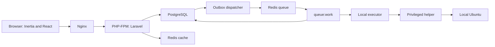

<p align="center">
  
</p>

# راه‌انداز | Rahandaz

**راه‌انداز؛ کنترل‌پنل فارسی و خودمیزبان برای همان سرور Ubuntu که روی آن نصب می‌شود.**

[](https://www.php.net/)
[](https://laravel.com/docs/13.x)
[](https://www.postgresql.org/)

راه‌انداز یک کنترل‌پنل خودمیزبان است تا مدیر همان سرور، نصب نرم‌افزار، اتصال Git، استقرار پروژه، دامنه، گواهی، دیتابیس، پشتیبان و وضعیت سرویس‌ها را از یک رابط فارسی انجام دهد. نسخه ۱ فقط میزبان محلی را می‌بیند. مدیریت چند سرور، عامل راه دور و اجرای پنل داخل Docker در این نسخه نیست.

این مخزن هنوز نصب‌کننده عمومی، Release امضاشده و مجوز OSI ندارد. حالت پیش‌فرض `RAHANDAZ_EXECUTION_MODE=disabled` است. در این حالت پنل دستور میزبان اجرا نمی‌کند و هیچ عملیات یا deployment را موفق اعلام نمی‌کند. جدول وضعیت پایین، قابلیت آماده را از طرح محصول جدا می‌کند. جزئیات پیشرفت در [docs/IMPLEMENTATION_PROGRESS.md](docs/IMPLEMENTATION_PROGRESS.md) و مشخصات در [.docs/PROJECT_SPEC.md](.docs/PROJECT_SPEC.md) است.

نشان‌های بالا فقط نسخه قفل‌شده Laravel و محدودیت PHP را می‌گویند. تصویر PostgreSQL به image توسعه `postgres:16-alpine` در `compose.dev.yml` اشاره دارد، نه به یک نسخه production آزموده‌شده روی Ubuntu. نشان License، Release و CI ساخته نشده، چون فایل مجوز، Release عمومی و گردش GitHub Actions در مخزن نیستند.

## فهرست

- [چرا راه‌انداز؟](#why)
- [وضعیت این مخزن](#status)
- [قابلیت‌ها](#features)
- [معماری](#architecture)
- [سازگاری سیستم‌عامل](#compatibility)
- [نصب](#install)
- [پس از بالا آمدن پنل](#after-start)
- [استقرار پروژه‌ها](#deployment)
- [پایگاه داده](#database)
- [امنیت](#security)
- [اجرا بدون Docker](#runtime)
- [محیط توسعه](#development)
- [ساختار مخزن](#layout)
- [به‌روزرسانی](#updates)
- [پشتیبان و بازیابی](#backup)
- [عیب‌یابی](#troubleshooting)
- [مستندات](#docs)
- [نقشه راه](#roadmap)
- [مشارکت](#contributing)
- [مجوز](#license)

<a id="why"></a>
## چرا راه‌انداز؟

کار روزمره روی یک VPS معمولاً پراکنده است: نصب PHP و Node، ساخت سایت Nginx، گواهی، کاربر دیتابیس، clone از GitHub یا GitLab، متغیر محیط، و برگشت به release قبلی وقتی استقرار می‌شکند. راه‌انداز برای همین کار روی **یک** سرور Ubuntu طراحی شده است، با رابط فارسی و بدون وابستگی رابط به CDN.

نسخه ۱ این تفاوت‌ها را نسبت به کار کاملاً دستی هدف گرفته است:

- دیدن وضعیت همان میزبان و سرویس‌هایش از پنل، به‌جای جمع‌کردن خروجی دستورها.
- جدا کردن محیط‌های یک مخزن، مثلاً `main` و `beta`، با runtime، متغیر، دیتابیس، دامنه و release مستقل.
- ثبت عملیات طولانی در صف، با وضعیت و لاگ، به‌جای اجرای مستقیم از درخواست HTTP.
- نگهداری راز عملیاتی به‌صورت پاکت رمز، جدا از `APP_KEY`.
- محدود کردن تغییر سیستم به یک helper اجازهٔ مشخص، پس از آنکه نصب اولیه تمام شود. این helper هنوز در مخزن نیست.

راه‌انداز ادعا نمی‌کند از پنل‌های دیگر بهتر است. مقایسه میدانی انجام نشده است. ایزوله‌سازی پروژه‌ها در طرح نسخه ۱ با کاربر یونیکس، ACL و cgroup است و جای ماشین مجازی را نمی‌گیرد.

<a id="status"></a>
## وضعیت این مخزن

| برچسب | معنی |
| --- | --- |
| آماده | در کد فعلی برای همان محدوده کار می‌کند |
| در حال ساخت | طرح یا داده هست؛ عمل نهایی به میزبان یا سرویس کاربر نمی‌رسد |
| برنامه‌ریزی‌شده | در مشخصات نسخه ۱ است و در این مخزن ساخته نشده |

هسته حساب، اسکیما، پوسته فارسی و صفحه‌های خواندنی آماده‌اند. موتور عملیات رکورد را ثبت می‌کند و عمداً آن را `succeeded` نمی‌کند. اسکریپت‌های میزبان در `infrastructure/operations/` هستند و اعمال زنده را روی همین میزبان توسعه مسدود می‌کنند. قرارداد helper در `infrastructure/privilege_helper/` است، ولی daemon سوکت root نصب نشده است. نصب تک‌دستوری، استقرار واقعی، گواهی و پشتیبان اجرایی هنوز production نیستند. نقشه در [.docs/ROADMAP.md](.docs/ROADMAP.md) و وضعیت موتور در [docs/OPERATIONS.md](docs/OPERATIONS.md) است.

<a id="features"></a>
## قابلیت‌ها

### پنل و حساب

| قابلیت | وضعیت | امروز |
| --- | --- | --- |
| ورود با نام کاربری یا ایمیل، بدون ثبت‌نام عمومی | آماده | `GET/POST /rahandaz/login` |
| اجبار تعویض رمز در ورود اول | آماده | `GET/PUT /rahandaz/password` |
| پوسته روشن، تیره و سیستم؛ وزیرمتن محلی؛ RTL | آماده | بدون CDN |
| Toast برای پیام واقعی سیستم و خطای فرم | آماده | React-Toastify پشت `notify` و flash |
| نمایش تاریخ ذخیره‌شده با تقویم جلالی | آماده | `Intl`، منطقه زمانی پیش‌فرض `Asia/Tehran`، ذخیره UTC |
| نقش‌های owner، admin، operator، viewer | در حال ساخت | عضویت و Policy هست. ماتریس کامل مشخصات هنوز به عمل میزبان وصل نیست |
| MFA و بازیابی رمز | برنامه‌ریزی‌شده | صفحه تنظیمات فقط نمایه را نشان می‌دهد |
| کاربران و اعضا | برنامه‌ریزی‌شده | صفحه ندارد |

### میزبان، نرم‌افزار و مشاهده

| قابلیت | وضعیت | امروز |
| --- | --- | --- |
| فهرست و برگه سرور محلی از ردیف‌های ذخیره‌شده | آماده | CPU، دیسک و شبکه زنده را نشان نمی‌دهد |
| راه‌اندازی فقط‌خواندنی | آماده | probe نصب نمی‌کند و سازگاری بسته را `untested` می‌گذارد |
| کاتالوگ و میرور | آماده | فقط خواندن. اعمال میرور و نصب بسته نیست |
| اطلاعات زنده Ubuntu، systemd، UFW، کلید SSH | در حال ساخت | اسکریپت facts هست و سازگاری را `untested` می‌گذارد. پنل آن را اجرا نمی‌کند. کنسول آزاد root نیست |
| نصب PHP، Node، Python، Nginx و سرویس‌ها روی میزبان | برنامه‌ریزی‌شده | اجرا خاموش است |
| نمودار پایش | برنامه‌ریزی‌شده | داشبورد فقط شمارش job، پروژه، سرور و نمونه متریک است |

### پروژه، Git و استقرار

| قابلیت | وضعیت | امروز |
| --- | --- | --- |
| فهرست پروژه و برگه محیط‌ها | آماده | ساخت پروژه از رابط نیست |
| آپلود ZIP با انتخاب فایل یا drag-and-drop | آماده | بررسی امنیتی، ذخیره خصوصی، SHA-256، deployment/job/outbox/audit واقعی؛ extraction و build هنوز اجرا نمی‌شود |
| GitHub، GitLab و GitLab خودمیزبان | برنامه‌ریزی‌شده | جدول‌ها و بررسی امضای وب‌هوک در کد هست. کنترلر HTTP وب‌هوک نیست |
| انتخاب مخزن و شاخه، deploy key، استقرار خودکار | برنامه‌ریزی‌شده | |
| دامنه، Nginx، TLS و تمدید گواهی | برنامه‌ریزی‌شده | اسکیما هست. UI و اعمال فایل نیست |
| Rollback و استقرار با کمترین وقفه | برنامه‌ریزی‌شده | تضمین صفر شدن وقفه در مشخصات هم مطلق نیست |
| لاگ deployment | در حال ساخت | لاگ job ذخیره‌شده خوانده می‌شود. استقرار واقعی لاگ تولید نمی‌کند |

### داده، صف و امنیت عملیاتی

| قابلیت | وضعیت | امروز |
| --- | --- | --- |
| PostgreSQL کنترل‌پلین و دو Redis توسعه | آماده | صف `control` و cache جدا |
| ثبت job، idempotency، outbox و lease | در حال ساخت | lease منقضی دزدیده نمی‌شود. runner موفقیت نمی‌نویسد |
| لغو، تلاش مجدد و پیشرفت زنده | برنامه‌ریزی‌شده | صفحه job صفحه‌بندی و متن لاگ ذخیره‌شده دارد |
| PostgreSQL، MySQL، MariaDB و MongoDB برای پروژه کاربر | برنامه‌ریزی‌شده | جدول instance و کاربر هست. ساخت دیتابیس اجرا نمی‌شود |
| Backup و restore | برنامه‌ریزی‌شده | مسیر artifact و وضعیت تایید در اسکیما هست. job اجرا نیست |
| اعلان داخل پنل | آماده | فهرست گیرنده، خواندن یکی و خواندن همه |
| گزارش فعالیت | آماده | فقط owner و admin. بدون metadata، hash و IP در صفحه |
| پاکت رمز راز | آماده | HKDF-SHA256 و XChaCha20-Poly1305. چرخش کلید هنوز workflow ندارد |
| Helper ممتاز با allowlist | برنامه‌ریزی‌شده | `ExecutionGate` تغییر میزبان را رد می‌کند |

صفحهٔ دقیق مسیرها در [docs/UI_PAGE_INVENTORY.md](docs/UI_PAGE_INVENTORY.md) است.

<a id="architecture"></a>
## معماری

کنترل‌پلین یک Laravel modular monolith است. رابط با Inertia به React می‌رسد. PostgreSQL وضعیت پایدار را نگه می‌دارد. Redis صف و cache را جدا نگه می‌دارد و جای وضعیت job نیست.

نمودار زیر **هدف نسخه ۱** است. در کد فعلی درخواست وب تا PostgreSQL و صفحه‌های خواندنی می‌رسد. انتشار outbox به Redis در `rahandaz:outbox:dispatch` هست. پیکان‌های executor، helper و تغییر Ubuntu هنوز بسته است.



### پشته

نسخه نصب‌شده از [docs/DEPENDENCIES.md](docs/DEPENDENCIES.md) است. محدوده نصب بعدی در `composer.json` و `package.json` است.

| لایه | انتخاب فعلی | نسخه قفل‌شده یا محدودیت |
| --- | --- | --- |
| زبان پنل | PHP | محدودیت `^8.3`. محیط ثبت‌شده ۸٫۵٫۱۱ |
| Backend | Laravel | ۱۳٫۳۵٫۰ |
| پل رابط | Inertia Laravel | ۳٫۵٫۱ |
| رابط | React و TypeScript سخت‌گیر | React ۱۹٫۳٫۰، TypeScript ۶٫۰٫۳ |
| CSS | Tailwind CSS | ۴٫۳٫۳ |
| Build | Vite | ۸٫۳٫۴. فقط توسعه و CI. اجرای production پنل به Node نیاز ندارد |
| آیکون و اعلان | Lucide، React-Toastify | Lucide ۱٫۵۵٫۰، React-Toastify ۱۱٫۱٫۰ |
| Primitive رابط | shadcn/ui گزینشی، Radix | فقط Sheet، Modal، Dropdown Menu، Tooltip، Avatar، Separator، Breadcrumb و Slot |
| پایگاه | PostgreSQL | image توسعه ۱۶ |
| صف و cache | Redis | image توسعه ۷، دو سرویس جدا |
| ORM و صف | Eloquent، Laravel Queue، Scheduler | Horizon نصب نشده |

shadcn/ui به‌صورت گزینشی و فقط برای Primitiveهای مصرف‌شده روی Radix نصب شده است. React-Toastify همچنان تنها سیستم Toast است. Recharts، React Hook Form، Zod و Motion نصب نشده‌اند؛ دلیل در [docs/FRONTEND_DEPENDENCIES.md](docs/FRONTEND_DEPENDENCIES.md) است. فرم ورود و رمز از `useForm` خود Inertia استفاده می‌کند.

### چرا این مرزها

PostgreSQL منبع کاربر، workspace، پروژه، job، outbox، audit و فراداده راز است. تراکنش و قید یکتایی همین‌جا نشسته‌اند. Redis فقط بیدار کردن worker، cache و هماهنگی کوتاه است. اگر Redis خالی شود، وضعیت قابل‌بازسازی باید در PostgreSQL مانده باشد.

کار طولانی از درخواست HTTP اجرا نمی‌شود. وب، در طرح نسخه ۱، job را در تراکنش ثبت می‌کند. dispatcher ردیف outbox را داخل همان تراکنش به Redis می‌فرستد و بعد `published_at` را می‌نویسد. تحویل at-least-once است. `retry_after` پیش‌فرض ۹۰ ثانیه است و باید از timeout ورکر، ۶۰ ثانیه، بلندتر بماند. worker شناسه job را می‌گیرد و وضعیت را در PostgreSQL می‌نویسد.

Helper ممتاز در طرح، یک برنامه root-owned با اسکیمای ثابت و allowlist است تا حساب پنل sudo عمومی نداشته باشد. فایل قرارداد در `infrastructure/privilege_helper/bin/rahandaz-helper` است و سوکت root را نصب نمی‌کند. dispatcher لاراول تا بسته بودن `ExecutionGate` فرآیندی نمی‌سازد، پس امروز مسیر پنل به APT، Nginx یا systemd نمی‌رسد.

جزئیات مرز ماژول‌ها در [.docs/ARCHITECTURE.md](.docs/ARCHITECTURE.md) است.

<a id="compatibility"></a>
## سازگاری سیستم‌عامل

هدف نسخه ۱ فقط Ubuntu Server روی x86_64 است. «هدف» با «آزموده‌شده» یکی نیست. ماتریس در [docs/OPERATIONS_TEST_MATRIX.md](docs/OPERATIONS_TEST_MATRIX.md) هر سه نسخه را `untested` ثبت کرده است. آزمون VM اجرا نشده است.

| سیستم‌عامل | معماری | نصب تولید | وضعیت |
| --- | --- | --- | --- |
| Ubuntu Server 22.04 LTS | x86_64 | نصب‌کننده هنوز نیست | Not yet verified |
| Ubuntu Server 24.04 LTS | x86_64 | نصب‌کننده هنوز نیست | Not yet verified |
| Ubuntu Server 26.04 LTS | x86_64 | نصب‌کننده هنوز نیست | Not yet verified |
| ARM64 و توزیع‌های دیگر | — | خارج از نسخه ۱ | Unsupported |

نسخه ۱ چند سرور را مدیریت نمی‌کند. اتصال SSH مدیریتی، Ansible و agent راه دور برای نسخه ۲ و ۳ مانده‌اند. پروژه کاربر هم روی همان میزبان و بدون Docker استقرار نسخه ۱ طراحی شده است.

<a id="install"></a>
## نصب

نصب تولید هنوز منتشر نشده است. اسکریپت `scripts/install.sh`، بسته Release، امضا و checksum در مخزن نیستند. برای همین اینجا فرمان دانلود یا `curl | bash` نیست. وقتی Release واقعی ساخته شود، نصب باید نسخه‌دار باشد، قبل از هر تغییر امضا و SHA-256 را بررسی کند، قابل ادامه باشد، سایت و سرویس موجود را بی‌اجازه عوض نکند، SSH جاری را نبندد، و حساب لینوکسی `rahandaz` را بدون sudo و بدون shell ورود بسازد. عملیات ممتاز بعد از آن فقط از helper می‌گذرد. تا آن Release، سلامت نصب تولید را نمی‌توان از روی این فایل اجرا کرد.

### بالا آوردن محیط توسعه

این مسیر برای کارکردن روی خود مخزن است. Compose فقط PostgreSQL و دو Redis را بالا می‌آورد و پنل را داخل Docker اجرا نمی‌کند.

پیش‌نیاز: PHP 8.3 یا جدیدتر با `pdo_pgsql`، `redis`، `sodium`، `zip` و `fileinfo`، Composer، Node.js سازگار با Vite 8، npm، و Docker فقط اگر پایگاه را از Compose می‌خواهید. PHP بدون درایور PostgreSQL به پایگاه وصل نمی‌شود و بدون `ext-zip` upload پروژه بررسی نمی‌شود.

```bash
docker compose -f compose.dev.yml up -d
composer install
npm ci
cp .env.example .env
php artisan key:generate
php artisan migrate
php artisan rahandaz:keys:init --local-only
php artisan rahandaz:bootstrap-owner --credentials-file=./var/initial-owner.txt
npm run build
php artisan serve --host=127.0.0.1 --port=8000
```

`.env.example` میزبان پایگاه و Redis را `127.0.0.1` گذاشته است. اگر فرایند PHP به loopback میزبان دسترسی ندارد، همان توضیح فایل نمونه را دنبال کنید. جزئیات محیط Lerd در [docs/IMPLEMENTATION_PROGRESS.md](docs/IMPLEMENTATION_PROGRESS.md) است.

`rahandaz:keys:init --local-only` کلید اصلی را جدا از `APP_KEY` می‌سازد. اجرای دوباره، اگر فایل کلید پر باشد، عمداً متوقف می‌شود. کلید را برای «رفع خطا» پاک نکنید. بدون کلید، رازهای بعدی باز نمی‌شوند.

`rahandaz:bootstrap-owner` فقط وقتی مالک نیست کاربر اول را می‌سازد. مسیر فایل الزامی است، داخل `public/` پذیرفته نمی‌شود، و فایل موجود را بازنویسی نمی‌کند. پوشه `/var/` در `.gitignore` است. رمز را در ترمینال چاپ نکنید. فایل حالت `0600` می‌خواهد. اگر دیسک `chmod` را نگه نمی‌دارد، مسیر کلید و canary را به یک volume سازگار با POSIX ببرید. متغیرهایش در `.env.example` است.

بعد از build، ورود توسعه روی [http://127.0.0.1:8000/rahandaz/login](http://127.0.0.1:8000/rahandaz/login) است. `APP_URL` فقط origin است و پیشوند `/rahandaz` را در خودش تکرار نمی‌کند. اولین ورود به عوض کردن رمز می‌رود.

<a id="after-start"></a>
## پس از بالا آمدن پنل

در محیط توسعه، بعد از ورود این‌ها واقعی است:

- تعویض رمز اولیه.
- داشبورد با شمارش ذخیره‌شده، نه نمودار زنده.
- صفحه راه‌اندازی فقط‌خواندنی. پایان راه‌اندازی را با یک دکمه موفقیت علامت نمی‌زند.
- فهرست سرور، کاتالوگ، میرور، پروژه، job، اعلان و نمایه.
- گزارش فعالیت برای owner و admin.

منوی استقرار، دامنه، دیتابیس، پشتیبان و پایش با برچسب «آماده نیست» است و لینک مرده ندارد.

طرح نسخه ۱ بعد از نصب تولید این مرحله‌ها را می‌خواهد: بررسی میزبان، انتخاب میرور، انتخاب PHP و Node، انتخاب دیتابیس، سرویس اختیاری، کلید SSH، و سلامت Nginx. سرویس خود کنترل‌پلین با نرم‌افزار پروژه‌های کاربر یکی نیست. صفحه خوشامد ایستا، در طرح، فقط نشان می‌دهد مسیریابی اولیه سالم است و اگر مجاز باشد حذف می‌شود. این صفحه در مخزن ساخته نشده. نشانی `/` امروز متن `Not found` و مسیر ورود پنل را برمی‌گرداند. موفقیت نصب تولید باید از healthcheck بیاید، نه از باز شدن یک صفحه.

<a id="deployment"></a>
## استقرار پروژه‌ها

این بخش ترکیبی از قابلیت آماده و طرح [.docs/PROJECT_SPEC.md](.docs/PROJECT_SPEC.md) است. runner فعلی deployment را موفق نمی‌کند و وب‌هوک HTTP وصل نیست.

برای پروژه‌ای که از قبل environment دارد، صفحه جزئیات اکنون فایل ZIP را با file picker یا drag-and-drop می‌پذیرد. فایل در disk خصوصی ذخیره، با SHA-256 deduplicate و به deployment دستی و `operation_jobs` متصل می‌شود. ZIP در درخواست HTTP extract یا build نمی‌شود و پیام UI فقط ثبت workflow را تأیید می‌کند. کنترل‌های مسیر، symlink، entry رمز‌شده، سقف حجم/تعداد و compression bomb در [docs/PROJECT_ARCHIVE_UPLOADS.md](docs/PROJECT_ARCHIVE_UPLOADS.md) مستند است.

سناریوی هدف: یک مخزن Laravel با شاخه‌های `main` و `beta` روی همین سرور، با دو دامنه جدا مثل `example.com` و `beta.example.com`. هر environment شاخه، runtime، متغیر محیط، دیتابیس، دامنه، release، لاگ و سیاست استقرار خودش را دارد. دامنه و UID یکی نیستند و کد مخزن با هویت وب پنل اجرا نمی‌شود.

استقرار خودکار در طرح با webhook است. GitHub یا GitLab فقط وقتی شاخه موردنظر به‌روز شد خبر می‌دهد. پنل تحویل را با امضا می‌سنجد، `delivery_id` تکراری را رد می‌کند، و payload خام را ذخیره نمی‌کند. polling دائمی مخزن لازم نیست. تابع امضا در `app/Domain/Git/WebhookSignature.php` هست و هنوز در مسیر HTTP قرار نگرفته است.

استقرار کم‌وقفه در طرح به ظرفیت آزاد، healthcheck مسیر واقعی، و migration سازگار وابسته است. symlink برای سایت ایستا، release به‌اضافه PHP-FPM برای Laravel، و دو port برای Next/Nuxt در مشخصات آمده‌اند. وقفه صفر برای هر پروژه، هر migration ناسازگار، یا سرور کم‌حافظه تضمین نشده است.

<a id="database"></a>
## پایگاه داده

PostgreSQL وضعیت پایدار است. گروه‌های اصلی: کاربر و workspace، فراداده میزبان، اتصال Git، پروژه و environment، آرشیو منبع پروژه، deployment، job و outbox، فراداده credential، backup، و audit.

قرارداد شناسه در کد و migrationهای تازه اعمال شده است، نه فقط هدف بعدی:

- `id` از نوع BIGINT کلید اصلی و کلید رابطه داخلی است.
- `uuid` از نوع native UUIDv7 شناسه API، URL و Inertia است و یکتا و اجباری است.
- کلید خارجی داخلی BIGINT است.
- `uuid` مجوز دسترسی نیست. Policy عضویت workspace را جدا بررسی می‌کند.
- شناسه GitHub یا GitLab ستون خودش را دارد و UUID راه‌انداز نیست.

جدول‌های خود Laravel مثل `sessions`، `cache` و `jobs` این جفت را نمی‌گیرند. `sessions.user_id` نوع `users.id` را دنبال می‌کند. `failed_jobs.uuid` همان رشته Laravel است. job دامنه در `operation_jobs` است.

فهرست جدول‌ها و قیدها در [docs/DATABASE_SCHEMA.md](docs/DATABASE_SCHEMA.md) و [docs/DATABASE_ERD.md](docs/DATABASE_ERD.md) است. تصمیم شناسه در [docs/adr/0004-bigint-primary-key-uuidv7-public-identifier.md](docs/adr/0004-bigint-primary-key-uuidv7-public-identifier.md) است.

<a id="security"></a>
## امنیت

طرح نسخه ۱ حساب لینوکسی `rahandaz` را بدون root، بدون sudo و بدون shell ورود می‌خواهد. فرآیند وب و worker هم root نیستند. این حساب‌ها را نصب‌کننده می‌سازد و آن نصب‌کننده هنوز در مخزن نیست.

آنچه امروز در کد هست:

- نشست Laravel، CSRF فرم‌ها، و Policy برای صفحه پنل.
- رمز کاربر با hash خود Laravel. سیاست فعلی حداقل دوازده نویسه با حروف کوچک، بزرگ و عدد است.
- کلید اصلی جدا از `APP_KEY`، فایل خارج از git، و canary برای تشخیص کلید اشتباه.
- پاکت AEAD برای credential. رمزگشایی عملیاتی با `openFor()` فقط برای owner و admin همان workspace است. مجوز `manage_secrets` برای operator هنوز در این مسیر اعمال نشده است.
- رد شدن کلیدهای شبیه راز در plan. لاگ job و صفحه audit متن راز را نشان نمی‌دهند.
- زنجیره hash برای audit در همان پایگاه. این زنجیره لنگر بیرونی ندارد و در برابر مالک پایگاه ضددستکاری نیست.
- بررسی امضای وب‌هوک GitHub با HMAC و GitLab با مقایسه هم‌طول، در تابع دامنه. نرخ‌محدودیت HTTP این مسیر هنوز نیست.
- RLS روشن نیست و جایگزین Policy نیست. نقش migration از نقش اجرای برنامه جدا نشده است.

آنچه هنوز ساخته نشده: helper allowlist، واحدهای systemd سخت‌شده، تأیید مالکیت دامنه، اعمال Nginx از قالب، و جلوگیری از DNS rebinding برای GitLab خودمیزبان. دانستن `uuid` یک منبع دسترسی نمی‌دهد، ولی ایزوله یونیکس جای مرز یک VM در برابر کد مخرب پروژه را نمی‌گیرد.

بکاپ پایگاه بدون نسخه جداگانه کلید اصلی، credentialهای رمزشده را برنمی‌گرداند. عوض کردن فایل کلید بدون workflow چرخش، رازهای موجود را ناخوانا می‌کند.

این متن امنیت مطلق ادعا نمی‌کند. فایل `SECURITY.md` هنوز نیست، پس مسیر رسمی گزارش آسیب‌پذیری منتشر نشده است. جزئیات لایه داده در [docs/DATABASE_SECURITY.md](docs/DATABASE_SECURITY.md) است.

<a id="runtime"></a>
## اجرا بدون Docker

اجرای production پنل و استقرار پروژه‌های کاربر در نسخه ۱ به Docker وابسته نیست. طرح این است که Nginx، PHP-FPM، worker صف و timer زمان‌بند با systemd روی Ubuntu باشند. Compose این مخزن فقط وابستگی توسعه است.

در طرح، هر environment کاربر مسیر، کاربر یونیکس، pool یا port، و سایت Nginx خودش را دارد. Nginx درخواست را به همان پروژه می‌فرستد. Runtime مهمان با runtime پنل یکی نیست. سقف حافظه و CPU پروژه به cgroup بستگی دارد و با نصب‌نشدن Docker کامل نمی‌شود.

پروفایل آزمون هدف در مشخصات، ۱ vCPU و ۲GB RAM است. سقف افزوده کنترل‌پلین در حالت idle، حداکثر ۵۱۲MiB RAM و میانگین ۰٫۵ vCPU، هدف طراحی است و benchmark نشده است. build کاربر، backup و نصب بسته از مصرف idle پنل جدا هستند و می‌توانند بالاتر بروند. تا ثبت اندازه‌گیری، این عددها تضمین محصول نیستند.

<a id="development"></a>
## محیط توسعه

راهنمای بلندتر در [.docs/DEVELOPMENT.md](.docs/DEVELOPMENT.md) است. فرمان‌های زیر با اسکریپت‌ها و Artisan همین مخزن جورند.

رابط را یک‌بار بسازید، یا در توسعه Vite را جدا اجرا کنید:

```bash
npm run build
npm run dev
```

`npm run dev` فقط Vite است. `composer run dev` سرور PHP، شنونده صف، دنباله لاگ و Vite را با هم از راه `@laravel/multiplex` بالا می‌آورد. این بسته باید در `node_modules/.bin` باشد. `npm ci` همان لینک را می‌سازد. اگر `php` داخل کانتینر باشد، پورت `artisan serve` الزاماً روی `127.0.0.1` مرورگر میزبان نیست.

صف پیکربندی‌شده `control` است. timeout ورکر را ۶۰ بگذارید تا از `retry_after` کوتاه‌تر بماند:

```bash
php artisan queue:work redis --queue=control --sleep=2 --tries=3 --timeout=60
php artisan schedule:run
```

زمان‌بند هر دقیقه `rahandaz:outbox:dispatch` را صدا می‌زند. با اجرای خاموش، worker ممکن است job را بردارد، ولی آن را عملیات موفق میزبان نمی‌کند.

آزمون، تشخیص وابستگی و سبک کد:

```bash
php artisan test
php artisan rahandaz:doctor
vendor/bin/pint --test
npm run lint
npx tsc --noEmit
npm run build
node --experimental-strip-types --test tests/js/datetime.test.ts
```

`php artisan test` از PostgreSQL جداگانه `rahandaz_test` استفاده می‌کند. SQLite جای قیدهای PostgreSQL را نمی‌گیرد. PHPStan در وابستگی‌ها نیست. نتیجه آخرین اجرای ثبت‌شده آزمون‌ها در سند پیشرفت است. این README اجرای تازه‌ای را گزارش نمی‌کند.

<a id="layout"></a>
## ساختار مخزن

```text
rahandaz/
├── app/
│   ├── Console/Commands/     # doctor، کلید، مالک اولیه، outbox
│   ├── Domain/               # حساب، میزبان، Git، پروژه، job، backup
│   ├── Http/                 # کنترلر، FormRequest، میان‌افزار
│   ├── Infrastructure/       # رمز، executor خاموش، cutover شناسه
│   ├── Jobs/
│   ├── Models/
│   └── Policies/
├── bootstrap/
├── config/
├── database/
│   ├── migrations/
│   ├── factories/
│   └── seeders/
├── docs/                     # طرح پایگاه، UI، پیشرفت، ADR
├── .docs/                    # مشخصات، معماری، توسعه، نقشه
├── infrastructure/docker/    # فقط init تصویر PostgreSQL توسعه
├── public/
├── resources/
│   ├── css/
│   ├── fonts/vazirmatn/
│   ├── js/                   # pages، layouts، components
│   └── views/
├── routes/
├── tests/
├── compose.dev.yml
├── composer.json
├── package.json
└── README.md
```

این‌ها در ریشه نیستند: `scripts/`، واحد systemd، `LICENSE`، `SECURITY.md`، `CHANGELOG.md` و `CONTRIBUTING.md`. `infrastructure/operations/` و قرارداد `infrastructure/privilege_helper/` در مخزن هستند. daemon سوکت نصب نشده است. معماری هدف در [.docs/ARCHITECTURE.md](.docs/ARCHITECTURE.md) است.

<a id="updates"></a>
## به‌روزرسانی

به‌روزرسانی خودکار پنل پیاده‌سازی نشده و فرمانی برای self-update در Artisan نیست.

طرح نسخه ۱ این ترتیب را می‌خواهد: نسخه Release قابل بررسی، backup تأییدشده از پایگاه و کلید، مهاجرت سازگار، تعویض symlink نسخه، healthcheck، و مسیر برگشت کد. برگشت کد با مهاجرت ناسازگار یکی نیست. اگر اسکیما جلو رفته باشد، بازگشت فقط با برنامه بازیابی همان نسخه ممکن است. به‌روزرسانی نباید به همان worker که در حال خاموش شدن است وابسته باشد. تا وجود آن ابزار، فقط مسیر توسعه همین مخزن معتبر است: `composer install`، `npm ci`، `php artisan migrate`، و `npm run build`.

`php artisan rahandaz:doctor` بعد از بالا آمدن وابستگی‌ها این‌ها را گزارش می‌کند: وجود `APP_KEY`، قابل‌استفاده‌بودن کلید اصلی، canary، PostgreSQL، هر دو Redis، نسبت timeout صف، حالت اجرا، و مجوز فایل کلید. این فرمان نصب production را تأیید نمی‌کند.

<a id="backup"></a>
## پشتیبان و بازیابی

طرح، backup را برای پایگاه کنترل‌پلین، کلید اصلی و ماده بازیابی، پیکربندی متعلق به پنل، فراداده deployment، و backup دیتابیس پروژه‌ها در محدوده پشتیبانی لازم می‌داند. فایل backup داخل PostgreSQL ذخیره نمی‌شود. مسیر مجاز در اسکیما زیر `/var/backups/rahandaz/` است.

backup پایگاه به‌تنهایی credential رمزشده را برنمی‌گرداند. کلید اصلی باید جدا، با دسترسی محدود، و خارج از همان dump باشد. restore در اسکیما وضعیت تأیید جدا دارد. job اجرای restore نوشته نشده و restore آزمایش‌نشده را نباید تضمین‌شده دانست. backup روی همان دیسک سرور، بازیابی بعد از از دست رفتن دیسک نیست.

<a id="troubleshooting"></a>
## عیب‌یابی

| نشانه | بررسی |
| --- | --- |
| سیستم‌عامل غیر از Ubuntu هدف | نسخه ۱ آن را پشتیبانی نمی‌کند. وضعیت آزمون در [جدول سازگاری](#compatibility) است |
| کمبود RAM در نصب آینده | هدف پروفایل در [اجرا بدون Docker](#runtime) است. installer هنوز این پیش‌بررسی را اجرا نمی‌کند |
| قفل APT یا میرور بد | اعمال میرور ساخته نشده. کاتالوگ پنل فقط خواندنی است |
| PHP به PostgreSQL وصل نمی‌شود | `pdo_pgsql` باید باشد. میزبان در `.env` باید از دید همان فرایند PHP قابل دسترس باشد |
| `rahandaz:doctor` برای Redis یا پایگاه fail می‌دهد | Compose یا سرویس محلی را ببینید. پورت صف ۶۳۷۹ و cache در نمونه توسعه ۶۳۸۰ است |
| `Refusing to overwrite an existing master key` | کلید قبلاً ساخته شده. فایل را پاک نکنید |
| `vite: not found` یا `multiplex: not found` | `npm ci` را دوباره اجرا کنید تا `node_modules/.bin` ساخته شود |
| worker job را موفق نمی‌کند | `RAHANDAZ_EXECUTION_MODE=disabled` است و این رفتار خواستهٔ فعلی است |
| ZIP پروژه آپلود نمی‌شود | وجود `ext-zip`/`fileinfo`، سقف‌های `RAHANDAZ_ARCHIVE_*` و محدودیت Nginx/PHP upload را بررسی کنید؛ ZIP خطرناک عمداً با خطای فرم رد می‌شود |
| webhook یا SSL یا دامنه کار نمی‌کند | مسیر HTTP و اعمال Nginx برنامه‌ریزی‌شده‌اند |
| ورود پنل ۴۰۴ است | مسیر `/rahandaz/login` است، نه `/login` و نه `/` |

فرمان تشخیص وابستگی توسعه:

```bash
php artisan rahandaz:doctor
```

<a id="docs"></a>
## مستندات

| موضوع | فایل |
| --- | --- |
| مشخصات محصول | [.docs/PROJECT_SPEC.md](.docs/PROJECT_SPEC.md) |
| معماری هدف | [.docs/ARCHITECTURE.md](.docs/ARCHITECTURE.md) |
| توسعه | [.docs/DEVELOPMENT.md](.docs/DEVELOPMENT.md) |
| نقشه راه | [.docs/ROADMAP.md](.docs/ROADMAP.md) |
| بازنگری خود اسناد | [.docs/CHANGELOG_DOCUMENTATION.md](.docs/CHANGELOG_DOCUMENTATION.md) |
| پیشرفت پیاده‌سازی | [docs/IMPLEMENTATION_PROGRESS.md](docs/IMPLEMENTATION_PROGRESS.md) |
| طرح پایگاه و ERD | [docs/DATABASE_SCHEMA.md](docs/DATABASE_SCHEMA.md)، [docs/DATABASE_ERD.md](docs/DATABASE_ERD.md) |
| امنیت داده | [docs/DATABASE_SECURITY.md](docs/DATABASE_SECURITY.md) |
| آپلود امن ZIP پروژه | [docs/PROJECT_ARCHIVE_UPLOADS.md](docs/PROJECT_ARCHIVE_UPLOADS.md) |
| وابستگی‌های قفل‌شده | [docs/DEPENDENCIES.md](docs/DEPENDENCIES.md) |
| تصمیم بسته رابط | [docs/FRONTEND_DEPENDENCIES.md](docs/FRONTEND_DEPENDENCIES.md) |
| هویت بصری و لوگو | [docs/BRAND_GUIDELINES.md](docs/BRAND_GUIDELINES.md) |
| اجزای رابط | [docs/FRONTEND_COMPONENTS.md](docs/FRONTEND_COMPONENTS.md)، [docs/UI_GUIDELINES.md](docs/UI_GUIDELINES.md) |
| موجودی صفحات | [docs/UI_PAGE_INVENTORY.md](docs/UI_PAGE_INVENTORY.md) |
| ADR مونولیت | [docs/adr/0001-laravel-modular-monolith.md](docs/adr/0001-laravel-modular-monolith.md) |
| ADR شناسه | [docs/adr/0004-bigint-primary-key-uuidv7-public-identifier.md](docs/adr/0004-bigint-primary-key-uuidv7-public-identifier.md) |

راهنمای نصب تولید، عملیات، مدل تهدید مستقل، استراتژی استقرار، کارایی، changelog محصول، مشارکت جدا، و `SECURITY.md` هنوز فایل ندارند. changelog محصول با گزارش بازنگری اسناد یکی نیست.

<a id="roadmap"></a>
## نقشه راه

تقسیم نسخه‌ها همان [.docs/ROADMAP.md](.docs/ROADMAP.md) است.

نسخه ۱ مدیریت همان سرور Ubuntu است: نرم‌افزار، سرویس، پروژه، استقرار، دامنه، TLS، دیتابیس، backup، پایش و به‌روزرسانی همان میزبان. مرحله ۰ هسته در مخزن هست. مرحله ۱ رابط هنوز با بازبینی viewport بسته نشده. مرحله‌های نصب، Git، سرویس و انتشار عملیاتی مانده‌اند.

نسخه ۲ چند سرور مورد اعتماد، اتصال امن، inventory و credential مقصد است. Ansible فقط بعد از ADR و آزمون هزینه و امنیت مطرح می‌شود.

نسخه ۳ agent توزیع‌شده، API اتوماسیون، provider ابری و telemetry گسترده‌تر است و بعد از تثبیت امنیت نسخه ۱ می‌آید.

<a id="contributing"></a>
## مشارکت

`CONTRIBUTING.md` جداگانه نیست. پیش از تغییر، [.docs/PROJECT_SPEC.md](.docs/PROJECT_SPEC.md)، [.docs/ARCHITECTURE.md](.docs/ARCHITECTURE.md) و [docs/IMPLEMENTATION_PROGRESS.md](docs/IMPLEMENTATION_PROGRESS.md) را بخوانید. `AGENTS.md` قاعده شناسه و رابط را برای کار داخل مخزن خلاصه کرده است.

- باگ و پیشنهاد را با رفتار فعلی جدول وضعیت بسنجید. قابلیت برنامه‌ریزی‌شده را باگ نبود پیاده‌سازی ندانید.
- تغییر میزبان، systemd و installer بدون قرارداد و آزمون ایمنی اضافه نشود. حالت اجرا پیش‌فرض `disabled` بماند.
- راز، توکن و رمز در commit، fixture و props اینرسی نیاید.
- شناسه عمومی `uuid` بماند و `id` عددی در JSON عمومی ظاهر نشود.
- برای PHP، `vendor/bin/pint --test` و `php artisan test`. برای رابط، `npm run lint`، `npx tsc --noEmit` و `npm run build`.
- موفقیت نصب، استقرار یا پایش را در UI قبل از نتیجه واقعی job نشان ندهید.

<a id="license"></a>
## مجوز

مجوز OSI انتخاب نشده و فایل `LICENSE` در مخزن نیست. عمومی بودن یک مخزن، به‌تنهایی حق استفاده، تغییر یا توزیع نمی‌دهد. تا وقتی مالک مجوز را در `LICENSE` ثبت کند، این پروژه مجوز مشخصی ندارد. توضیح بسته Composer هم همین را می‌گوید.
