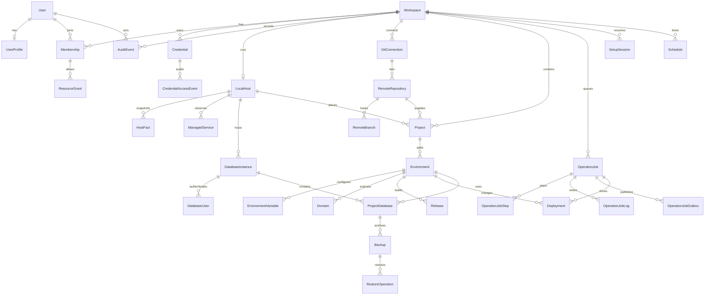

# ERD پایگاه داده راه‌انداز

نمودار موجودیت‌های نسخه اول است. جدول‌های فرزند snapshot میزبان، متریک، alert و تجدید گواهی برای خوانایی کنار گذاشته شده‌اند. آن‌ها به والد خود `restrict` یا، برای ترکیب یک fact، `cascade` دارند.

خط‌های رابطه روی کلید داخلی `id` از نوع `bigint` هستند. شناسه عمومی هر موجودیت ستون `uuid` از نوع UUIDv7 است و در این نمودار کلید رابطه نیست. جدول‌های فریم‌ورک (`sessions`، `cache`، `jobs` و مانند آن) اینجا نیستند.

## معنی رابطه‌های اصلی

یک workspace در نسخه اول همان میزبان محلی مشترک است و ایزوله‌سازی چندمستاجری مستقل نیست. با این حال credential، Git، پروژه و audit با `workspace_id` و FK مرکب از هم جدا شده‌اند تا policy لاراول scope داشته باشد.

یک Git connection چند repository دارد. یک repository می‌تواند به چند پروژه برسد. هر پروژه چند environment دارد. branch محیط متغیر است و `deployments.commit_sha` بعد از ثبت تغییر نمی‌کند.

`environments.active_release_id` با FK مرکب به release همان environment اشاره می‌کند. فقط یک release با state برابر `active` برای هر environment مجاز است. این FK به‌تنهایی ثابت نمی‌کند که سوئیچ فقط بعد از healthcheck انجام شده است. چک موفقیت deployment health را الزام می‌کند، ولی runner هنوز وضعیت `succeeded` نمی‌نویسد.

چند پروژه می‌توانند از یک `database_instance` استفاده کنند. نام دیتابیس در همان instance یکتا است. حذف پروژه به‌خاطر `restrict` روی environment و دیتابیس، داده را drop نمی‌کند.

`OperationJob` در PostgreSQL وضعیت پایدار است. ردیف `operation_job_outbox` در همان transaction ساخته می‌شود. Redis فقط حمل پیام `job.queued` با شناسه job است.
